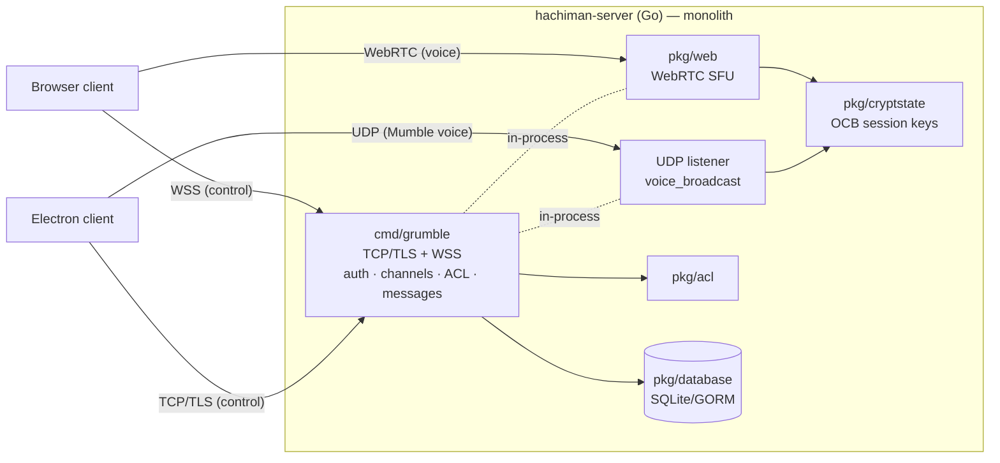
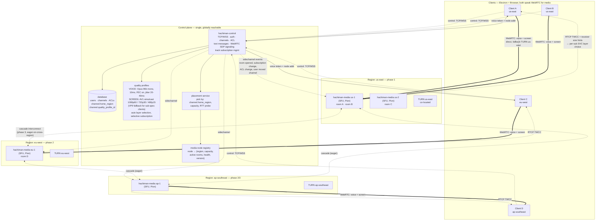

# Hachiman Media Plane Migration

**Status:** Draft — revision 7
**Last updated:** 2026-06-06 (revision 7 — added Development experience section; slimmed Phase 5 to reference it)

## Summary

Split `hachiman-server` (today: monolithic Mumble-derived Go server) into two binaries:

- **`hachiman-control`** — the existing TCP/WSS server with media handling removed. Owns auth, channels, ACL, text messages, WebRTC SDP signaling, voice token minting, media node registry, and placement decisions. Stateful in storage (DB), stateless per request.
- **`hachiman-media`** — a new stateless WebRTC SFU. Terminates voice and screen-share tracks (and future camera). Holds only ephemeral per-session state. Scales horizontally and regionally via cloud-native autoscaling.

Drop the native Mumble UDP voice path entirely. Both Electron and browser hosts use Chromium's WebRTC. One media stack, one SFU code path.

The architectural emphasis is **highest-quality voice + screen share at lowest practical latency**, with a baseline that audibly beats Microsoft Teams.

---

## Relationship to Oracle and managed mode

The repo already has a meaningful control plane in **`apps/oracle/`**, and this plan does not duplicate it:

- OIDC provider + user auth (`@auth/core`, `oidc-provider`)
- Placement scoring with region affinity (`src/lib/placement.ts`)
- Scheduler (`src/lib/scheduler.ts`) consulting Redis live metrics
- Island metrics aggregation
- vServer provisioning via the existing `pkg/management/management.proto` Oracle↔server surface

Reframing of responsibilities:

- **Oracle keeps and extends placement.** Add media nodes to `placement.ts` scoring. Media nodes self-register with Oracle on boot. Oracle is the source of truth for "which media node should this session land on."
- **`hachiman-control` calls Oracle for placement** at voice-token mint time. Extend `management.proto` with `PlaceMediaSession` (and `RegisterMediaNode` / `MediaNodeHeartbeat`), don't invent a parallel registry.
- **Quality profiles live in `hachiman-control`'s DB** — application-level config, per-channel.
- **OIDC, auth, vServer provisioning, island-metrics in Oracle are untouched.** Auth flow stays: client gets Oracle token via OIDC → presents to `hachiman-control` on Mumble `Authenticate` → control introspects with Oracle (already implemented in `server.go` `handleAuthenticate`).

## Deployment modes

The split must not regress the self-hosted single-binary use case from the project README. Two supported topologies:

**Embedded mode** (self-host default — **strict feature subset**):
- `hachiman-control` builds with media linked in-process via Go build tag (`//go:build embedded_media`).
- Sidechannel runs over an in-process channel; no gRPC, no mTLS.
- Single binary, single config, SQLite. "Drop on a host" preserved.
- **Carries:** voice, screen share, text, channels, ACL, hop-by-hop DTLS-SRTP encryption.
- **Does not carry:** E2EE (no SFrame key distribution path), recording (no recorder binary, no S3), cascading (single node by definition). Cloud-only features stay split-mode-only. Build tags compile these subsystems out of the embedded binary; CI verifies the embedded binary doesn't link them.

**Split mode** (cloud / multi-region — full feature set):
- `hachiman-control`, `hachiman-media`, and `hachiman-recorder` as separate binaries.
- Sidechannel over mTLS gRPC bidirectional stream.
- Postgres for control DB; autoscaled media nodes per region.
- E2EE, recording, cascading all enabled.

Both modes share identical source for the SFU (a new `pkg/media/` package); only the control↔media transport differs. The E2EE / recording / cascade subsystems live in packages gated behind the split-mode build tag. CI gates both modes.

---

## Quality targets

### Voice
- Opus 48 kHz mono, 64–96 kbps, 10 ms frames, in-band FEC on, DTX off
- AEC + NS on, tuned for voice
- Jitter buffer: 20–40 ms target (vs WebRTC default 60–100 ms)
- End-to-end mouth-to-ear: under 100 ms intra-region

### Screen share
- **Minimum spec for AV1 default:** Intel 11th-gen+ or Apple M1+. This is the documented system requirement; the product targets modern hardware from launch. Older hardware falls back to VP9 simulcast automatically.
- **Phase 1 default codec is AV1 simulcast** for in-spec clients, 3-layer ladder: 1080p60 / 720p30 / 480p15. AV1 hardware-decode on Intel 11th-gen+, Apple M1+, NVIDIA Ampere+, AMD RDNA2+ covers the supported fleet.
- **VP9 fallback:** clients that report no AV1 hardware decode in their `RTCRtpReceiver.getCapabilities()` probe negotiate VP9 simulcast on the same ladder shape. Publisher pays for the simulcast simulcast (AV1 + VP9 in parallel) only when there's at least one VP9-only subscriber in the room; pure-AV1 rooms skip the VP9 encode.
- **VP9 SVC** behind a feature flag for the VP9 path (Pion interceptor maturity gate); doesn't affect the AV1 default path.
- Content-aware encoder tuning (sharp text, fluid motion).
- Separate audio track for screen-share audio.
- Receiver-driven layer selection (RTCP TWCC + UI size hints).
- Selective subscription (top layer goes only to subscribers rendering at full size).

### Scale
- Per-region pool of stateless media nodes from phase 3; horizontal autoscale on CPU + network egress.
- **Cascading SFU mesh is eager** — any cross-region participant triggers a same-region cascade peer that stitches to the primary. Every participant gets in-region latency to its local SFU; cascade peers forward upstream to the primary for cross-region distribution and recording.
- Typical room: 10–50 participants. Hard target: 100+ on a single node for voice-mostly with 1–2 screen sharers.

---

## Architecture

### Today (monolithic)



### Target (split + multi-region)



### Key shifts

- `hachiman-server` becomes `hachiman-control`; `hachiman-media` is new.
- `pkg/web/` (the WebRTC SFU) moves to media.
- Mumble UDP voice path, `pkg/cryptstate/`, and OCB encryption retire once clients no longer use them. WebRTC DTLS-SRTP replaces them.
- Control mints short-lived signed voice tokens at session establishment; media validates on WebRTC offer.
- New gRPC sidechannel between control and media for events (room open/close, channel/ACL changes, talking state, etc.).
- Media nodes self-register with Oracle on boot; cloud autoscaling handles instance lifecycle.

---

## Pre-deployment posture

There are no deployed servers, no production data, and no existing clients. The plan executes as a **clean cut**: the legacy in-process SFU bridge, native Mumble UDP voice path, `UDPTunnel`, `CryptSetup`, and `pkg/cryptstate/` are **deleted outright**, not deprecated. No `media_plane_enabled` channel flag, no `Version`-packet capability bit, no data backfill.

In-development revert is plain git: each phase tagged, each landed PR small. Once we ship to anyone, the transition/rollback discipline from earlier revisions of this doc comes back — but not before.

---

## Observability, SLOs, and failure modes

### SLOs

- **Voice mouth-to-ear** p50 ≤ 80 ms / p95 ≤ 120 ms intra-region.
- **Voice MOS** ≥ 4.0 on synthetic probes. Baseline measured against current Mumble UDP path *and* against Teams on the same probes in the pre-phase-1 measurement pass — the "beats Teams" claim becomes a number, not a vibe.
- **Sidechannel partition tolerance:** existing sessions survive a 30s control↔media partition; new sessions refused on that node until reconnect.
- **Session establishment** p95 ≤ 2s from `VoiceTokenGrant` to first audible packet.
- **Media node availability** 99.95% per region.

### Required metrics (minimum)

- **Per WebRTC session:** RTT, jitter, packet loss, frame loss, audio level, talking-state transition rate, current simulcast/SVC layer, RTCP NACK rate, FEC repair rate, encode/decode CPU, MOS estimate, `e2ee_decrypt_failures_total` (tagged by reason: epoch mismatch / unknown key id / auth tag fail).
- **Per media node:** active sessions, active rooms, aggregate RX/TX Mbps, CPU, memory, goroutines, sidechannel RPC rate + duration, token validation rate, SSRC pool utilization, layer-subscription distribution.
- **Per control instance:** Mumble session count, `Authenticate` rate, `VoiceTokenGrant` mint rate, token refresh rate, sidechannel uptime per media node, placement decision distribution by region.
- **Per Oracle (extension of existing):** placement decision latency, media node registry size, registry write rate. Existing island-metrics consumer-lag metric reused.
- **Per region pair:** synthetic-probe mouth-to-ear latency histogram. Runs continuously from a small synthetic-client fleet.
- **Per recorder:** active subscription count, S3 PUT rate + latency, segment-seal latency (frame receive → S3 object created), bytes-per-room-minute, retention-policy enforcement errors.

### Logging and tracing

- Structured JSON logs with trace IDs propagated client → control → media → Oracle.
- Every sidechannel RPC emits start/end spans with idempotency key + result.
- PII discipline: `user_id` (opaque) is OK in logs; usernames/emails are not.

### Failure-mode matrix

| Failure | Required behavior |
|---|---|
| Control crashes mid-call | Media keeps RTP flowing locally. Client reconnects to replacement control; sidechannel re-handshakes; sessions resume. No user-visible re-join. |
| Media node crashes mid-call | All its sessions drop. Clients detect via ICE failure, reconnect via control, control mints a new token to a different node. ~2–5s audible glitch; no data loss. |
| Sidechannel partition (control↔media) | Media continues serving existing sessions from its in-memory routing table; refuses new `OpenRoom`. Control routes new sessions elsewhere. On reconnect, control re-pushes `RoomMembershipSnapshot` per active room; media reconciles. |
| Token expires mid-call | Client refreshes via control on `VoiceTokenGrant` push before `expires_at - 15s`. If refresh fails, client surfaces a graceful re-join prompt. |
| Signing-key compromise | Rotate via `KeySetUpdate`; revoke all sessions signed by compromised key; force re-token. Target ≤ 5 min from detection to mass revocation. |
| Media node at session cap | Node reports `accepting=false` in `Heartbeat`; Oracle excludes it from placement; existing sessions unaffected. |

---

## Development experience

The split adds binaries, databases, and an SFU stack on top of what was a single Go process. Without deliberate DX work, the inner loop falls off a cliff. This section is the spec for "clone → install → one command → working stack." Phase 5 is the work that builds it.

**Principles:**
- One command to bring up the whole world. One command to bring up just what you're working on.
- Every infra dependency is containerized. Every binary is runnable native too.
- Every state is a function of seed; `pnpm dev:reset` is always safe.
- Hot reload everywhere (Go via [air](https://github.com/air-verse/air), TS via Vite HMR / `tsgo --watch`, oracle via nodemon).
- Ports are deterministic and documented. No silent rebinding, no port discovery dance.
- Production-shaped defaults — local TLS via mkcert, structured JSON logs, real Postgres, real Redis, real coturn — so dev mirrors what ships.

### Dev modes

Four modes; pick the one that fits the inner loop you're optimizing for.

| Mode | Use when | What runs where |
|---|---|---|
| **Full Docker stack** (`pnpm dev:stack`) | Onboarding, full-system smoke test, demoing | All binaries + infra in containers. Hot-reload via mounted source. Slowest cold boot (~30s), simplest mental model. |
| **Hybrid** (`pnpm dev:infra` + native binaries) | Day-to-day backend work | Postgres / Redis / coturn / MinIO in Docker. Go binaries + Oracle run native (`pnpm dev:control`, `pnpm dev:media`, …). Fastest backend inner loop — Go restarts in ~200ms via air. |
| **All-native** | Bare-metal performance debugging, profiling, no Docker | Everything on host. Manual postgres/redis install. Slowest setup, fastest iteration once running. |
| **Embedded** (`pnpm dev:embedded`) | Working on the self-host code path, or anything that doesn't touch E2EE / recording / cascade | One Go binary, SQLite, no external services. Build tag `embedded_media`. Zero-dep dev. |

Hybrid is the recommended default for backend work; full Docker is the default for new contributors and frontend work.

### Service topology

What's running, what port, what container, what command. **Ports are reserved up-front and committed to `.env.dev`** so collisions surface fast.

| Service | Port(s) | Container image | Native command |
|---|---|---|---|
| `hachiman-control` | 64738 (TCP/WSS) | local build (`apps/hachiman-server`) | `pnpm dev:control` |
| `hachiman-media` | 7881 (sidechannel gRPC), 50000-50100/udp (RTP) | local build | `pnpm dev:media` |
| `hachiman-recorder` | 7882 (gRPC) | local build | `pnpm dev:recorder` |
| `hachiman-oracle` | 4000 (HTTP/OIDC), 9090 (gRPC to control) | local build (`apps/oracle`) | `pnpm dev:oracle` |
| `hachiman-browser` (UI) | 5173 (Vite) | n/a (browser app) | `pnpm dev:browser` |
| Postgres | 5432 | `postgres:16-alpine` | host install |
| Redis | 6379 | `redis:7-alpine` | host install |
| coturn (STUN/TURN) | 3478 udp/tcp, 5349 tls, 49152-49200/udp (relay) | `coturn/coturn:latest` | host install (rare) |
| MinIO (S3 local) | 9000 (S3 API), 9001 (web UI) | `minio/minio:latest` | host install (rare) |
| Signer (dev) | n/a — file at `.dev/keys/voice-signer.ed25519` | n/a | n/a — generated on first boot |
| Prometheus (opt-in) | 9091 | `prom/prometheus:latest` | enable via `pnpm dev:obs` |
| Grafana (opt-in) | 3001 | `grafana/grafana:latest` | enable via `pnpm dev:obs` |

A single Postgres instance hosts both schemas (`grumble` for control, `public` for oracle) per the rev 4 schema-ownership decision. `pnpm dev:psql <name>` sets `search_path` for you.

### Command cheat sheet

**One-time setup:**
```bash
pnpm install                        # also installs air, mkcert helpers via dev postinstall
scripts/dev-certs.sh                # mkcert local CA + per-service certs → .dev/certs/
pnpm dev:reset                      # creates schemas, runs seeds
```

**Bring up the stack:**
```bash
pnpm dev:stack                      # full Docker stack — everything containerized
pnpm dev:infra                      # just postgres + redis + coturn + minio in Docker
pnpm dev:embedded                   # all-in-one binary, SQLite, no infra needed
pnpm dev:obs                        # opt-in: add Prometheus + Grafana to the stack
```

**Run an individual binary native (with `pnpm dev:infra` already up):**
```bash
pnpm dev:control                    # control plane (air hot reload)
pnpm dev:media                      # media plane
pnpm dev:recorder                   # recorder (split mode only)
pnpm dev:oracle                     # oracle
pnpm dev:browser                    # browser app (Vite HMR)
pnpm dev:electron                   # electron app
```

**Reset / introspection:**
```bash
pnpm dev:reset                      # drop+reseed control & oracle schemas (per feedback_dev_migrations)
pnpm dev:psql control               # psql into control schema
pnpm dev:psql oracle                # psql into oracle schema
pnpm dev:redis-cli                  # redis-cli into oracle's redis
pnpm dev:logs                       # tail all running services
pnpm dev:logs media                 # tail just media
pnpm dev:minio                      # open MinIO web UI (S3 bucket explorer)
```

**Debug / verify:**
```bash
pnpm dev:test-client                # synthetic Pion client; opens a session, plays a tone
pnpm dev:proto-check                # run proto-sync-checker locally (same as CI)
pnpm dev:enable-recording <ch-id>   # flip the recording bit on a channel for testing
pnpm dev:e2ee-disable               # set DEV_DISABLE_E2EE=1 across services (banner shows in logs)
```

### Conventions

- **Single Postgres, two schemas** — `grumble` for control, `public` for oracle. One DB to manage, two ownerships. `pnpm dev:psql <name>` is a thin wrapper.
- **Drop + reseed, not stacked migrations** — per `feedback_dev_migrations.md`. `pnpm dev:reset` is the canonical "I broke something" button. Every dev DB state is a function of the seed.
- **mkcert for local TLS** — provisions a local CA trusted by the host once; `.dev/certs/` is reused across runs. No more "accept the self-signed cert" dance every time.
- **Signer in dev = file-on-disk** at `.dev/keys/voice-signer.ed25519` — generated on first boot, persists across restarts so tokens minted in one session validate after a reboot. Matches the production `Signer` interface, just a different backend.
- **S3 → MinIO** — recording writes go to a MinIO container with a pre-created `hachiman-recordings` bucket. Lifecycle rules are no-op in dev. Clean up = delete the bucket.
- **TURN credentials in dev** — coturn config provisions a static dev credential (`devuser` / `devpass`) for fast iteration. HMAC ephemeral-credential issuance is tested separately via `pnpm test:turn-creds` and exercised end-to-end by `pnpm dev:test-client`.
- **Structured JSON logs to stdout** — every service. `pnpm dev:logs` is a `docker compose logs -f` shortcut. Trace IDs propagate across services per the Observability section.
- **Ports deterministic and committed** — table above is the source of truth, mirrored in `.env.dev` and `docker-compose.dev.yml`. Conflicts fail loudly at startup, not via silent rebinding.
- **Embedded mode is build-tagged out of split-mode code paths**, not feature-flagged at runtime. CI builds the embedded binary and asserts it doesn't link the E2EE / recording / cascade packages — drift detection at compile time.

### Observability in dev

Prometheus + Grafana are **opt-in**, not default-on. Most dev work needs logs, not dashboards.

```bash
pnpm dev:obs                        # start Prometheus + Grafana alongside the stack
open http://localhost:3001          # Grafana — pre-provisioned dashboards for control/media/recorder/oracle
```

Dashboards are committed to `.dev/grafana/dashboards/` and provisioned automatically. Editing one in the UI auto-exports back to the file (Grafana provisioning + file watcher), so changes get versioned.

### Working on a specific concern

- **Mumble.proto change** → `regen-proto` skill → `pnpm dev:proto-check` → hot reload picks up new Go and TS bindings. CI runs `proto-sync-checker` over the same paths.
- **WebRTC stack change** → `pnpm dev:stack`, open the browser app, use `chrome://webrtc-internals` to inspect ICE / SDP / RTCP. `pnpm dev:test-client` validates the handshake without the UI.
- **Cascading** → `OVERRIDE_REGION=us-east` env on the second media container so control thinks `media-1` is `eu-west` and `media-2` is `us-east`; eager-cascade fires on any cross-region participant.
- **E2EE** → keep enabled by default. Only `DEV_DISABLE_E2EE=1` when you specifically need plaintext-frame inspection (RTP capture, frame dump). Every service banners "E2EE DISABLED" in logs while off so it doesn't slip into a commit.
- **Recording** → `pnpm dev:enable-recording <channel-id>` flips the channel bit; MinIO UI lets you watch segments land in real time. Segments are deletable from the UI for cleanup.
- **AV1 vs VP9 negotiation** → most dev machines don't have AV1 hardware encode. `QUALITY_PROFILE=vp9-only` env on the publisher forces VP9; useful for working on the fallback path without buying a GPU.
- **Embedded-mode regression** → `pnpm dev:embedded` builds the embedded binary and starts it. The binary refuses to start if any forbidden package (`pkg/recording`, `pkg/e2ee`, `pkg/cascade`) leaks in — that check is what catches accidental cross-mode imports.

### Onboarding flow

For a new contributor:

```bash
git clone https://github.com/hachiman/hachiman.git
cd hachiman
pnpm install                        # also installs tsgo, air, mkcert helpers
scripts/dev-certs.sh                # one-time mkcert install + cert provisioning
pnpm dev:stack                      # full stack comes up in ~30s
open https://localhost:5173         # browser app, authenticate via dev OIDC
```

Single command from clone to a working browser app + connected backend. They don't need to know that Postgres is on 5432 or that the signer is file-on-disk — they don't touch those concerns until they need to.

`CLAUDE.md` points at this section so future Claude Code sessions don't reinvent it.

### Troubleshooting

| Symptom | Cause / fix |
|---|---|
| `pnpm dev:stack` fails on port 5432 | Local Postgres already running. Stop it, or set `POSTGRES_PORT=5433` in `.env.dev`. |
| Browser app rejects TLS cert | `mkcert -install` not run; CA not trusted. `scripts/dev-certs.sh` invokes it — running it once fixes the host trust store. |
| WebRTC ICE fails inside Docker on macOS | Docker bridge networking doesn't expose host IPs cleanly. Media container runs with `network_mode: host` in `docker-compose.dev.yml`; if that's been edited, restore it — or fall back to hybrid mode (`pnpm dev:infra` + native `pnpm dev:media`). |
| AV1 encode CPU pegged | Most dev machines don't have AV1 hardware encode. Force VP9 publisher: `QUALITY_PROFILE=vp9-only pnpm dev:browser`. AV1 is for production; dev only needs to test the negotiation path. |
| Mystery schema errors after pulling main | Schema changed under you. `pnpm dev:reset`. Treat the dev DB as ephemeral. |
| Recording writes fail in MinIO | Bucket not created. `pnpm dev:reset` re-runs bucket setup; or use the MinIO UI to create `hachiman-recordings` by hand. |
| Tokens rejected by media after restart | Signer key file got wiped (e.g. `.dev/` deleted). Delete `.dev/keys/voice-signer.ed25519` and restart control — a fresh key is generated and the media node picks it up via `KeySetUpdate` on reconnect. |
| Cascade peer never spins up locally | Both media containers report the same region. Set `OVERRIDE_REGION=us-east` on `media-2`. |

---

## Implementation phases

### Phase 1 — Migration: split control and media planes

**Goal:** extract WebRTC media handling into a new stateless binary; define the control↔media sidechannel; wire token-based session auth.

**Steps:**

1. Scaffold `apps/hachiman-media` as a new Go binary. Share proto types via go workspace; keep database and ACL strictly in control.
2. Move from control → media:
   - `pkg/web/` (SFU)
   - `cmd/grumble/voice_broadcast.go`, UDP handlers in `client.go`
   - `cmd/grumble/webrtc_handlers.go` — split into a thin signaling shim in control + media termination in media
3. **Delete** `pkg/cryptstate/`, the UDP listener, the OCB key derivation in `Authenticate`, and the per-client `crypt` state in `cmd/grumble/client.go`. WebRTC's DTLS-SRTP handles encryption. No deprecation period — these are gone in phase 1.
4. **Define the voice token** with full security properties:
   - Short-lived (60–120 s), Ed25519-signed. **Global keypair** (single signer for all regions in phase 1; per-region split revisited when first regulated tenant lands). **Production: AWS KMS** (asymmetric Ed25519 key, signing via `Sign` API; rotation via KMS scheduled rotation). Dev: file-on-disk generated on first boot. Both implementations sit behind a `Signer` interface — `type Signer interface { Sign(payload []byte) ([]byte, error); ActiveKeyIDs() []string; Verify(payload, sig []byte, keyID string) error }` — so a future customer-managed-key (CMK) or multi-cloud signer drops in without touching call sites.
   - Claims: `session_id`, `user_id`, `channel_id`, `media_node_id` (aud), `quality_profile_id`, `voice_targets`, `expires_at`, `iat`, `jti` (unique nonce), `dtls_fingerprint`, `ice_ufrag`.
   - **DTLS-fingerprint binding (critical).** Client computes its DTLS cert fingerprint at `RTCPeerConnection` creation and includes it in `VoiceTokenRequest`. Control mints the token binding the fingerprint into the claim. Media refuses any DTLS handshake whose cert fingerprint doesn't match — a leaked token replayed from a different peer is rejected at the TLS layer.
   - **Replay protection.** Media keeps a bounded LRU of seen `jti` for the token TTL window; rejects duplicates.
   - **Revocation.** Sidechannel `KickSession(session_id)` immediately invalidates an active session on media; control sends it on kick/ban/ACL changes that should drop a session.
   - **Mid-call refresh.** Before `expires_at`, control pushes a fresh `VoiceTokenGrant` over the existing client control channel. Media accepts the new token without WebRTC renegotiation (token is metadata only).
   - **Signing-key rotation.** Two-key window with **90-day cadence**. Media accepts tokens signed by either active key; control publishes the active key set over the sidechannel `KeySetUpdate` event. Auto-rotation via KMS schedule in production; manual rotation supported for emergency revocation. Overlap window is short (~24h) — long enough to roll all media nodes, short enough that compromised-key blast radius is bounded.
5. Define the control↔media sidechannel as a bidirectional gRPC stream over mTLS. **Phase 1 baseline RPC set** (just enough to split the planes; phase 2 step 4 extends this with the full E2EE / recording / cascading / membership-snapshot RPCs):
   - **Control → media:** `OpenRoom`, `CloseRoom`, `UserJoinedChannel`, `UserLeftChannel`, `ACLChanged`, `SubscriptionUpdate`, `QualityProfileApplied`, `KickSession`
   - **Media → control:** `SessionEstablished`, `SessionEnded`, `TalkingStateChanged`, `BandwidthReport`, `NodeHealthReport`
6. Add the media node registry in control: gRPC service for `Register`, `Heartbeat`, query by region/capacity.
7. Add the placement service in control: input is `channel.home_region` + registry state; output is `(node_id, addr)` for token mint.
8. Strip media-related handling from control: remove the Mumble UDP listener and `pkg/web/` import. Control listens on TCP/TLS + WSS only.
9. **Schema additions** (no migration story — pre-deployment):
   - **`hachiman-control` GORM:** add to `channels` — `home_region` (string, nullable), `quality_profile_id` (uint, nullable FK), `cascade_mode` (enum: `EAGER` default, `THRESHOLD_50`, `OFF`, nullable). Add to `servers` — `default_home_region` (string), `default_quality_profile_id` (uint, FK). Channel-level values override server-level when set; null channel values inherit from server defaults. New `quality_profiles` table with codec / ladder / jitter columns. Seed a default `Hachiman-Standard` profile matching the Quality Targets section. Server admins set `default_home_region` at server-create time; channel-create UI offers a picker but defaults to inheriting (null).
   - **Oracle Drizzle:** add a `media_nodes` table (`node_id`, `region`, `capacity`, `last_heartbeat_at`, `version`, `status`) so placement has a registry to read.
   - **Schema ownership:** Oracle and control share the Postgres instance under separate schemas (`public` for Oracle, `grumble` for control). Independent migrations.
   - **Dev policy:** per `feedback_dev_migrations.md`, drop + reseed during schema churn instead of stacking ALTERs. Document the command in CLAUDE.md.

**Out of scope:** dropping native Mumble UDP voice path from clients (phase 4).

### Phase 2 — Protocol changes (interleaves with phase 1)

**Goal:** define the new wire messages. Lockstep with phase 1, not after.

**Steps:**

1. **Edit `apps/hachiman-control/pkg/mumbleproto/Mumble.proto`.** New messages:
   - `VoiceTokenRequest` — client → server. Carries `dtls_fingerprint` and `ice_ufrag` (computed at `RTCPeerConnection` creation) so control can bind them into the token.
   - `VoiceTokenGrant` — sent inside or after `ServerSync`, also push-able later for refresh. Fields: `media_node_addr`, `media_node_id`, `token`, `ice_servers[]` (TURN creds), `quality_profile`, `assigned_ssrc`. **SSRC is allocated by control (via Oracle's placement step) and embedded in the signed token** — resolves the SSRC pool ownership question across the split.
   - `MediaTrackPublish` / `MediaTrackUnpublish` — `kind` is an **open enum**: `KIND_UNSPECIFIED = 0`, `KIND_VOICE = 1`, `KIND_SCREEN = 2`, `KIND_CAMERA = 3` (reserved for forward compat), `KIND_RESERVED_4..9`. Carries E2EE metadata: `e2ee_key_id` (sender's current key identifier), `e2ee_epoch` (uint32, monotonic per sender), `sframe_profile` (cipher suite). When `e2ee_key_id == 0`, the track is hop-by-hop encrypted only (DTLS-SRTP) — i.e. E2EE disabled for that publisher.
   - `MediaTrackSubscribe` / `MediaTrackUnsubscribe` — with `preferred_layer` hint.
   - `ScreenShareStart` / `ScreenShareStop` — high-level intents.
   - `QualityProfile` — embedded in `ServerSync` and pushed on change. Includes a `requires_renegotiation` flag for changes (codec, ptime, FEC, ladder shape) that force SDP renegotiation, so the client can defer the audible glitch until call end if desired.
2. **Delete from `Mumble.proto`:** `UDPTunnel`, `VoiceTarget`, `CryptSetup`. Reserve their field numbers per proto3 to prevent accidental reuse.
3. **SDP/ICE ordering across the hop.** Every signaling message between client and server carries `(session_id, generation, seq)`. Client buffers remote ICE candidates until the matching SDP generation is applied. Media is the **polite peer** per RFC 8829 (rolls back on offer collision). Per-peer signaling is serialized in a state machine on media; control is a pure relay on the signaling path.
4. **Create `pkg/mediaproto/MediaControl.proto`** — new file for the control↔media sidechannel gRPC service. RPCs:
   - **Control → media:** `OpenRoom`, `CloseRoom`, `RoomMembershipSnapshot` (initial state pump), `UserJoinedChannel`, `UserLeftChannel`, `MuteDeafChanged`, `VoiceTargetChanged`, `ACLChanged`, `SubscriptionMatrixUpdate` (control pre-computes who-can-hear-whom; media has zero ACL logic), `QualityProfileApplied`, `KickSession`, `KeySetUpdate` (signing-key rotation), `E2EEMemberJoin` / `E2EEMemberLeave` (force epoch bump on per-room E2EE state), `RecordingStart` / `RecordingStop` (room-level opt-in), `AttachRecorder(recorder_pubkey)` (under E2EE: adds recorder's pubkey to the per-room key-share set).
   - **Media → control:** `RegisterNode`, `Heartbeat(metrics)`, `SessionEstablished`, `SessionEnded`, `TalkingStateChanged` (debounced on media; `start`/`stop` semantics), `BandwidthReport`, `NodeHealthReport`, `RecordingSegmentSealed(room_id, segment_id, s3_key, duration_ms)` (recorder service notifies control when a segment lands).
   - **Media → recorder service (separate stream):** `SubscribeAsRecorder(room_id, recorder_credential)` opens a long-lived gRPC stream; media forwards per-track encoded frames (Opus / VP8 / VP9) with timestamps to the recorder. Recorder writes per-track segments to S3 with object-lock + lifecycle rules (retention per tenant config). Under E2EE the recorder receives a per-room key-share via `AttachRecorder`; without that share the segments stay encrypted at rest and require an explicit unsealing step to play back.
   - **Transport guarantees:** at-least-once delivery; control→media messages carry idempotency keys; media de-dupes. On sidechannel partition, media continues serving existing sessions from its routing table and refuses new `OpenRoom` until reconnected.
   - **Cascading shape baked in now:** include `RemoteRelayedTrack` and `RelayHopMetadata` (`source_node_id`, `originating_ssrc`) in the proto even though implementation is phase-3-future. Adding them later forces a protocol break.
5. **End-to-end encryption (SFrame).** Phase 2 ships E2EE, not just placeholder fields.
   - **Frame format:** IETF SFrame (`draft-ietf-sframe-enc`). Encrypted body + per-frame counter + key id; SFU forwards opaque payloads, never touches the inner codec frame.
   - **Cipher suite:** AES-128-GCM (`SFRAME_AES_128_GCM_SHA256`). Profile is negotiated via `sframe_profile` on `MediaTrackPublish`.
   - **Key model:** per-room shared secret + per-sender ratcheting key. On membership change (`E2EEMemberJoin` / `E2EEMemberLeave`), control rotates the room secret; clients derive new sender keys via HKDF and bump `e2ee_epoch`. Old epoch accepted for a short overlap so in-flight frames decrypt during the rotation window.
   - **Key distribution:** control mints per-room key material and pushes it to clients over the existing TCP control channel inside an authenticated envelope (signed by the same Ed25519 key family as voice tokens; recipient verification against the client's `dtls_fingerprint` claim binds the key to the WebRTC session that requested it). The SFU never sees room keys.
   - **Recording under E2EE:** when a room is recording, control explicitly invites the recorder's pubkey into the key-share set via `AttachRecorder`. Recorder participation is visible to room admins (audit log + UI indicator). Without `AttachRecorder`, segments are written encrypted at rest and require an explicit unsealing step to play back.
   - **UX for decode failures:** client surfaces a "couldn't decrypt last N seconds" toast and triggers a key-refresh request rather than dropping the call. Decode failures emit a metric (`e2ee_decrypt_failures_total`) tagged by reason.
6. **Recording pipeline.**
   - **Recorder service** is a new binary in `apps/hachiman-recorder` (separate from control and media so its retention-bound storage and S3 credentials don't cross-contaminate the SFU).
   - **Wire:** opens `SubscribeAsRecorder` against the **room's primary SFU only** (never a cascade peer). In cascaded rooms, cascade peers already forward their region's published frames to the primary for inter-region distribution; the recorder reads from the primary, getting one unified stream per room regardless of cascade fan-out. Receives encoded frames + timestamps; writes WebM (AV1 primary; VP9 / VP8 for fallback tracks) / Opus-in-Ogg segments to S3 with object-lock for compliance.
   - **Storage:** S3 with per-channel lifecycle rules. **Default retention: 30 days**; channel admins override per channel up to a hard ceiling of **7 years** (matches MiFID II / financial-services maximums). Object key shape: `s3://{tenant_bucket}/{yyyy}/{mm}/{dd}/{room_id}/{session_id}/{track_id}/{segment_index}.{ext}`. Object-lock retention set to match the channel's configured period at PUT time.
   - **Opt-in:** off by default per room. Admins enable via channel settings (and pick retention at enable time, defaulting to 30d); participants see a persistent "recording in progress" indicator.
7. **Extend `pkg/management/management.proto`** (Oracle ↔ control) with `RegisterMediaNode`, `MediaNodeHeartbeat`, `PlaceMediaSession`. Don't invent a parallel registry — Oracle already does placement.
8. **Regenerate bindings** via the `regen-proto` skill: Go (control + media + oracle + recorder) and TS (`pkgs/hachiman-node/src/mumbleproto/`).
9. **Update `pkgs/hachiman-node/src/packet-type-registry.ts`** with new IDs.
10. **Run `proto-sync-checker`** against control + media + Oracle + recorder + TS to confirm no drift. Extend it to cover `MediaControl.proto`.
11. **Delete `MumbleUDP.proto`** entirely.

### Phase 3 — Infra: Oracle and cloud-native scaling

**Goal:** stateless media nodes scale via cloud autoscaling (k8s HPA / ECS / Fly machines). Oracle's role shrinks to coordination it's uniquely good at.

**Auto-scaling handles for free:** horizontal scale-out on CPU/network egress, health-check replacement, per-region pools, graceful drain on scale-in.

**Steps:**

1. Media node self-registers with control on boot. On 3 missed heartbeats, control evicts. No external provisioning.
2. Containerize:
   - `apps/hachiman-control` — long-lived, single instance (or HA pair behind LB).
   - `apps/hachiman-media` — stateless, autoscaled, **single-tenant per node** (tenant label propagated via env; control's placement service refuses to assign rooms from tenant B to a node already serving tenant A). Cost-driven multi-tenancy revisited only when utilization makes single-tenant uneconomical.
   - `apps/hachiman-recorder` — separate autoscale group; tenant-scoped IAM role granting write access only to that tenant's S3 bucket.
   - `coturn` — TURN per region.
3. **Deploy target: AWS EC2 first.** ASGs for media + recorder; ECS optional if it simplifies blue/green. **Kubernetes is not adopted in phase 3** — simplicity wins. Revisit only if ASG/ECS limitations bite (multi-region orchestration complexity, per-node policy needs that ASG can't express). Each region's ASG passes a region tag via env; media reads on boot.
4. Oracle revised scope:
   - **Drop:** any direct provisioning of media instances.
   - **Keep:** quality profile CRUD, cross-region coordination (when cascading lands), scheduled tasks, observability aggregation, island-metrics consumer.
   - **Add (optional):** intelligent placement hints from Redis live metrics (extends the existing scheduler pattern).
5. Media registry persistence: control DB for phase 1; revisit Redis if placement lookups become hot.
6. **TURN topology: per-region co-located coturn.** Each region runs its own coturn cluster alongside the media nodes. `VoiceTokenGrant.ice_servers[]` for a session lists the TURN endpoint in the same region as the assigned media node, keeping fallback-path latency in-region (≤15 ms TURN hop) and preserving the p95 ≤ 120 ms intra-region voice SLO on the relayed path. Shared global anycast was rejected (added 30–80 ms breaches the SLO on the relayed path). Control mints short-lived ephemeral credentials (coturn HMAC scheme) per region; rotates the per-region HMAC secrets independently.
7. **Cascading interconnect — eager trigger, phase 3 in-scope.** Cascade-on-first-cross-region-participant: the moment a room has any participant whose home region differs from the room's `home_region`, Oracle's placement logic provisions a second SFU node in that participant's region and stitches it to the primary via the existing `RemoteRelayedTrack` / `RelayHopMetadata` proto surface. Eager-cascade pays the inter-region bandwidth tax for the upside of consistent in-region latency for every participant. Implementation details:
   - **Cascade fan-out:** primary SFU forwards per-track encoded frames to each cascade peer; peers act as local SFUs for their region's subscribers.
   - **Upstream forwarding:** every cascade peer also forwards its region's *published* frames upstream to the primary. This makes the primary the canonical aggregation point — recording subscribes once to the primary and sees every track. Worst case for a cascade peer's network: 2× the local participant bandwidth (down from primary + up to primary).
   - **Subscription matrix:** control's `SubscriptionMatrixUpdate` is partitioned by cascade peer — each peer only receives the subscriptions it needs to forward locally.
   - **Failure mode:** if a cascade peer dies, its region's participants ICE-fail to a replacement peer in the same region; primary keeps flowing. Primary failure cascades downward — all participants reconnect via control.
   - **Cost-tuning knob:** a per-channel `cascade_mode` enum (`EAGER`, `THRESHOLD_50`, `OFF`) lets future channels opt out of eager mode when a tenant proves it's too expensive for their use case. `EAGER` is the global default.

### Phase 4 — Client integration

**Goal:** clients consume the new protocol; native Mumble UDP voice path retires.

**`pkgs/hachiman-node` (SDK):**

1. Replace `webrtc-voice.ts` with a unified `MediaManager` for voice + screen tracks, multi-track peer connection, RTCP-driven layer-selection hints.
2. Add `VoiceTokenGrant` handler. On receipt: open `RTCPeerConnection` to `media_node_addr`, attach token, publish voice (and optionally screen).
3. Delete from the SDK: UDP socket code, any `UDPTunnel` / `CryptSetup` / `CryptState` references. Keep TCP/WSS control channel for non-media messages.
4. Add `QualityProfile` consumer — configure local Opus settings + screen-share codec (probe `RTCRtpReceiver.getCapabilities()` for AV1 hardware decode; negotiate AV1 simulcast when supported, VP9 fallback when not) + simulcast ladder from server-pushed profile. Distinguish runtime-tunable settings (bitrate via `setParameters`) from reneg-required settings (codec, ptime, FEC).
5. Add subscription-management API: `subscribeToTrack(userId, kind, layerHint)` / `unsubscribeFromTrack(...)`.
6. **E2EE plumbing** — Insertable Streams (encoded transform) wrapping per-track send/receive pipelines. SFrame encrypt on outbound encoded frames using the per-sender ratcheting key; SFrame decrypt on inbound, with a small jitter-tolerant ring of accepted epochs around the current one. Key-rotation handler on `E2EEMemberJoin` / `E2EEMemberLeave`. Decryption-failure metric + UX hook (toast + auto key-refresh request). Fallback: if the browser/Electron version lacks Insertable Streams (none of the supported targets do, but the check is cheap), surface "E2EE unavailable on this client" and refuse to join an E2EE-enforced room.

**`apps/hachiman-electron`:**

1. Drop `@discordjs/opus` and any Mumble UDP voice-related code.
2. Move media to a renderer-process `RTCPeerConnection`. Main process passes the voice token through. Global push-to-talk: intercept in main via `globalShortcut`, forward key state to renderer via IPC. Validate end-to-end latency informally during phase 4 implementation; no pre-phase-4 spike.
3. Verify hardware encode/decode flags enabled in Electron command-line switches.
4. **macOS system-audio for screen share: deferred.** Phase 4 ships screen share with mic audio only on macOS. ScreenCaptureKit entitlement work (`com.apple.security.device.audio-input`-style + signed bundle re-sign + macOS 13+ gate) is tracked as a separate workstream after phase 4, not blocking the media plane split. Phase 4 docs the limitation in the UI ("System audio sharing not yet supported on macOS"). Windows/Linux Electron get system-audio screen share via the standard loopback APIs in phase 4.

**`apps/hachiman-browser`:**

1. Update existing WebRTC plumbing to consume `VoiceTokenGrant` and new track messages.
2. Add screen capture UI using `getDisplayMedia()`. **Audio capture during screen share is mic-only in phase 4**: `getDisplayMedia({audio: true})` works on Windows/Linux Chromium but is gated by tab-only capture on macOS Safari and requires unreliable workarounds in Electron on macOS — see Electron note below. Browser app surfaces an explicit "Share system audio (Windows/Linux Chromium only)" toggle that's disabled on macOS.

**`apps/hachiman` (shared UI):**

1. Screen share button + presenter view in channel UI.
2. Voice quality indicator (codec, bitrate, jitter, latency).
3. Adaptive layout: send `MediaTrackSubscribe` layer hints based on rendered tile size.
4. Settings UI for quality profile (admin edits per channel, members read-only).

### Phase 5 — Local development

**Goal:** ship the dev experience specified in the [Development experience](#development-experience) section above.

**Steps:**

1. **`docker-compose.dev.yml` at repo root** — one service per row in the service-topology table. `network_mode: host` on the media service for clean ICE on macOS. `media-1` and `media-2` with different `OVERRIDE_REGION` envs to exercise placement + cascading.
2. **`.env.dev` at repo root** — the ports table is the source of truth, mirrored here. Per-developer overrides go in `.env.dev.local` (gitignored).
3. **Root `package.json` scripts** — one per command in the cheat sheet: `dev:stack`, `dev:infra`, `dev:control`, `dev:media`, `dev:recorder`, `dev:oracle`, `dev:browser`, `dev:embedded`, `dev:obs`, `dev:reset`, `dev:psql`, `dev:redis-cli`, `dev:logs`, `dev:minio`, `dev:test-client`, `dev:proto-check`, `dev:enable-recording`.
4. **`scripts/dev-certs.sh`** — invokes `mkcert -install` if needed; provisions per-service certs into `.dev/certs/`.
5. **`scripts/dev-reset.sh`** — drops and reseeds both Postgres schemas per `feedback_dev_migrations.md`; recreates the MinIO bucket; clears `.dev/keys/`.
6. **Per-binary `.air.toml`** for Go hot reload (control, media, recorder). Oracle keeps its existing nodemon config.
7. **`scripts/dev-test-client.go`** — synthetic Pion client. Authenticates, requests a token, opens WebRTC to media, publishes a tone. Exit code is the test result.
8. **MinIO bucket bootstrap** in `docker-compose.dev.yml` — `mc mb local/hachiman-recordings` on container start so the recorder has somewhere to write from the first boot.
9. **`.dev/grafana/` provisioning** for the opt-in observability stack — dashboards committed; file-watcher round-trips edits back to disk.
10. **CLAUDE.md update** — short "what runs where" pointer at the Development experience section, plus the dev:reset reminder per `feedback_dev_migrations.md`.

### Phase 6 — Test suites: contracts, load, chaos, quality

**Goal:** wire-protocol drift caught at PR time, scale verified before phase 4 ships, failure modes tested before they fire in prod.

**Workspaces:**
- `pkgs/hachiman-contracts` (TS) for protocol contracts.
- `apps/hachiman-media-qa` (Go, Pion-driven) for load / chaos / quality.

**Contract tests (PR gate):**

1. Scaffold `pkgs/hachiman-contracts` with `package.json` and `tsgo`.
2. Golden vectors for every `Mumble.proto` and `MediaControl.proto` message: hand-author an encoded byte string, assert re-encode equality. Catches silent proto drift.
3. Round-trip tests: encode → decode → re-encode equality for every message type.
4. Sidechannel contract tests: spin up control in-process (Go harness) + mock media (TS client speaking sidechannel gRPC). Scripted flows: register, open room, publish track, ACL change, mute, voice-target change, kick, key rotation.
5. E2E handshake test: docker-compose up, TS test client authenticates, receives token, opens WebRTC to media, publishes audio. Validates handshake completion, not media content.
6. Wire into CI on every PR touching `.proto` / control / media / SDK. Extend `proto-sync-checker` to cover `MediaControl.proto`.

**Load tests (gate before phase 4):**

7. Synthetic-client fleet (Go, Pion) publishes voice + screen at target codec settings.
8. Profile: 50-participant rooms (typical), 100-participant rooms (hard target), 1–2 simultaneous screen-sharers per room. **Cascade profile:** 50-participant rooms spread across 3 simulated regions exercise the eager-cascade fan-out — assert per-region participant only RTPs against its local cascade peer (no cross-region direct hops).
9. Assertions: per-node CPU < 70%, packet loss < 0.5%, p99 SFU forwarding latency < 5 ms, no SSRC pool exhaustion, sidechannel RPC p99 < 50 ms.

**Chaos tests (gate before phase 4):**

10. Kill a media node mid-call → all clients reconnect to a replacement node within 5s, no client crash.
10a. Kill a cascade peer mid-call → only that region's participants ICE-fail to a replacement peer in the same region; primary keeps flowing; other regions unaffected.
10b. Kill the primary in a cascaded room → all participants reconnect via control to a new primary; cascade peers re-stitch to the new primary on `OpenRoom`.
11. Partition the sidechannel for 30s → existing sessions keep flowing, new sessions refused, reconciliation succeeds on reconnect.
12. Kill control mid-call → media keeps forwarding, sessions resume on control replacement.
13. Rotate signing key → in-flight tokens validate during the overlap window; old-key revocation kills replays.
13a. Rotate per-room E2EE key on member join/leave → in-flight frames decrypt across the epoch boundary using the small epoch-overlap ring; no audible glitch on rotation.
13b. Recorder failover → kill the recorder mid-room; control reassigns; segment continuity assertion (no missing segment indices) after recovery.

**Network-condition matrix (gate before phase 4):**

14. `tc`/`netem` profiles: 1% / 5% loss, 50 ms / 200 ms RTT, 1 Mbps / 10 Mbps caps, jitter spikes.
15. Per profile, assert MOS floor (≥ 3.5 at 5% loss, ≥ 4.0 at 1% loss) and that simulcast layer-drop kicks in correctly.

**Quality regression tests (gate on PR touching encoders / SFU):**

16. PESQ-style MOS estimation against reference audio. Compared to a pre-phase-1 baseline measurement of (a) current Mumble UDP path, (b) Teams on the same probes.
17. Mouth-to-ear latency measured via a timestamp-embedded test signal, compared to SLO targets.

**Not covered:** subjective listening, accessibility, perceptual A/B between codecs — out-of-band human QA.

---

## Dependency graph between phases

Strict sequence won't work cleanly:

- **Phases 1 + 2 are one work stream** with two artifact types. Splitting planes without messages is impossible; designing messages without knowing what the planes need is also impossible.
- **Phase 5 scaffolding (docker-compose) starts day one.** Even a half-working stack benefits from `docker-compose up`.
- **Phase 6 grows incrementally,** not as a final pass. Every new message gets a golden vector at the same time. Every new sidechannel RPC gets a contract test when added.
- **Phase 3 lags phase 1 by a small gap** — once both binaries build, containerize.
- **Phase 4 starts when phase 1+2 stabilize on a tagged proto version.** Don't migrate clients to in-flux messages.

Practical execution order: phase 5 scaffolding first; phases 1+2 together with phase 6 growing alongside; then phase 3; then phase 4.

---

## Decisions

Architectural calls that shape the rest of the plan. Implementation details live in their phase sections, not here.

**Planes and binaries**
- **Two binaries in split mode** (cloud): `hachiman-control`, `hachiman-media`. Plus `hachiman-recorder` when recording is enabled.
- **Embedded mode** is a strict feature subset: voice + screen + text + DTLS-SRTP. **No E2EE, no recording, no cascading.** Build tags compile those subsystems out; CI verifies the embedded binary doesn't link them.
- **`hachiman-server` renames to `hachiman-control`** now, not later.

**Placement and registry**
- **Oracle owns placement and registry** (extends existing `placement.ts`). Control queries via `management.proto` (`RegisterMediaNode`, `MediaNodeHeartbeat`, `PlaceMediaSession`). No parallel registry.
- **Single-tenant per media node.** Tenant label propagated via env; placement refuses cross-tenant assignment.

**Voice token security**
- **SSRC allocated in control at token mint**, embedded in the signed token.
- **DTLS-fingerprint binding** on the token — leaked token replayed from a different peer is rejected at the TLS layer.
- **Replay protection** via bounded `jti` LRU.
- **Mid-call refresh** pushed over the control channel before `expires_at - 15s`.
- **Revocation** via sidechannel `KickSession`.
- **Signing keys:** global Ed25519 keypair, **AWS KMS-backed** (asymmetric, `Sign` API). All call sites behind a `Signer` interface so CMK/multi-cloud is a future drop-in. Dev uses file-on-disk under the same interface. **90-day rotation** with two-key overlap (~24h). Per-region split revisited only when first regulated tenant lands.

**Wire protocol**
- **Mumble TCP control protocol kept through phase 4.** `hachimanproto/Control.proto` v2 is a post-phase-4 phase, triggered by the first chat feature that doesn't fit Mumble (threads / reactions / files / edits / typing / rich presence). No time-box.
- **`MumbleUDP.proto`, `UDPTunnel`, `CryptSetup`, `VoiceTarget` deleted outright** in phase 1. Field numbers reserved.
- **SDP glare handling:** media is the polite peer (RFC 8829); signaling carries `(session_id, generation, seq)`; client buffers remote ICE until matching SDP generation.
- **Federation with vanilla Mumble: dropped forever.** No gateway. `pkg/cryptstate/` deletion is final.

**Media / quality**
- **Voice:** Opus 48 kHz mono, 64–96 kbps, 10 ms frames, FEC on, DTX off.
- **Screen share AV1 default** for in-spec clients (**Intel 11th-gen+ / Apple M1+ minimum spec**); VP9 fallback negotiated via `RTCRtpReceiver.getCapabilities()`. Mixed-codec simulcast (AV1 + VP9 in parallel) only when at least one VP9-only subscriber joins.
- **Simulcast over SVC** for phase 1. VP9 SVC behind a feature flag once Pion's interceptor matures. Doesn't affect the AV1 default path.

**Quality profiles**
- **Server-level default → channel override.** No tenant tier. Seeded `Hachiman-Standard` profile matches the Quality Targets section.

**Channel scope**
- **`channel.home_region`** inherits from `servers.default_home_region` when null; channel-create UI offers a picker that defaults to inheriting. Server admin sets the default at server-create time.
- **`channel.cascade_mode`** enum (`EAGER`, `THRESHOLD_50`, `OFF`); inherits from server default; `EAGER` is the global default.

**Cascading**
- **Eager — cascade on first cross-region participant.** Oracle provisions a same-region cascade peer the moment a room spans regions. Cascade peers forward published frames *upstream* to the primary, so the primary remains the canonical aggregation point (used by recording).
- **Failure handling:** cascade-peer loss reroutes only its region; primary loss reconnects everyone via control.

**Recording**
- **Opt-in per room.** Separate `apps/hachiman-recorder` binary subscribes via `SubscribeAsRecorder` against the **primary SFU only** (cascade peers forward upstream — recorder reads one unified stream).
- **Storage:** S3 with object-lock, per-track Opus/AV1/VP9/VP8 segments. **30d default retention**, channel override up to 7yr (MiFID II ceiling). Object-lock matches channel config at PUT time.
- **Under E2EE:** recorder must be explicitly invited via `AttachRecorder(recorder_pubkey)`. Without that, segments stay encrypted at rest.

**E2EE**
- **Shipped in phase 2**, not deferred. **SFrame over Insertable Streams**, AES-128-GCM.
- **Per-room shared secret + per-sender ratcheting key**, rotated on `E2EEMemberJoin` / `E2EEMemberLeave`. Short epoch-overlap ring for in-flight frames during rotation.
- **Key distribution** over the TCP control channel inside an authenticated envelope bound to the client's `dtls_fingerprint`. SFU never sees room keys.

**Cloud infra**
- **AWS EC2 first.** ASGs for media + recorder; ECS optional. **Kubernetes not adopted** unless ASG/ECS limitations bite.
- **TURN topology:** per-region co-located coturn. Shared global anycast rejected for SLO reasons. Per-region HMAC secrets rotated independently.

**Client integration (phase 4)**
- **Electron media moves to a renderer-process `RTCPeerConnection`.** No pre-phase-4 spike — PTT / AEC / virtual-mic validated inline during phase 4.
- **macOS system-audio screen share deferred** to a post-phase-4 workstream (ScreenCaptureKit entitlements + signed bundle re-sign + macOS-13+ gate). Phase 4 ships mic-only on macOS; Windows/Linux get system-audio via standard loopback.

**Out of scope (deferred)**
- **Cost model and per-tenant quotas.** Not built in this plan. Re-open once real users exist.

---

## Revision history

### Revision 7 — Development experience section

Added a top-level **Development experience** section codifying four dev modes (full Docker, hybrid, all-native, embedded), a service-topology table with reserved ports, a command cheat sheet, conventions, an opt-in observability stack (Prometheus + Grafana), working-on-X recipes for common dev concerns, an onboarding flow, and a troubleshooting matrix. Phase 5 was slimmed to reference the new section and now reads as the implementation checklist that ships it.

Implicit decisions captured by the new section: air for Go hot reload, MinIO for local S3, mkcert for local TLS, single Postgres with two schemas, file-on-disk Signer in dev, deterministic port allocation in `.env.dev`, embedded-mode forbidden-package linker check, opt-in (not default-on) local observability stack.

### Revision 6 — review pass, cleanup, three architectural calls

Independent reread of the rev-5 doc surfaced three architectural calls that hadn't been made explicit, plus mechanical cleanup:

- **Embedded mode = strict feature subset.** Voice + screen + text + DTLS-SRTP only. E2EE / recording / cascading compile out via build tags. Resolves the implicit conflict between "single binary, drop on a host" and the heavy split-mode features added in rev 4.
- **`channel.home_region` inherits from server default.** New `servers.default_home_region` column; channels default to null and inherit. `cascade_mode` follows the same shape.
- **Recorder subscribes to primary only in cascaded rooms.** Cascade peers now explicitly forward published frames *upstream* to the primary, making the primary the canonical aggregation point. One recorder stream per room regardless of cascade fan-out.

Mechanical cleanup: collapsed Decisions section into one flat list (provenance lives here in the revision history); rewrote Scale subsection to reflect eager cascade; reconciled phase 1 and phase 2 sidechannel RPC lists (phase 1 is baseline, phase 2 extends); fixed glossary and phase 4 SDK step to reflect AV1 primary / VP9 fallback; removed the "Still open" section (architectural items resolved; implementation details flagged inline).

### Earlier revisions (integrated into the plan body — see Decisions section)

- **Rev 5** — closed seven remaining open items: TURN per-region, eager cascade, global+channel quality profile inheritance, AV1 platform-gated, AWS KMS pinned behind Signer interface, 30d/7yr retention, v2 protocol triggered by first non-fitting chat feature.
- **Rev 4** — eight review-surfaced questions resolved: single-tenant nodes, E2EE in phase 2, S3 recording, vanilla-Mumble dropped, global Ed25519 key + 90d rotation, cost/quotas deferred, Mumble protocol kept through phase 4, no Electron spike + macOS system-audio deferred.
- **Rev 3** — pre-deployment simplification: removed rollout-safety scaffolding (no media_plane_enabled flag, no Version capability bit, no data backfill). Legacy paths deleted outright in phase 1.
- **Rev 2** — four-agent review pass: Oracle relationship explicit, embedded mode added, voice token security spec (DTLS-binding, replay, revocation, refresh, rotation), SSRC-in-token, SDP glare handling, simulcast-over-SVC, ACL subscription matrix, observability/SLOs/failure modes section, expanded phase 6 (load/chaos/network/quality).
- **Rev 1** — initial draft. Six phases (migration, protocol, infra, integration, dev, tests).

---

## Glossary

- **Control plane** — `hachiman-control`. TCP/WSS, auth, channels, ACL, signaling, persistence.
- **Media plane** — `hachiman-media`. WebRTC SFU. Stateless on disk; ephemeral per-session state in RAM.
- **Sidechannel** — bidirectional gRPC stream between control and media for events.
- **Voice token** — short-lived signed claim that authorizes a client to open a WebRTC session against a specific media node for a specific channel.
- **Quality profile** — server-side codec / simulcast ladder / jitter configuration record. Voice: Opus settings. Screen share: AV1 primary + VP9 fallback. Applied via server-level default → channel override.
- **Placement** — control-plane decision selecting which media node a new room lands on.
- **Cascading** — a single room spanning multiple media nodes across regions.
- **E2EE** — end-to-end encryption of media payloads via SFrame + Insertable Streams. SFU forwards opaque encrypted frames; only room participants (and explicitly invited recorders) hold the keys.
- **SFrame** — IETF-standard frame-level secure framing for WebRTC media (`draft-ietf-sframe-enc`). Wraps each encoded frame with AES-GCM + per-frame counter + key id.
- **Recorder** — `apps/hachiman-recorder` binary that subscribes to media via `SubscribeAsRecorder` and writes per-track segments to S3. Optional per room; under E2EE must be explicitly invited into the key-share set.
