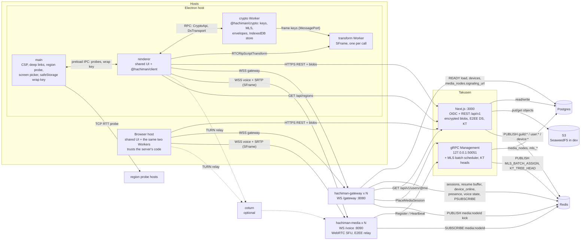
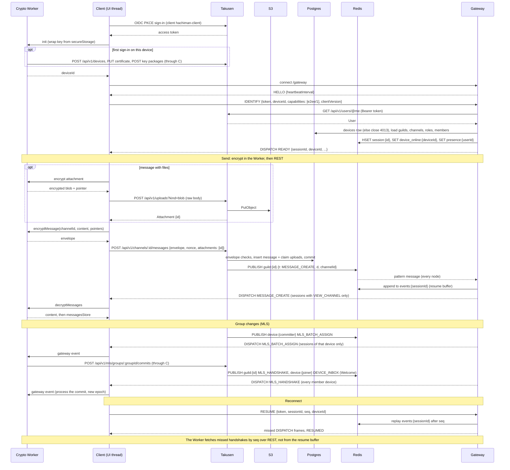
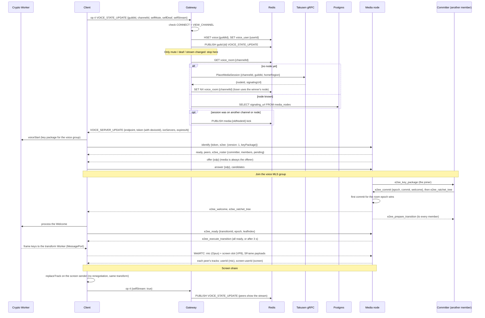
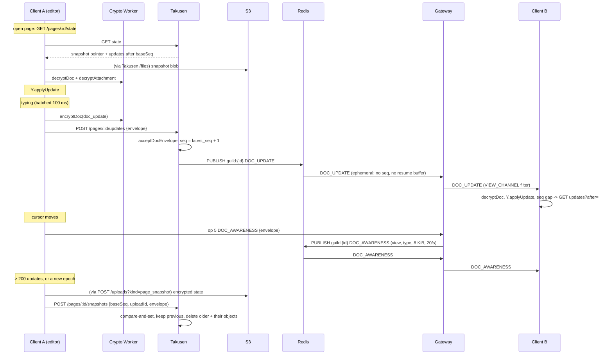
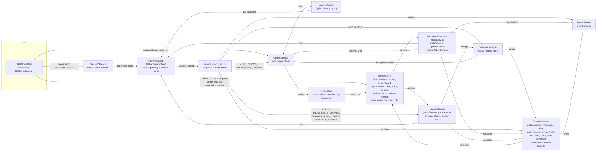

# Hachiman

Guild-based voice and text chat with a Discord-style architecture. Guilds are Postgres rows, not processes.
Clients use a REST API for reads, writes and files, a WebSocket gateway for realtime events, and WebRTC for voice and screen share.

Everything is end-to-end encrypted (E2EE): DMs, guild text channels, attachments, voice, video and screen share. There is no plaintext mode.
Key agreement uses MLS (RFC 9420, through ts-mls). Each device is a separate MLS member. Media frames use SFrame.

Takusen, the gateway and the media nodes relay only ciphertext. They see metadata: membership, sender, time, sizes, typing, presence and voice state.
They also see the read state, pinned message ids, guild events, thread names, blocks and custom status.
Avatars, guild icons and banners stay plaintext, because they are public profile data.

The Electron app is the strong client. The browser app shows the label "trusts the server's code", because a hostile server can send hostile JavaScript to a browser.

The wire contract for every process boundary is [`docs/gateway-protocol.md`](docs/gateway-protocol.md). §12 of it is normative for E2EE.
The decisions behind the design are in [`docs/discord-refactor.md`](docs/discord-refactor.md) and, for E2EE, in [`docs/e2ee-plan.md`](docs/e2ee-plan.md).
The UI spec is in [`docs/ui-redesign.md`](docs/ui-redesign.md).
Repo conventions are in [`CLAUDE.md`](CLAUDE.md).

## Packages

Each package README has its own diagrams: where the package fits, its code architecture and its key flows.

| Path | Package | What |
|---|---|---|
| [`apps/takusen`](apps/takusen/README.md) | `@hachiman/takusen` | Next.js app: identity (OIDC provider), REST API `/api/v1`, encrypted file blobs (S3), Postgres schema (Drizzle), Redis event publisher. The E2EE delivery service: devices, key packages, MLS groups, handshakes, device inbox, key transparency. A separate process serves the management gRPC (media registry + placement) and runs the MLS batch scheduler. |
| [`apps/hachiman-server`](apps/hachiman-server/README.md) | `hachiman-server` | Go: `hachiman-gateway` (WebSocket gateway, device-scoped delivery), `hachiman-media` (WebRTC SFU for voice and screen share, voice E2EE relay and commit ordering), `hachiman-recorder` (scaffold, not wired). |
| [`pkgs/hachiman-client`](pkgs/hachiman-client/README.md) | `@hachiman/client` | Browser-safe client library: `RestClient`, `GatewayClient`, `VoiceConnection`, `HachimanClient`, permissions, upload policy, wire types. It holds no crypto. |
| [`pkgs/hachiman-crypto`](pkgs/hachiman-crypto/README.md) | `@hachiman/crypto` | E2EE: the crypto Worker (identity, MLS groups, envelopes, attachments, encrypted store) and the SFrame transform Worker. Takusen checks MLS uploads with the `./ds` entry. |
| [`apps/hachiman`](apps/hachiman/README.md) | `@hachiman/hachiman` | Shared React UI (components, Zustand stores, services, hooks, the `IPlatformService` seam, a `?preview` mode with no backend). `CryptoService` owns the crypto Worker. |
| [`apps/hachiman-electron`](apps/hachiman-electron/README.md) | `@hachiman/hachiman-electron` | Electron host: CSP, deep links, region probe, screen source picker, the wrap key in the OS keychain (`safeStorage`), `hachiman://app` renderer protocol. |
| [`apps/hachiman-browser`](apps/hachiman-browser/README.md) | `@hachiman/hachiman-browser` | Browser host (Vite): the same CSP, a non-extractable wrap key in IndexedDB. |

## Architecture

### Components



Gateway and media nodes are stateless. Durable data lives in Postgres. File bytes live in S3, and only Takusen talks to the bucket. Sessions, the resume buffer, presence, voice state and the event bus live in Redis.

All key material lives in the crypto Worker of each device. The UI thread gets only status, decrypted content and attachment pointers. The Worker never calls `fetch`. It asks the UI thread for each REST call (`DsTransport`). The wrap key of the Worker store comes from the host (`IPlatformService.secureStorage`).

The gateway and media nodes have no direct link. The gateway signs a voice token for one media node and can kick a session through the Redis channel `media:{nodeId}`. The gateway mints TURN credentials (`TURN_SECRET`, `TURN_URLS`) when they are configured. Otherwise clients get a public STUN server.

### Connection and event flow



The gateway closes with 4012 when IDENTIFY has no `e2ee/1` capability or the client version is too old. It closes with 4013 when the device is unknown or revoked. The client does not reconnect after either code. After 4013, the app signs out.

### Voice join and screen share



The gateway signs the voice token (PASETO v4.public, `pkg/voicetoken`) for one media node. The media node verifies it and rejects a replayed token id.

Each voice room session has its own MLS group. The media node has no MLS library. It relays key packages, Welcomes, commits and ratchet trees, and it accepts the first commit for each epoch. The committer is the member with the lowest leaf index. The SFU forwards the SFrame payloads unchanged. The UI shows the call participants from the MLS tree, not from the server roster.

### Pages: edits and presence

A `pages` channel shows chat in the center and a tree of collaborative markdown pages on the right. The clients merge edits with Yjs. The server stores and relays only page envelopes (contract §4 Pages, §12.20).



### Shared UI



`services/hachiman.ts` owns the one `HachimanClient` and copies its cache into the stores after each event. Components read stores. They write through the services or `hachiman.rest`. The gateway event that results then updates the stores.

`UnreadService` keeps the read state and counts the mentions on the client, because the server cannot read them. Reactions are encrypted messages with their own content kind. `SoundService` plays a chime for message, voice and stream events, as `prefsStore` permits.

The shell is one sidebar (280 px) and one content card on a wallpaper that the guild tints. The top of the sidebar holds the controls, the space bar, the quick switcher and the favourite DMs. Below them are the channel list (or the settings sections) and the voice dock. The space bar replaces the guild rail. A pinned tab bar runs above the content card. The right column shows the members, a page or a DM profile. The UI spec is [`docs/ui-redesign.md`](docs/ui-redesign.md).

`CryptoService` owns the one `CryptoClient`, which is the crypto Worker of the signed-in user. `services/hachiman.ts` forwards the E2EE gateway events to it. The client cache holds ciphertext. Every message goes through the Worker before it goes into `messagesStore`. `cryptoStore` mirrors the Worker events and holds no key material.

Each host implements `IPlatformService` (`apps/hachiman/src/shared/IPlatformService.ts`). It supplies the OAuth redirect URI and sign-in flow, the title-bar inset, invite deep links, OAuth callbacks, region probes and the screen source picker. It also supplies the store wrap key (`secureStorage`). The Electron implementation (`apps/hachiman-electron/src/renderer/src/PlatformService.ts`) wraps the preload bridge `window.hachiman`. The browser implementation (`apps/hachiman-browser/src/platforms/browser/PlatformService.ts`) does same-tab redirects, gives no region probe and uses the browser's own screen picker.

## Local development

Prerequisites: Node 22.9+, pnpm 10+, Go 1.25+, Docker.

```bash
pnpm install

# 1. Postgres (:5432), Redis (:6379) and SeaweedFS (S3 on :8333, bucket hachiman-uploads)
docker compose -f docker/docker-compose.yml up -d

# 2. One env file for all services, at the repo root.
#    Set AUTH_SECRET and OIDC_COOKIES_KEY (openssl rand -base64 32).
#    The values for DATABASE_URL, REDIS_URL, S3_* and OIDC_ISSUER_URL match the compose file.
#    For voice, set MEDIA_REGION=us-east (a seeded region).
cp .env.example .env

# 3. Schema + seed (OIDC client hachiman-client, regions)
pnpm db:migrate && pnpm db:seed

# 4. Takusen: Next.js on :3000 and the management gRPC on 127.0.0.1:50051 (one command starts both)
pnpm dev:takusen

# 5. Gateway (:8080) + media (:8090). Both read the root .env.
#    Takusen places voice by guild region. Run media in a seeded region and give the guild that region.
pnpm dev:server          # or pnpm dev:gateway / pnpm dev:media

# 6. A host app
pnpm dev:browser         # http://localhost:5173
pnpm dev:electron
```

When the stack runs, do these steps:

1. Create an account at http://localhost:3000/signup.
2. Sign in from the app.
3. Set up encryption on the device. Keep the recovery key that the app shows.
4. Create a guild.
5. Set the guild region to `us-east`.

To work on the UI without a backend, open the browser host with `?preview`. Stubbed REST and gateway data and a crypto stub then drive the UI (see [`apps/hachiman/src/dev/README.md`](apps/hachiman/src/dev/README.md)).

Environment: every runner reads the repo-root `.env` (Takusen, gateway, media and the Vite builds). `.env.example` lists all variables, in one section for each service. A "Production only" section holds the JWKS, the gRPC bind address, TURN and the voice public key. A variable that you set in your shell wins over the file. If the file does not exist, each runner uses its defaults.

E2EE variables: Takusen reads `TAKUSEN_DS_SIGNING_KEY` and `TAKUSEN_KT_SIGNING_KEY` (seed files that it creates when they do not exist), plus the MLS and envelope limits `TAKUSEN_MLS_*`, `TAKUSEN_MAX_ENVELOPE_BYTES` and `TAKUSEN_PUBLIC_SET_MAX_MEMBERS`. The gateway reads `GATEWAY_MIN_CLIENT_VERSION`. Media reads `MEDIA_WS_READ_LIMIT`. `.env.example` gives the defaults.

Full setup notes: [`docs/takusen-sso-setup.md`](docs/takusen-sso-setup.md). Server flags: [`apps/hachiman-server/README.md`](apps/hachiman-server/README.md). Placement design: [`apps/takusen/PLACEMENT-DESIGN.md`](apps/takusen/PLACEMENT-DESIGN.md).

Schema changes: each change adds a migration (`pnpm -F @hachiman/takusen db:generate`), and `pnpm db:migrate` applies it. Do not edit or regenerate a committed migration. `pnpm db:reset` empties the dev DB, then migrates and seeds. There is no migration from plaintext data.

## Checks

```bash
pnpm -F @hachiman/hachiman typecheck
pnpm -F @hachiman/hachiman-electron typecheck
pnpm -F @hachiman/hachiman-browser typecheck
pnpm -F @hachiman/client typecheck
pnpm -F @hachiman/crypto typecheck
pnpm -F @hachiman/takusen typecheck

pnpm -F @hachiman/client test
pnpm -F @hachiman/crypto test
pnpm -F @hachiman/takusen test
pnpm -F @hachiman/hachiman-electron test
pnpm -F @hachiman/hachiman-browser test
cd apps/hachiman-server && CGO_ENABLED=0 go test ./...
```

TypeScript uses `tsgo` (`@typescript/native-preview`), not `tsc`.

The shared UI unit tests run with the vitest binary of a sibling package: `cd apps/hachiman && ../../pkgs/hachiman-client/node_modules/.bin/vitest run --config src/dev/vitest.config.ts`.

## Build

```bash
pnpm build:server        # bin/hachiman-gateway, bin/hachiman-media (the recorder builds only from its Dockerfile)
pnpm build:browser
pnpm build:electron      # or: pnpm -F @hachiman/hachiman-electron build:mac | build:win | build:linux
```

Docker images: `apps/hachiman-server/Dockerfile.{gateway,media,recorder}` (plus `Dockerfile.arm32v6.*`). Each image builds one binary.

A production browser deployment must send the CSP as a response header on every response, Worker scripts included. The meta tag in the build does not cover Workers. See [`apps/hachiman-browser/README.md`](apps/hachiman-browser/README.md).

## License

ISC. `apps/hachiman-server` and `pkgs/hachiman-client` keep their upstream licenses. See the `LICENSE` file in each.
