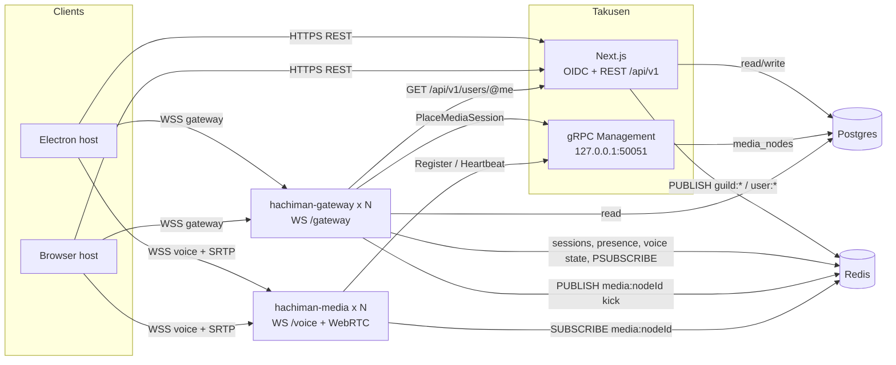
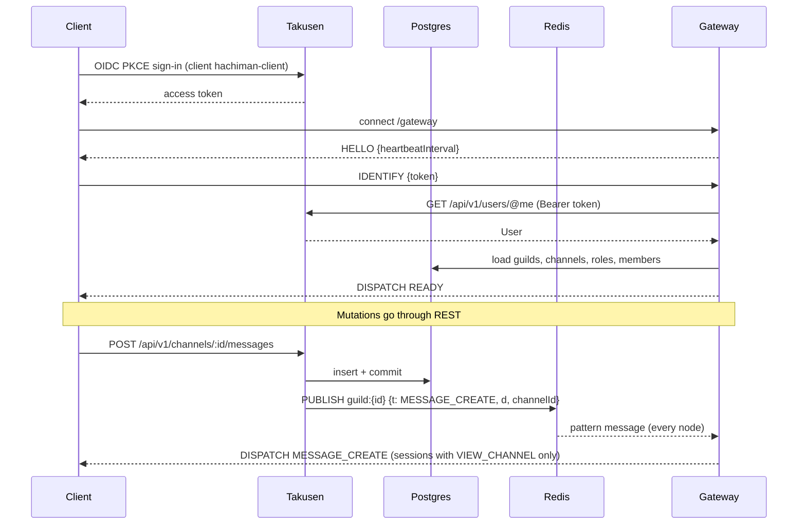
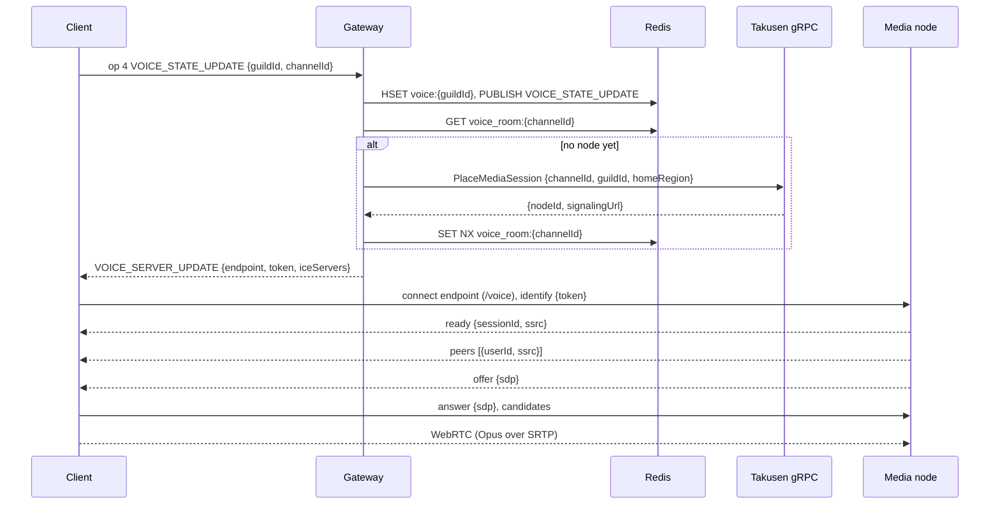
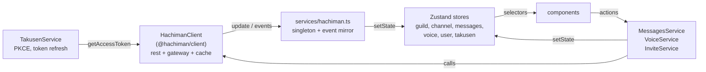

# Hachiman

Guild-based voice and text chat with a Discord-style architecture. Guilds are Postgres rows, not processes.
Clients use a REST API for reads and writes, a WebSocket gateway for realtime events, and WebRTC for voice.

The wire contract for every process boundary is [`docs/gateway-protocol.md`](docs/gateway-protocol.md).
The decisions behind the design are in [`docs/discord-refactor.md`](docs/discord-refactor.md).
Repo conventions are in [`CLAUDE.md`](CLAUDE.md).

## Packages

| Path | Package | What |
|---|---|---|
| `apps/takusen` | `@hachiman/takusen` | Next.js app: identity (OIDC), REST API `/api/v1`, Postgres schema (Drizzle), Redis event publisher. A separate process serves the management gRPC (media registry + placement). |
| `apps/hachiman-server` | `hachiman-server` | Go: `hachiman-gateway` (WebSocket gateway), `hachiman-media` (WebRTC SFU), `hachiman-recorder` (scaffold). |
| `pkgs/hachiman-client` | `@hachiman/client` | Browser-safe client library: `RestClient`, `GatewayClient`, `VoiceConnection`, `HachimanClient`. |
| `apps/hachiman` | `@hachiman/hachiman` | Shared React UI (components, Zustand stores, services). |
| `apps/hachiman-electron` | `@hachiman/hachiman-electron` | Electron host. |
| `apps/hachiman-browser` | `@hachiman/hachiman-browser` | Browser host (Vite). |

## Architecture

### Components



Gateway and media nodes are stateless. Durable data lives in Postgres. Sessions, presence, voice state and the event bus live in Redis.

### Connection and event flow



### Voice join



The gateway signs the voice token (PASETO, `pkg/voicetoken`) for one media node. The media node verifies it. There is no gateway-to-media link except the Redis kick channel.

### Shared UI



`services/hachiman.ts` owns the one `HachimanClient` and copies its cache into the stores after each event. Components read stores. They write through the services or `hachiman.rest`. The gateway event that results then updates the stores.

Hosts implement `IPlatformService` (`apps/hachiman/src/shared/IPlatformService.ts`): the OAuth redirect URI and sign-in page, the title-bar inset, invite deep links, OAuth callbacks and region probes.

## Local development

Prerequisites: Node 22.9+, pnpm 10+, Go 1.25+, Docker.

```bash
pnpm install

# 1. Postgres, Redis and SeaweedFS (S3 on :8333)
docker compose -f docker/docker-compose.yml up -d

# 2. One env file for all services, at the repo root.
#    Set AUTH_SECRET and OIDC_COOKIES_KEY (openssl rand -base64 32).
#    The values for DATABASE_URL, REDIS_URL and OIDC_ISSUER_URL match the compose file.
#    For voice, set MEDIA_REGION=us-east (a seeded region).
cp .env.example .env

# 3. Schema + seed (OIDC client hachiman-client, regions)
pnpm -F @hachiman/takusen db:migrate && pnpm -F @hachiman/takusen db:seed

# 4. Takusen: Next.js on :3000 and the management gRPC on 127.0.0.1:50051 (one command starts both)
pnpm dev:takusen

# 5. Gateway (:8080) + media (:8090). Both read the root .env.
#    Takusen places voice by guild region. Run media in a seeded region and give the guild that region.
pnpm dev:server          # or pnpm dev:gateway / pnpm dev:media

# 6. A host app
pnpm dev:browser         # http://localhost:5173
pnpm dev:electron
```

When the stack runs, do these steps:

1. Create an account at http://localhost:3000/signup.
2. Sign in from the app.
3. Create a guild.
4. Set the guild region to `us-east`.

Environment: every runner reads the repo-root `.env` (Takusen, gateway, media and the Vite builds). `.env.example` lists all variables, in one section for each service. A variable that you set in your shell wins over the file. If the file does not exist, each runner uses its defaults.

Full setup notes: [`docs/takusen-sso-setup.md`](docs/takusen-sso-setup.md). Server flags: [`apps/hachiman-server/README.md`](apps/hachiman-server/README.md).

Schema changes during development: drop the dev DB schema. Then run `db:migrate` + `db:seed` again. Do not stack ALTERs.

## Checks

```bash
pnpm -F @hachiman/hachiman typecheck
pnpm -F @hachiman/hachiman-electron typecheck
pnpm -F @hachiman/hachiman-browser typecheck
pnpm -F @hachiman/client typecheck
pnpm -F @hachiman/takusen typecheck

pnpm -F @hachiman/client test
pnpm -F @hachiman/takusen test
pnpm -F @hachiman/hachiman-electron test
cd apps/hachiman-server && CGO_ENABLED=0 go test ./...
```

TypeScript uses `tsgo` (`@typescript/native-preview`), not `tsc`.

## Build

```bash
pnpm build:server        # bin/hachiman-gateway, bin/hachiman-media
pnpm build:browser
pnpm build:electron      # or: pnpm -F @hachiman/hachiman-electron build:mac | build:win | build:linux
```

Docker images: `apps/hachiman-server/Dockerfile.{gateway,media,recorder}` (plus `Dockerfile.arm32v6.*`).

## License

ISC. `apps/hachiman-server` and `pkgs/hachiman-client` keep their upstream licenses. See the `LICENSE` file in each.
