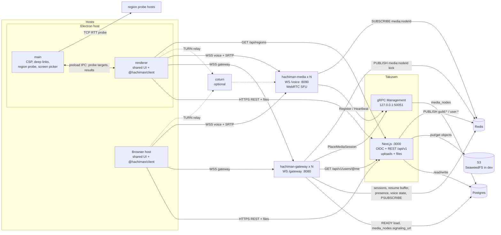
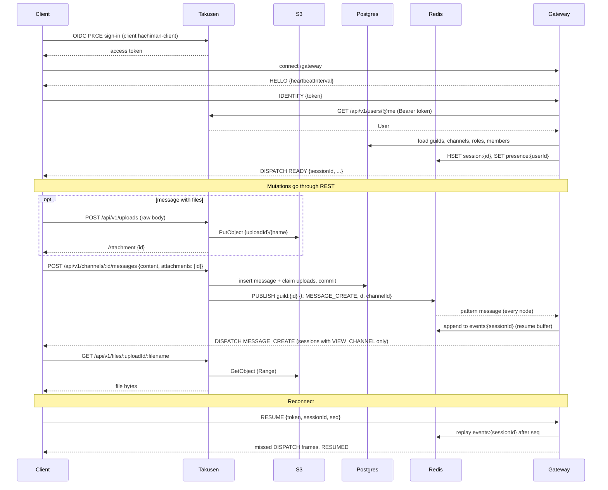
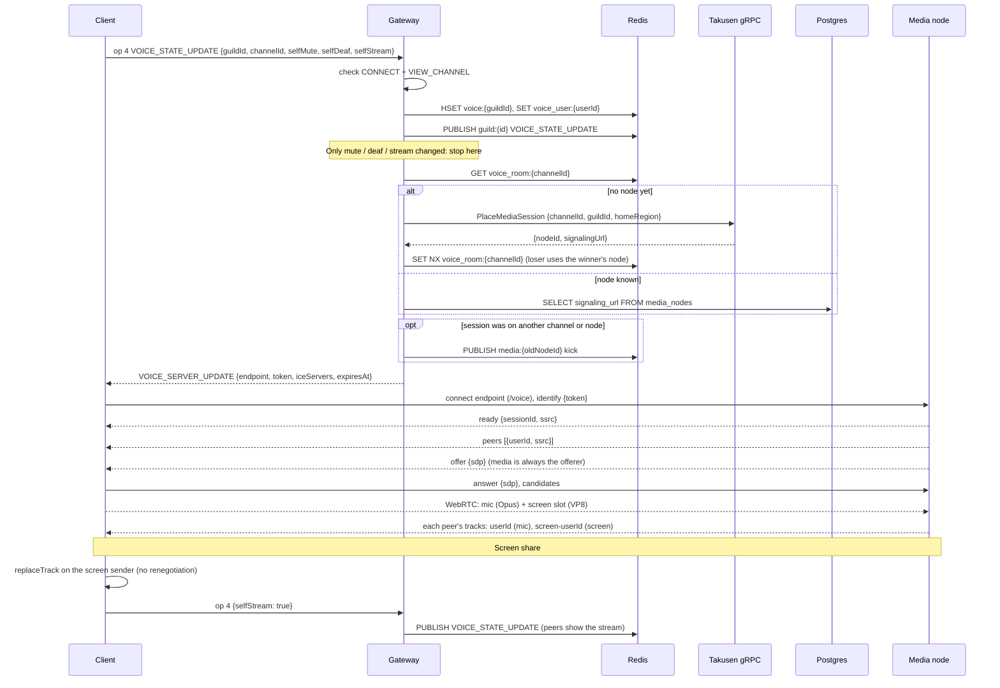
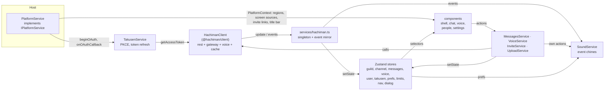

# Hachiman

Guild-based voice and text chat with a Discord-style architecture. Guilds are Postgres rows, not processes.
Clients use a REST API for reads, writes and files, a WebSocket gateway for realtime events, and WebRTC for voice and screen share.

The wire contract for every process boundary is [`docs/gateway-protocol.md`](docs/gateway-protocol.md).
The decisions behind the design are in [`docs/discord-refactor.md`](docs/discord-refactor.md).
The UI spec is in [`docs/ui-redesign.md`](docs/ui-redesign.md).
Repo conventions are in [`CLAUDE.md`](CLAUDE.md).

## Packages

Each package README has its own diagrams: where the package fits, its code architecture and its key flows.

| Path | Package | What |
|---|---|---|
| [`apps/takusen`](apps/takusen/README.md) | `@hachiman/takusen` | Next.js app: identity (OIDC provider), REST API `/api/v1`, file uploads and downloads (S3), Postgres schema (Drizzle), Redis event publisher. A separate process serves the management gRPC (media registry + placement). |
| [`apps/hachiman-server`](apps/hachiman-server/README.md) | `hachiman-server` | Go: `hachiman-gateway` (WebSocket gateway), `hachiman-media` (WebRTC SFU for voice and screen share), `hachiman-recorder` (scaffold, not wired). |
| [`pkgs/hachiman-client`](pkgs/hachiman-client/README.md) | `@hachiman/client` | Browser-safe client library: `RestClient`, `GatewayClient`, `VoiceConnection`, `HachimanClient`, permissions, upload policy, wire types. |
| [`apps/hachiman`](apps/hachiman/README.md) | `@hachiman/hachiman` | Shared React UI (components, Zustand stores, services, hooks, the `IPlatformService` seam, a `?preview` mode with no backend). |
| [`apps/hachiman-electron`](apps/hachiman-electron/README.md) | `@hachiman/hachiman-electron` | Electron host: CSP, deep links, region probe, screen source picker, `hachiman://app` renderer protocol. |
| [`apps/hachiman-browser`](apps/hachiman-browser/README.md) | `@hachiman/hachiman-browser` | Browser host (Vite). |

## Architecture

### Components



Gateway and media nodes are stateless. Durable data lives in Postgres. File bytes live in S3, and only Takusen talks to the bucket. Sessions, the resume buffer, presence, voice state and the event bus live in Redis.

The gateway and media nodes have no direct link. The gateway signs a voice token for one media node and can kick a session through the Redis channel `media:{nodeId}`. The gateway mints TURN credentials (`TURN_SECRET`, `TURN_URLS`) when they are configured. Otherwise clients get a public STUN server.

### Connection and event flow



### Voice join and screen share



The gateway signs the voice token (PASETO v4.public, `pkg/voicetoken`) for one media node. The media node verifies it and rejects a replayed token id.

### Shared UI



`services/hachiman.ts` owns the one `HachimanClient` and copies its cache into the stores after each event. Components read stores. They write through the services or `hachiman.rest`. The gateway event that results then updates the stores. `SoundService` plays a chime for message, voice and stream events, as `prefsStore` permits.

Each host implements `IPlatformService` (`apps/hachiman/src/shared/IPlatformService.ts`). It supplies the OAuth redirect URI and sign-in flow, the title-bar inset, invite deep links, OAuth callbacks, region probes and the screen source picker. The Electron implementation (`apps/hachiman-electron/src/renderer/src/PlatformService.ts`) wraps the preload bridge `window.hachiman`. The browser implementation (`apps/hachiman-browser/src/platforms/browser/PlatformService.ts`) does same-tab redirects, gives no region probe and uses the browser's own screen picker.

## Local development

Prerequisites: Node 22.9+, pnpm 10+, Go 1.25+, Docker.

```bash
pnpm install

# 1. Postgres (:5432), Redis (:6379) and SeaweedFS (S3 on :8333, bucket hachiman-uploads)
docker compose -f docker/docker-compose.yml up -d

# 2. One env file for all services, at the repo root.
#    Set AUTH_SECRET and OIDC_COOKIES_KEY (openssl rand -base64 32).
#    The values for DATABASE_URL, REDIS_URL, S3_* and OIDC_ISSUER_URL match the compose file.
#    For voice, set MEDIA_REGION=us-east (a seeded region).
cp .env.example .env

# 3. Schema + seed (OIDC client hachiman-client, regions)
pnpm -F @hachiman/takusen db:migrate && pnpm -F @hachiman/takusen db:seed

# 4. Takusen: Next.js on :3000 and the management gRPC on 127.0.0.1:50051 (one command starts both)
pnpm dev:takusen

# 5. Gateway (:8080) + media (:8090). Both read the root .env.
#    Takusen places voice by guild region. Run media in a seeded region and give the guild that region.
pnpm dev:server          # or pnpm dev:gateway / pnpm dev:media

# 6. A host app
pnpm dev:browser         # http://localhost:5173
pnpm dev:electron
```

When the stack runs, do these steps:

1. Create an account at http://localhost:3000/signup.
2. Sign in from the app.
3. Create a guild.
4. Set the guild region to `us-east`.

To work on the UI without a backend, open the browser host with `?preview`. Stubbed REST and gateway data then drive the UI (see [`apps/hachiman/src/dev/README.md`](apps/hachiman/src/dev/README.md)).

Environment: every runner reads the repo-root `.env` (Takusen, gateway, media and the Vite builds). `.env.example` lists all variables, in one section for each service. A "Production only" section holds the JWKS, the gRPC bind address, TURN and the voice public key. A variable that you set in your shell wins over the file. If the file does not exist, each runner uses its defaults.

Full setup notes: [`docs/takusen-sso-setup.md`](docs/takusen-sso-setup.md). Server flags: [`apps/hachiman-server/README.md`](apps/hachiman-server/README.md). Placement design: [`apps/takusen/PLACEMENT-DESIGN.md`](apps/takusen/PLACEMENT-DESIGN.md).

Schema changes during development: drop the dev DB schema. Then run `db:migrate` + `db:seed` again. Do not stack ALTERs.

## Checks

```bash
pnpm -F @hachiman/hachiman typecheck
pnpm -F @hachiman/hachiman-electron typecheck
pnpm -F @hachiman/hachiman-browser typecheck
pnpm -F @hachiman/client typecheck
pnpm -F @hachiman/takusen typecheck

pnpm -F @hachiman/client test
pnpm -F @hachiman/takusen test
pnpm -F @hachiman/hachiman-electron test
cd apps/hachiman-server && CGO_ENABLED=0 go test ./...
```

TypeScript uses `tsgo` (`@typescript/native-preview`), not `tsc`.

## Build

```bash
pnpm build:server        # bin/hachiman-gateway, bin/hachiman-media (the recorder builds only from its Dockerfile)
pnpm build:browser
pnpm build:electron      # or: pnpm -F @hachiman/hachiman-electron build:mac | build:win | build:linux
```

Docker images: `apps/hachiman-server/Dockerfile.{gateway,media,recorder}` (plus `Dockerfile.arm32v6.*`). Each image builds one binary.

## License

ISC. `apps/hachiman-server` and `pkgs/hachiman-client` keep their upstream licenses. See the `LICENSE` file in each.
