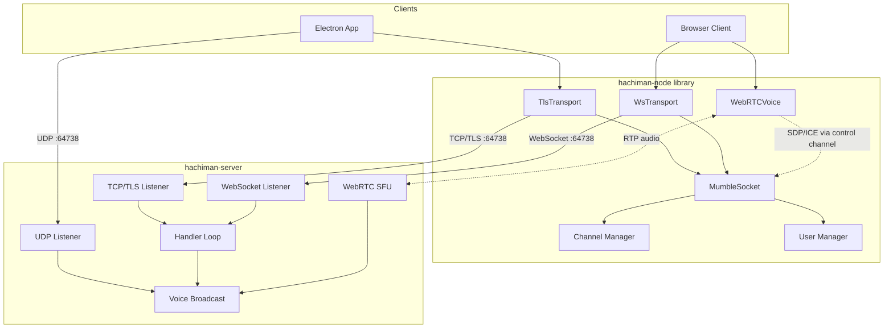
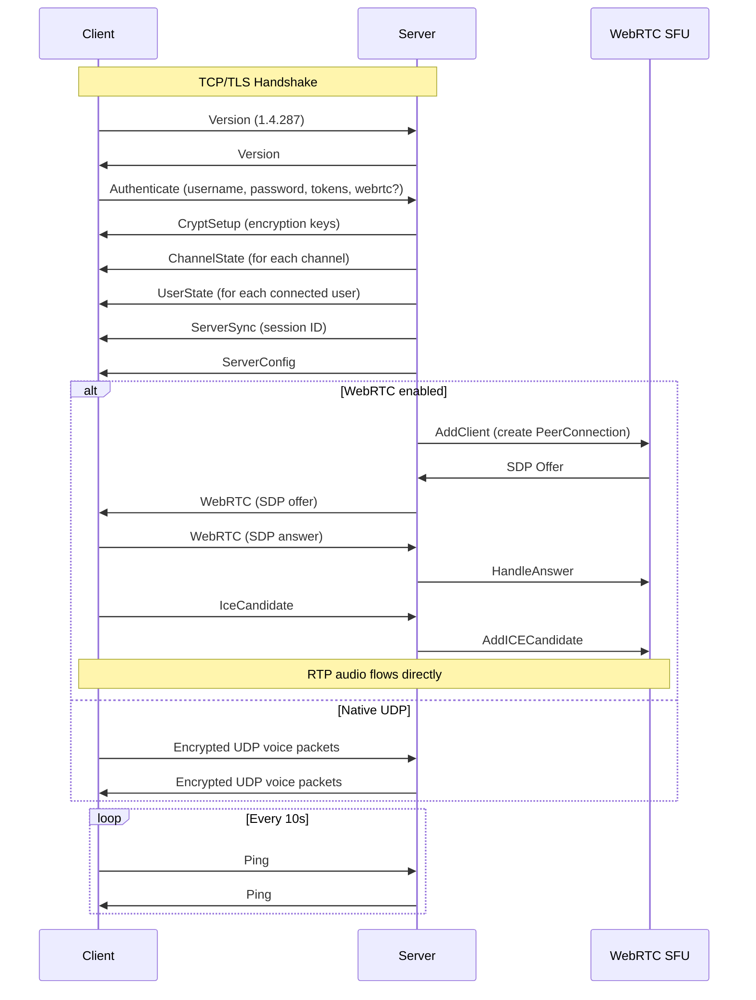
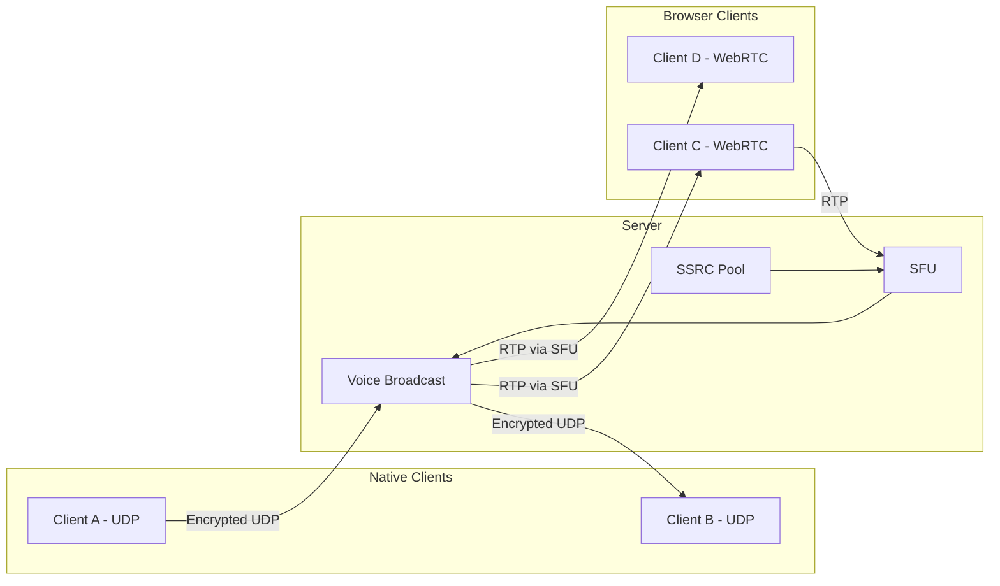
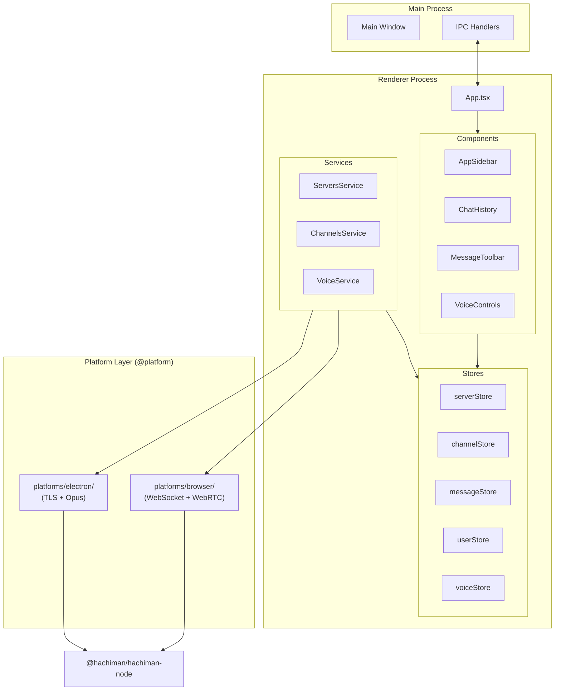

# Hachiman

Mumble voice chat infrastructure — a modern client, library, and server in a single monorepo.

Hachiman provides a desktop application for Mumble voice communication, a TypeScript client library for building Mumble-compatible applications, and an extended Mumble server with WebRTC support for browser clients.

## Packages

| Package | Description | Tech |
|---------|-------------|------|
| [`apps/hachiman`](apps/hachiman/) | Shared React UI library (components, stores, services, platform abstraction) | React 19, Tailwind CSS 4, Zustand |
| [`apps/hachiman-electron`](apps/hachiman-electron/) | Electron desktop host | electron-vite, native TLS + Opus |
| [`apps/hachiman-browser`](apps/hachiman-browser/) | Browser host | Vite, WebSocket + WebRTC |
| [`apps/hachiman-server`](apps/hachiman-server/) | Mumble-compatible voice server | Go, Pion WebRTC, SQLite |
| [`pkgs/hachiman-node`](pkgs/hachiman-node/) | TypeScript Mumble client library | RxJS, Protobuf, WebRTC |

The host apps (`hachiman-electron`, `hachiman-browser`) both depend on the shared UI in `@hachiman/hachiman` and the protocol/transport library in `@hachiman/hachiman-node`. The shared UI talks to Mumble through the `IMumbleService` / `IPlatformService` interfaces; each host provides its own implementation under `platforms/<host>/`.

## Architecture



### Connection Flows



### Voice Routing

The server bridges audio between native UDP clients and WebRTC browser clients transparently:



### Electron App Architecture



## Getting Started

### Prerequisites

- [Node.js](https://nodejs.org/) >= 18
- [pnpm](https://pnpm.io/) >= 10
- [Go](https://go.dev/) >= 1.21 (for server)

### Setup

```bash
# Install all dependencies
pnpm install

# Start everything (server + apps) in parallel with hot-reload
pnpm dev

# Or run individually:
pnpm dev:server      # Go server with nodemon hot-reload
pnpm dev:electron    # Electron desktop app
pnpm dev:browser     # Browser app on Vite
```

The server listens on port **64738** (TCP, UDP, and WebSocket share the port). Hosts connect with self-signed certificates generated at runtime.

### Build

```bash
# Server binary
pnpm build:server

# Browser bundle (Vite)
pnpm build:browser

# Desktop app
pnpm build:electron
# Or for an installer for a specific platform:
cd apps/hachiman-electron
pnpm build:mac       # macOS
pnpm build:win       # Windows
pnpm build:linux     # Linux (AppImage, snap, deb)
```

### TypeScript: `tsgo`, not `tsc`

All TypeScript work in this repo uses the [TypeScript-native compiler](https://github.com/microsoft/typescript-go) (`@typescript/native-preview`, binary `tsgo`), installed once as a root devDependency. Every workspace's `typecheck` and `build` script invokes `tsgo` directly — do not run `tsc` or add `typescript` as a devDependency to any package.

```bash
# Typecheck a single workspace
pnpm -F @hachiman/hachiman          typecheck
pnpm -F @hachiman/hachiman-electron typecheck
pnpm -F @hachiman/hachiman-browser  typecheck
```

## Client Library

`@hachiman/hachiman-node` can be used independently to build Mumble-compatible applications:

```typescript
import { Client } from '@hachiman/hachiman-node'

const client = new Client({
  host: 'localhost',
  port: 64738,
  username: 'bot',
  rejectUnauthorized: false,
})

await client.connect()

// List channels
for (const channel of client.channels.all()) {
  console.log(channel.name)
}

// Join a channel
const lobby = client.channels.byName('Lobby')
await client.self.moveToChannel(lobby.id)

// Send a text message
await client.command('textMessage', {
  sendPacket: [TextMessage, { message: 'Hello!', channelId: [lobby.id] }],
  expectPacket: [TextMessage, () => true],
})

// Listen for events
client.on('userCreate', (user) => console.log(`${user.name} connected`))
client.on('speakingStateChange', ({ user, speaking }) => {
  console.log(`${user.name} ${speaking ? 'started' : 'stopped'} speaking`)
})

client.disconnect()
```

### Browser Usage

For browser clients, use WebSocket transport with WebRTC voice:

```typescript
const client = new Client({
  host: 'server.example.com',
  port: 64738,
  username: 'browser-user',
  transport: 'websocket',
  wsUrl: 'ws://server.example.com:64738/',
  webrtc: true,
})

await client.connect()
client.webrtcVoice?.startMicrophone()
```

## Protocol

Hachiman implements the [Mumble protocol](https://mumble-protocol.readthedocs.io/) with extensions for WebRTC:

| Type | Message | Description |
|------|---------|-------------|
| 0 | Version | Client/server version exchange |
| 2 | Authenticate | Username, password, tokens, WebRTC flag |
| 5 | ServerSync | Session assignment, welcome text |
| 7 | ChannelState | Channel create/update |
| 9 | UserState | User state changes |
| 11 | TextMessage | Chat messages |
| 27 | WebRTC | SDP offer/answer exchange |
| 28 | IceCandidate | ICE candidate exchange |
| 29 | TalkingState | Voice activity for WebRTC clients |

## Project Structure

```
hachiman/
├── apps/
│   ├── hachiman/                       # Shared React UI library (@hachiman/hachiman)
│   │   └── src/
│   │       ├── App.tsx                 # Root layout (server rail + channel sidebar + chat + members)
│   │       ├── components/             # UI (shadcn/ui + custom: chat-area, channel-sidebar, member-list, …)
│   │       ├── services/               # ServersService, ChannelsService, VoiceService, MessagesService
│   │       ├── stores/                 # Zustand stores (server, channel, message, user, voice)
│   │       └── shared/                 # IMumbleService, IPlatformService, PlatformContext
│   │
│   ├── hachiman-electron/              # Electron host (@hachiman/hachiman-electron)
│   │   ├── src/
│   │   │   ├── main/                   # Electron main process
│   │   │   ├── preload/                # IPC bridge
│   │   │   └── renderer/src/           # Mounts the shared <App />
│   │   └── platforms/electron/         # MumbleService (TLS + Opus), PlatformService
│   │
│   ├── hachiman-browser/               # Browser host (@hachiman/hachiman-browser)
│   │   └── src/
│   │       ├── main.tsx                # Mounts the shared <App />
│   │       └── platforms/browser/      # MumbleService (WebSocket + WebRTC), PlatformService
│   │
│   └── hachiman-server/                # Go Mumble server (Grumble fork)
│       ├── cmd/grumble/                # Server entry point + packet handlers + voice broadcast
│       └── pkg/
│           ├── web/                    # WebRTC SFU + SSRC pool
│           ├── mumbleproto/            # Protobuf definitions (authoritative for both sides)
│           ├── database/               # GORM + SQLite
│           ├── acl/                    # Permission system
│           └── cryptstate/             # Voice encryption
│
└── pkgs/
    └── hachiman-node/                  # Mumble client library (@hachiman/hachiman-node)
        └── src/
            ├── client.ts               # Main client API
            ├── transport.ts            # ITransport interface
            ├── tls-transport.ts        # Node.js TLS
            ├── ws-transport.ts         # Browser WebSocket
            ├── webrtc-voice.ts         # WebRTC voice
            ├── mumble-socket.ts        # Protocol framing
            └── mumbleproto/            # Generated protobuf bindings (do not edit by hand)
```

See [`CLAUDE.md`](CLAUDE.md) for repo conventions (Zustand selector patterns, the `tsgo`-only rule, protobuf regeneration workflow, etc.).

## License

ISC
