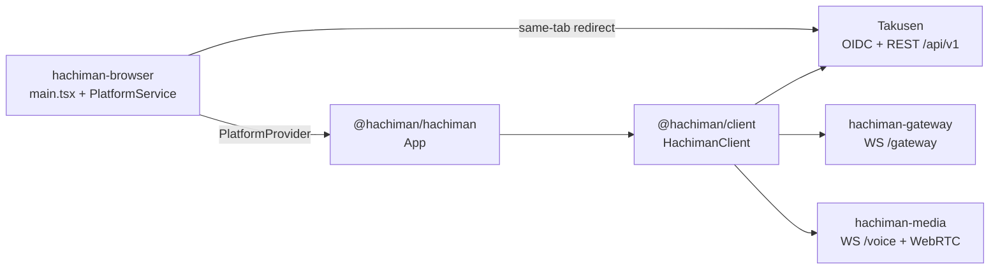
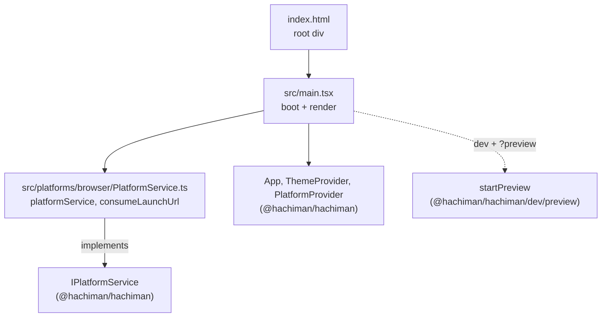
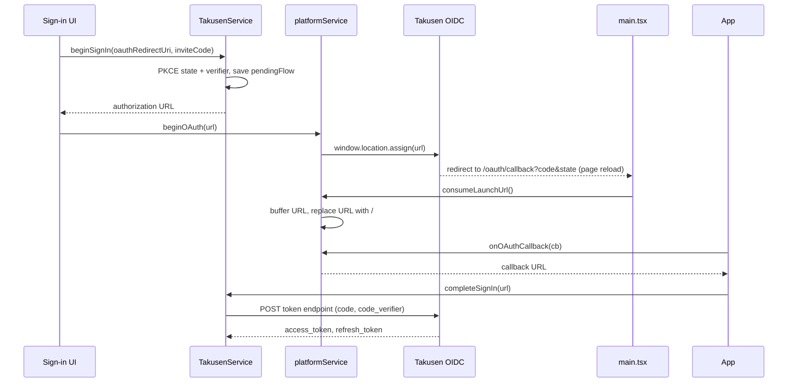

# @hachiman/hachiman-browser

Browser host for Hachiman, built with Vite. It mounts the shared UI (`@hachiman/hachiman`) and gives it a browser implementation of `IPlatformService`.
The seam contract is [`docs/gateway-protocol.md`](../../docs/gateway-protocol.md) §11. The root [`README.md`](../../README.md) has the system diagrams.

## Where it fits



- The host has no app logic. The shared UI owns the `HachimanClient` and every store.
- The host supplies the OAuth redirect URI, the sign-in redirect, invite deep links and the OAuth callback.
- After sign-in, the UI calls Takusen REST, the gateway and media through `@hachiman/client`.
- The browser cannot open raw sockets, so `probeRegions` returns `[]`. The browser has its own screen picker, so `getScreenSources` returns `null` and `selectScreenSource` does nothing.

## Code architecture



| File | Contents |
|---|---|
| `index.html` | Page shell. It sets the dark background before the CSS loads and loads `src/main.tsx`. |
| `src/main.tsx` | Reads the launch query and calls `consumeLaunchUrl`. In dev with `?preview`, it starts preview mode. Then it renders `App` in `PlatformProvider` and `ThemeProvider`. |
| `src/platforms/browser/PlatformService.ts` | `platformService` (the `IPlatformService` implementation) and `consumeLaunchUrl`. |
| `vite.config.ts` | React and Tailwind plugins. The `@` alias points to `../hachiman/src`. The dev server uses port 5173 with `strictPort`. `envDir` is the repo root. |
| `tsconfig.json` | Extends `tsconfig.base.json`. It mirrors the `@` alias for the shared UI source. |

### Launch URL routes

`consumeLaunchUrl` reads the page URL once at startup. It handles two routes:

| Route | Action |
|---|---|
| `/oauth/callback?code=…&state=…` (or `error=`) | Sends the full URL to `onOAuthCallback` subscribers. |
| `/invite/<code>` | Sends the code to `onInviteCode` subscribers. |

After a match, it replaces the URL with `/`. A reload then does not use the single-use OAuth code again or open the invite again. Values that arrive before the UI subscribes stay in a buffer.

### OAuth redirect round trip



The redirect reloads the page. `pendingFlow` survives the reload because the Takusen store persists it to `localStorage`. If the sign-in started from an invite, `App` opens the invite dialog after `completeSignIn`.

The redirect URI is `VITE_HACHIMAN_OIDC_REDIRECT` if it is set. Otherwise it is `${window.location.origin}/oauth/callback`. The value must be a redirect URI of the `hachiman-client` OIDC client in `apps/takusen/src/db/seed.ts`.

## Preview mode

In the dev server, `?preview` seeds the stores with a fixture. The UI then renders without Takusen or a gateway. Production builds do not include it. See [`apps/hachiman/src/dev/README.md`](../hachiman/src/dev/README.md) for the URLs and the fixture.

## Run and build

```bash
pnpm dev:browser                              # from the repo root: http://localhost:5173
pnpm build:browser                            # tsgo --noEmit, then vite build
pnpm -F @hachiman/hachiman-browser preview    # serve the build
pnpm -F @hachiman/hachiman-browser typecheck  # tsgo --noEmit
pnpm -F @hachiman/hachiman-browser lint
pnpm -F @hachiman/hachiman-browser format
```

Keep port 5173. The Takusen CORS allowlist and the seeded OAuth redirect URI use this origin.

## Environment

Vite reads `VITE_*` from the repo-root `.env` at build time. The template is the `# MARK: - Desktop / Web (VITE_*)` section of `.env.example`. Build again after a change.

| Variable | Purpose |
|---|---|
| `VITE_TAKUSEN_OIDC_ISSUER` | OIDC issuer for discovery. |
| `VITE_TAKUSEN_OIDC_CLIENT_ID` | OIDC client ID (`hachiman-client`). |
| `VITE_TAKUSEN_API_BASE` | Takusen API base. The UI adds `/v1` for REST. |
| `VITE_HACHIMAN_GATEWAY_URL` | Gateway WebSocket URL. |
| `VITE_HACHIMAN_OIDC_REDIRECT` | Optional. It overrides the redirect URI. Keep it unset in the shared `.env`, because the Electron host reads it too. |
