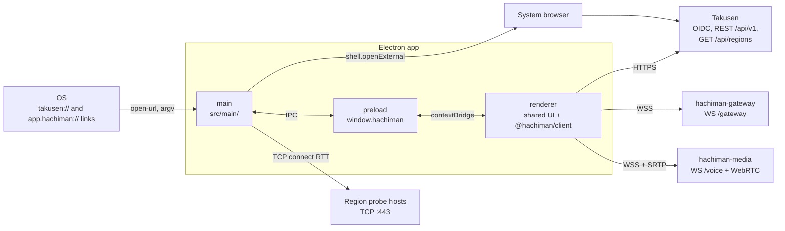
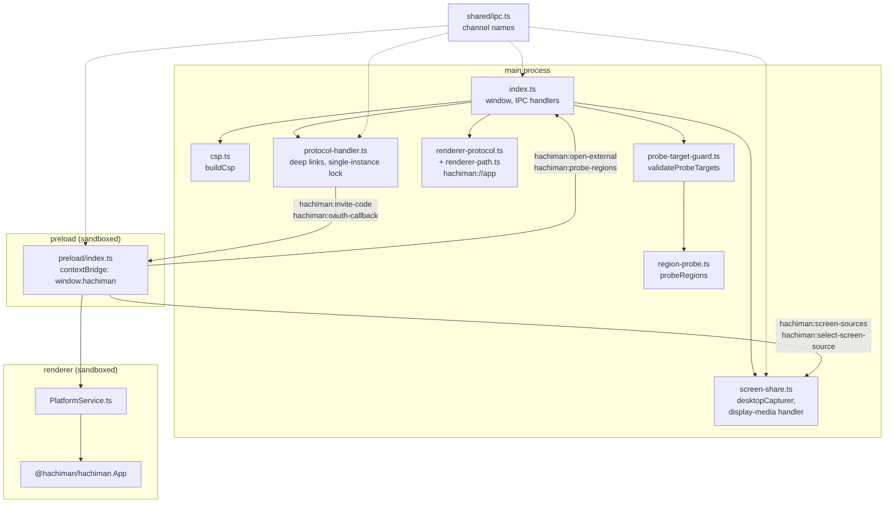
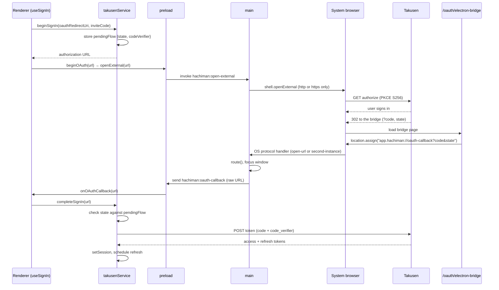
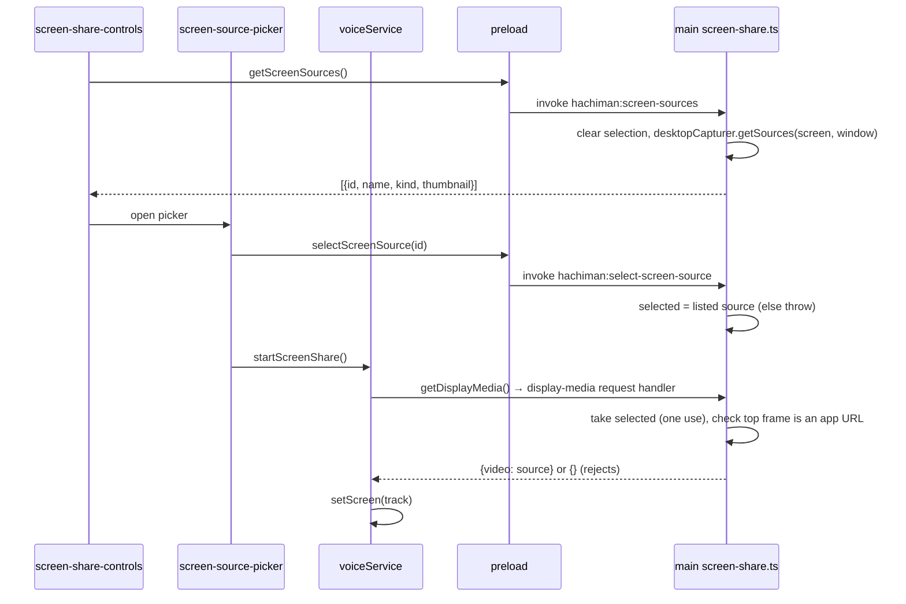

# @hachiman/hachiman-electron

The Electron host of Hachiman, built with electron-vite. The renderer mounts the shared UI ([`@hachiman/hachiman`](../hachiman/README.md)). The main process adds the desktop features: CSP, deep links, the region probe, the screen source picker and the `hachiman://app` renderer scheme.

References:

- Host seam (`IPlatformService`): [`docs/gateway-protocol.md`](../../docs/gateway-protocol.md) §11.
- Sign-in setup: [`docs/takusen-sso-setup.md`](../../docs/takusen-sso-setup.md).
- Repo conventions: [`CLAUDE.md`](../../CLAUDE.md).

## Where it fits



- The renderer is a sandboxed web page. It has no Node and no Electron imports. It reaches main only through `window.hachiman`.
- `src/renderer/src/PlatformService.ts` implements `IPlatformService` over `window.hachiman`.
- The renderer reads `GET /api/regions` (`takusenService.listRegions`). Main gets the probe targets from the renderer and validates them before it opens a socket.
- Sign-in opens in the system browser. The result comes back as an `app.hachiman://oauth-callback` deep link.
- All Takusen, gateway and media traffic goes from the renderer through `@hachiman/client` and `TakusenService`.

## Code architecture



IPC channels (`src/shared/ipc.ts`):

| Channel | Direction | Payload |
|---|---|---|
| `hachiman:invite-code` | main → renderer | Invite code from `takusen://invite/<code>` |
| `hachiman:oauth-callback` | main → renderer | The raw `app.hachiman://oauth-callback?…` URL |
| `hachiman:open-external` | renderer → main (invoke) | An `http:` or `https:` URL. Main refuses other schemes. |
| `hachiman:probe-regions` | renderer → main (invoke) | `{region, host, port}[]` → `{region, rttMs}[]` |
| `hachiman:screen-sources` | renderer → main (invoke) | → `{id, name, kind, thumbnail}[]` |
| `hachiman:select-screen-source` | renderer → main (invoke) | Source id for the next `getDisplayMedia` |

The preload buffers the two main → renderer channels until the UI subscribes. Thus a deep link that arrives at cold start is not lost.

| File | Contents |
|---|---|
| `src/main/index.ts` | Creates the window (`sandbox`, `contextIsolation`, no `nodeIntegration`). Registers the IPC handlers, the navigation guard and the `window.open` handler. Asks for microphone access on macOS. |
| `src/main/csp.ts` | `buildCsp` makes the renderer CSP from the `VITE_*` env through `resolveTakusenEnv` |
| `src/main/protocol-handler.ts` | `takusen://invite/<code>` and `app.hachiman://oauth-callback` from `argv`, `second-instance` and `open-url`. Holds the single-instance lock. |
| `src/main/renderer-protocol.ts` | Serves the built renderer from `hachiman://app/` with the CSP header. In dev, adds the CSP to the dev server responses. |
| `src/main/renderer-path.ts` | Maps `hachiman://app/…` to a file and refuses path traversal and symlink escapes. It has no Electron imports, so `node --test` can load it. |
| `src/main/region-probe.ts` | TCP connect RTT: 3 samples per target, minimum wins, 2 s timeout, 8 sockets at a time |
| `src/main/probe-target-guard.ts` | SSRF guard for `hachiman:probe-regions` |
| `src/main/screen-share.ts` | Lists sources with `desktopCapturer`, keeps the selected source, and answers `setDisplayMediaRequestHandler` |
| `src/preload/index.ts` | `window.hachiman` (the only renderer surface). `window.d.ts` types it for the renderer. |
| `src/shared/ipc.ts` | IPC channel names and `ScreenSourceInfo`. Constants only. |
| `src/renderer/src/PlatformService.ts` | `IPlatformService` adapter over `window.hachiman` |
| `src/renderer/src/main.tsx` | Renders `PlatformProvider` + `ThemeProvider` + `App` |
| `src/main/*.test.mts` | `csp`, `probe-target-guard` and `renderer-path` unit tests (`node --test`) |

## OAuth sign-in

The system browser cannot show an `app.hachiman://` page. Thus the redirect URI is a Takusen page, `/oauth/electron-bridge` (`apps/takusen/src/app/oauth/electron-bridge/page.tsx`). That page sends the browser to the deep link.



The redirect URI is `VITE_HACHIMAN_OIDC_REDIRECT`, or else `${issuerOrigin}/oauth/electron-bridge`. The Takusen seed registers `http://localhost:3000/oauth/electron-bridge` on the `hachiman-client` OIDC client. If the user started from an invite, `App.tsx` opens the invite again after the callback.

## Screen share source pick



If `getSources` fails, the picker shows a hint about the macOS Screen Recording permission.

## Security notes

- The window runs with `sandbox: true`, `contextIsolation: true` and `nodeIntegration: false`. The preload uses only `contextBridge` and `ipcRenderer`.
- `will-navigate` blocks all navigation away from the app URL. `window.open` opens only `http:` and `https:` URLs in the system browser.
- The CSP comes from `csp.ts`. `connect-src` allows the Takusen and gateway origins plus `wss:`, because media node hosts are not known at build time. It allows `ws:` only when an endpoint is plain text. Images and media load only from `'self'`, `blob:` and the Takusen API origin. `script-src` is `'self'`. In dev, it also has `'unsafe-inline'` for the React Fast Refresh preamble.
- `probe-target-guard.ts` validates each probe payload before main opens a socket. It checks the shape and allows a maximum of 64 targets on port 443 only. It resolves the host through DNS and refuses loopback, private, link-local, metadata and unspecified addresses.
- `screen-share.ts` accepts only a source id from the last listing and only a request from the top app frame. Script in the app page can still list and select a source without the picker. The code comment records this as an accepted risk.
- The packaged renderer has the origin `hachiman://app`. A `file://` page sends `Origin: null`, which Takusen CORS refuses. `TAKUSEN_ALLOWED_ORIGINS` includes `hachiman://app` and the dev origin `http://localhost:5174`.

## Run, test and build

```bash
pnpm dev:electron                                   # electron-vite dev; renderer dev server on :5174 (strictPort)
pnpm -F @hachiman/hachiman-electron typecheck       # typecheck:node + typecheck:web (tsgo)
pnpm -F @hachiman/hachiman-electron test            # node --test src/**/*.test.mts
pnpm -F @hachiman/hachiman-electron lint
pnpm -F @hachiman/hachiman-electron start           # electron-vite preview (built renderer on hachiman://app)
pnpm build:electron                                 # typecheck + electron-vite build
pnpm -F @hachiman/hachiman-electron build:mac       # or build:win, build:linux, build:unpack
```

Takusen, the gateway and media must run for sign-in and voice. See the [root README](../../README.md#local-development).

Environment: `electron.vite.config.ts` sets `envDir` to the repo root for the main, preload and renderer bundles. The renderer reads `VITE_TAKUSEN_OIDC_ISSUER`, `VITE_TAKUSEN_OIDC_CLIENT_ID`, `VITE_TAKUSEN_API_BASE` and `VITE_HACHIMAN_GATEWAY_URL`. Main reads the same values to build the CSP. Build the app again after a change. Keep `VITE_HACHIMAN_OIDC_REDIRECT` unset, because the browser host reads it too.

`electron-builder.yml` registers the `takusen` and `app.hachiman` schemes with the OS. On macOS, `setAsDefaultProtocolClient` alone does not register them for a packaged build.
