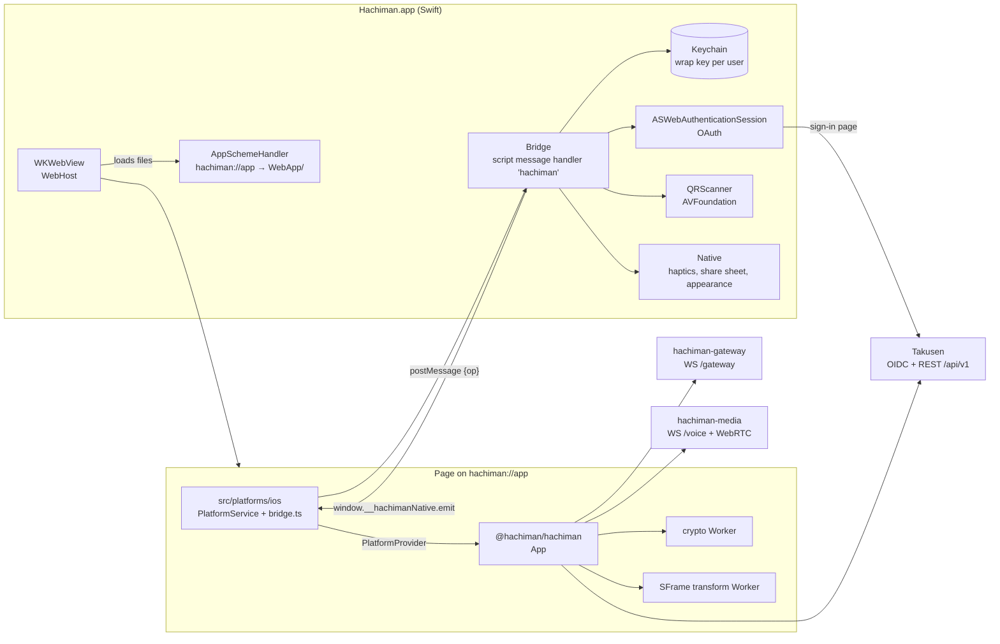
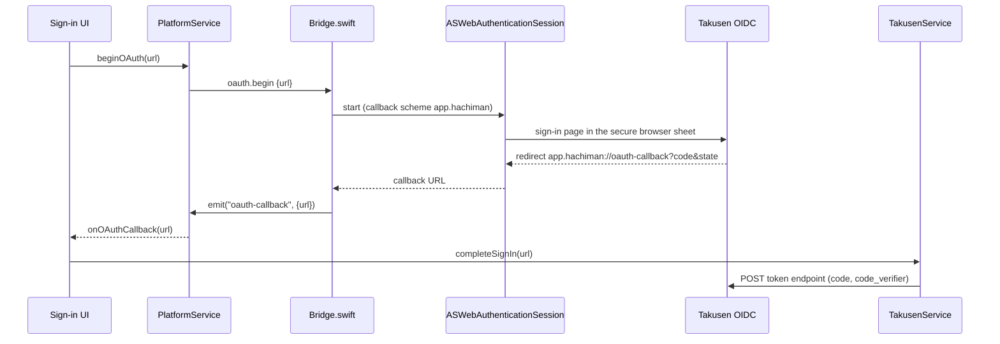
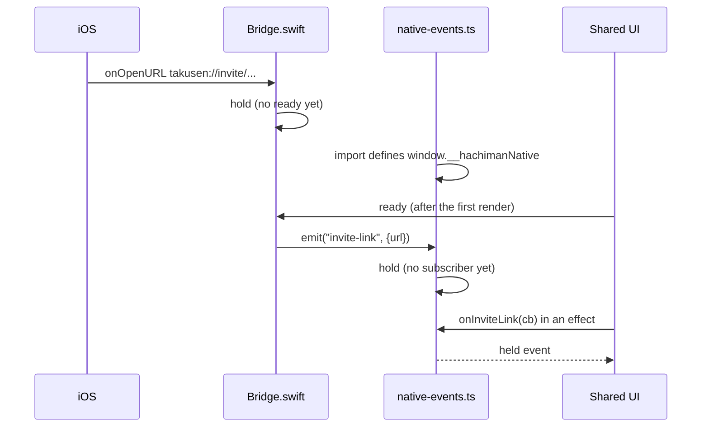

# @hachiman/hachiman-ios

iOS host for Hachiman: a SwiftUI app with one `WKWebView`. The app bundles the shared UI (`@hachiman/hachiman`), built with Vite, and serves it on `hachiman://app`. A small Swift bridge gives the UI the native parts of `IPlatformService`.
The seam contract is [`docs/gateway-protocol.md`](../../docs/gateway-protocol.md) §11 ("iOS host"). The plan is [`docs/ios-app-plan.md`](../../docs/ios-app-plan.md). The root [`README.md`](../../README.md) has the system diagrams.

The minimum iOS version is 18.5. The WebKit of iOS 18.3 has no WebCrypto X25519, and ts-mls needs it for MLS key packages (plan, Phase 1).

## Where it fits



- The host has no app logic. The shared UI owns the `HachimanClient`, every store and both Workers.
- The origin `hachiman://app` is the origin of the packaged Electron renderer. Thus Takusen CORS and the seeded redirect URI `app.hachiman://oauth-callback` work with no server change.
- The app code ships inside the signed app bundle. Takusen cannot send other code to it, so `hostTrust` is `'strong'`, as for Electron (contract §12.17).
- No screen share (WKWebView has no `getDisplayMedia`), no global shortcuts, no region probe (`probeRegions` returns `[]`). TestFlight updates the app, so `checkForUpdate` returns `not-available`.

## Code architecture

| File                                   | Contents                                                                                                                                                                                                                                                                                                                                                                                                                                               |
| -------------------------------------- | ------------------------------------------------------------------------------------------------------------------------------------------------------------------------------------------------------------------------------------------------------------------------------------------------------------------------------------------------------------------------------------------------------------------------------------------------------ |
| `index.html`                           | Page shell with `viewport-fit=cover` and `maximum-scale=1` (no focus zoom). It loads `src/main.tsx`.                                                                                                                                                                                                                                                                                                                                                   |
| `src/main.tsx`                         | Renders `App` in `PlatformProvider` and `ThemeProvider`, then sends the bridge op `ready`. In dev with `?preview`, it starts preview mode.                                                                                                                                                                                                                                                                                                             |
| `src/platforms/ios/PlatformService.ts` | `createIosPlatformService`: the `IPlatformService` implementation over the bridge.                                                                                                                                                                                                                                                                                                                                                                     |
| `src/platforms/ios/bridge.ts`          | `call(op, args)`: the typed bridge ops, and the parse of a native rejection `"Code: message"` into an error with a `code`.                                                                                                                                                                                                                                                                                                                             |
| `src/platforms/ios/native-events.ts`   | `window.__hachimanNative`: the events from the app. It holds each event type until its first subscriber (`buffered()` of `@hachiman/hachiman/shared/buffered.ts`).                                                                                                                                                                                                                                                                                     |
| `csp.ts`                               | `iosCsp`: the Electron CSP rules as a header and as a meta tag.                                                                                                                                                                                                                                                                                                                                                                                        |
| `vite.config.ts`                       | The browser host config, plus the CSP plugin: the meta tag in `index.html` and `dist/csp-header.txt`.                                                                                                                                                                                                                                                                                                                                                  |
| `*.test.mts`, `src/**/*.test.mts`      | CSP, bridge, event and PlatformService tests (`node --test`).                                                                                                                                                                                                                                                                                                                                                                                          |
| `project.yml`                          | XcodeGen spec. `xcodegen generate` writes `Hachiman.xcodeproj` (not in git).                                                                                                                                                                                                                                                                                                                                                                           |
| `Hachiman/HachimanApp.swift`           | `@main`. `onOpenURL` sends a `takusen://` URL to the page as `invite-link`.                                                                                                                                                                                                                                                                                                                                                                            |
| `Hachiman/WebView.swift`               | `WebHost`: the `WKWebView` configuration, the navigation policy (only `hachiman://app` loads, http(s) opens in the system browser) and the media permission (main frame of `hachiman://app` only). Also the touch settings: no link preview and no WebKit context menu (the long press belongs to the page), no document bounce, and no keyboard accessory bar (a runtime subclass of the private `WKContentView`, App Review risk, spec section 6.2). |
| `Hachiman/AppSchemeHandler.swift`      | Serves `WebApp/`: path guard, SPA fallback, MIME types, and the `Content-Security-Policy` header on every response.                                                                                                                                                                                                                                                                                                                                    |
| `Hachiman/Bridge.swift`                | `BridgeError`, the op dispatch and the event queue. It answers only the main frame of `hachiman://app`.                                                                                                                                                                                                                                                                                                                                                |
| `Hachiman/WrapKeyStore.swift`          | The Keychain wrap key.                                                                                                                                                                                                                                                                                                                                                                                                                                 |
| `Hachiman/OAuth.swift`                 | `ASWebAuthenticationSession` with the callback scheme `app.hachiman`.                                                                                                                                                                                                                                                                                                                                                                                  |
| `Hachiman/QRScanner.swift`             | The full-screen QR scanner for the device link Scan tab.                                                                                                                                                                                                                                                                                                                                                                                               |
| `Hachiman/Native.swift`                | Haptics, the share sheet, the Files export sheet (`saveTextFile`) and the window appearance.                                                                                                                                                                                                                                                                                                                                                           |
| `Hachiman/AudioSession.swift`          | `AVAudioSession` `playAndRecord` / `voiceChat`.                                                                                                                                                                                                                                                                                                                                                                                                        |
| `HachimanTests/`                       | XCTest: the scheme handler (path guard, CSP header), the Keychain store, the bridge (sender check, event queue), the keyboard accessory bar, the export sheet (`saveTextFile`).                                                                                                                                                                                                                                                                        |
| `ExportOptions.plist`                  | The App Store Connect export for TestFlight.                                                                                                                                                                                                                                                                                                                                                                                                           |

### Bridge

The page calls `window.webkit.messageHandlers.hachiman.postMessage({ op, ...args })`. The reply comes back through `WKScriptMessageHandlerWithReply`. An error is the text `"<Code>: <message>"`.

| Op              | Arguments                                                            | Reply                                                                                                                                                                                                                                     |
| --------------- | -------------------------------------------------------------------- | ----------------------------------------------------------------------------------------------------------------------------------------------------------------------------------------------------------------------------------------- |
| `ready`         |                                                                      | `null`. The app sends its held events.                                                                                                                                                                                                    |
| `wrapKey.get`   | `userId`                                                             | Base64 of the 32 key bytes.                                                                                                                                                                                                               |
| `wrapKey.clear` | `userId`                                                             | `null`                                                                                                                                                                                                                                    |
| `oauth.begin`   | `url` (http or https)                                                | `null`. The callback comes as the `oauth-callback` event.                                                                                                                                                                                 |
| `haptic`        | `kind`: `light`, `success` or `warning`                              | `null`                                                                                                                                                                                                                                    |
| `share`         | `url`, `text` (optional)                                             | `true` when shared, `false` when cancelled.                                                                                                                                                                                               |
| `scanQr`        |                                                                      | The text of the code, or `null` when cancelled.                                                                                                                                                                                           |
| `saveTextFile`  | `name` (a file name, no path), `text`                                | `true` when saved, `false` when cancelled. The app writes a temp file in `tmp/export/`, shows the Files export sheet, and deletes the file when the sheet closes. One sheet at a time: a call while one is open rejects with `Malformed`. |
| `setAppearance` | `theme` (`dark` or `light`), `background` (`#rrggbb` or `#rrggbbaa`) | `null`                                                                                                                                                                                                                                    |
| `push.register` | `deviceId` | `{ token, sandbox, pushKey }`: the hex APNs token, `sandbox` true in a Debug build, and a new push key (base64url P-256 point) whose private half goes to the shared Keychain group. `null` when the user refused the permission (`Push.swift`). |

Events from the app are `oauth-callback` and `invite-link`, each with `{ url }`. The app registers only the URL scheme `takusen`. It does not register `app.hachiman`, so only the `ASWebAuthenticationSession` completion sends `oauth-callback`.

### Sign-in



The page does not reload, so the PKCE flow and the invite key stay in memory.

### Event queue



A main-frame load (a reload, or a restart after a web content crash) makes the app hold its events again until the next `ready`.

## Push notifications

Contract §4 Push and §12.22, the WhatsApp way. User settings → Notifications → "Notify this phone" calls `push.register`. The app asks for alert and sound permission, registers with APNs, and makes a P-256 push key (`Shared/PushPreview.swift`). The crypto Worker signs the key with the device MLS key, and the page sends token, key and signature to Takusen (`PUT /api/v1/push`). A sender checks the signature against the MLS roster and seals the sender name and the text to the key. APNs wakes the Notification Service Extension `HachimanNotify` (`mutable-content`), which opens the preview with the key from the Keychain group `<team>.<bundle id>.push` and shows the sender and the text. When nothing opens, the alert stays "Hachiman / New message". Takusen and Apple see only ciphertext. In front, the app shows no banner for a push (`willPresent`), because it has the gateway.

Setup:

- `Hachiman.entitlements` has `aps-environment` `development`. An export for TestFlight or the App Store sets `production`. Automatic signing adds the Push Notifications capability to the App ID. For cloud signing (`scripts/testflight.sh`), turn on Push Notifications for the App ID in Certificates, Identifiers & Profiles once.
- `HachimanNotify` (bundle id `<bundle id>.notify`) is embedded in the app. Both targets have the Keychain group `$(AppIdentifierPrefix)<bundle id>.push`. Automatic signing registers the extension App ID and the group.
- Takusen needs an APNs auth key (`.p8`, Keys → "Apple Push Notifications service"): `TAKUSEN_APNS_KEY`, `TAKUSEN_APNS_KEY_ID`, `TAKUSEN_APNS_TEAM_ID` and `TAKUSEN_APNS_TOPIC` (the bundle id) in the root `.env`. Debug builds get sandbox tokens. Takusen sends each token to the APNs host of its environment.

## Crypto store wrap key

`secureStorage` (contract §11, §12.17) gives the crypto Worker the key that encrypts its IndexedDB store.

- The app keeps 32 random bytes per user in the Keychain: generic password, service `hachiman.wrap-key`, account the user id, `kSecAttrAccessibleAfterFirstUnlockThisDeviceOnly`, not synchronized.
- The first call makes the key. The app never replaces it. An item that is not 32 bytes gives `StoreCorrupt`.
- The page imports the bytes as a non-extractable AES-GCM key and then overwrites its copy, as the Electron renderer does.
- Any other Keychain failure gives `SecureStorageUnavailable` (fail closed). A user id that is not a lowercase UUID gives `Malformed`.

## Content-Security-Policy

The policy is the Electron policy (`csp.ts`, contract §12.17).

- `vite build` writes the header form to `dist/csp-header.txt`. `AppSchemeHandler` reads the file once and sends it as the `Content-Security-Policy` header on every response. The crypto Worker, the transform Worker and the mic worklet get the policy this way, because a Worker does not get the policy of the page.
- `index.html` also has the policy as a meta tag, without `frame-ancestors`.
- Without `csp-header.txt`, the Copy WebApp build phase fails, and the handler answers every request with 500.

## Run and build

Use Xcode 16.4 or later. On this machine, prefix every `xcodebuild`, `xcrun` and `simctl` command with `DEVELOPER_DIR=/Applications/Xcode-beta.app/Contents/Developer` when `xcode-select` points to another Xcode.

```bash
pnpm -F @hachiman/hachiman-ios build      # tsgo --noEmit, then vite build into dist/
pnpm -F @hachiman/hachiman-ios typecheck  # tsgo --noEmit
pnpm -F @hachiman/hachiman-ios test       # node --test
pnpm -F @hachiman/hachiman-ios lint

cd apps/hachiman-ios
brew install xcodegen                      # once
xcodegen generate                          # writes Hachiman.xcodeproj
open Hachiman.xcodeproj                    # run on a simulator from Xcode
xcodebuild test -project Hachiman.xcodeproj -scheme Hachiman \
  -destination 'platform=iOS Simulator,name=iPhone 16,OS=latest'
```

Build the web bundle again after a change in the shared UI. The Copy WebApp phase copies `dist/` into `Hachiman.app/WebApp/`, and it fails when `dist/index.html` is missing.

The simulator build must have a signature. With `CODE_SIGNING_ALLOWED=NO`, the app has no entitlements, and every Keychain call fails with `errSecMissingEntitlement` (-34018). The default ad hoc signature ("Sign to Run Locally") needs no team.

`xcodebuild test` needs developer mode on the Mac (`DevToolsSecurity -enable`). Without it, the test runner hangs before it connects.

### Against the local dev servers

1. Start the backing services and `pnpm dev` (Takusen on :3000, the gateway on :8080).
2. Build the web bundle with the default `VITE_*` values of the repo-root `.env`.
3. Run a Debug build on a simulator. Debug builds add `NSAllowsLocalNetworking`, so the simulator can reach `http://localhost`. Release builds do not have it.

Debug builds also set `isInspectable`: open the page in the Safari Web Inspector (Develop menu).

### Hot reload

At start, a Debug build sends a probe to the iOS dev server (`http://localhost:5175`, which `pnpm dev` starts). If the server answers, the app loads it instead of `WebApp/`, and changes to the shared UI reload in the simulator. If not, the app loads `WebApp/`. A device has no dev server on its own `localhost`, so it always loads `WebApp/`.

- The app checks only at start. Start the dev server before the app, or start the app again.
- The dev server origin has its own IndexedDB, so the app has a different device identity there than with `WebApp/`.
- Takusen must allow the origin. `http://localhost:5175` is in the default `TAKUSEN_ALLOWED_ORIGINS` and in `.env.example`.
- The Copy WebApp phase still needs `dist/`. Build the web bundle once.

## Release (TestFlight)

### From this Mac

`pnpm -F @hachiman/hachiman-ios testflight` (`scripts/testflight.sh`) does the steps of the `testflight` job below on this Mac: the web build with the production endpoints, XcodeGen, `xcodebuild archive`, and the export that uploads to TestFlight. The build number is the UTC time (`yyMMddHHmm`), so it is always higher than the run number of a CI build.

Set the `IOS_*` values of the section "iOS release" in the repo-root `.env` (`.env.example` shows them). Put the API key at `~/.appstoreconnect/private_keys/AuthKey_<key id>.p8`, or set `IOS_ASC_KEY_PATH`. The key needs the Admin role. If `xcode-select` points to the Command Line Tools, set `DEVELOPER_DIR` to the Xcode developer dir.

### From CI

`.github/workflows/ios.yml` has two jobs:

- `check`, on each pull request and push that touches the app: web build, `node --test`, XcodeGen, and `xcodebuild test` on the newest iPhone simulator.
- `testflight`, on pushes to `main` and manual runs: web build with the production endpoints, `xcodebuild archive` with automatic signing through an App Store Connect API key, then `xcodebuild -exportArchive` with `ExportOptions.plist` (`app-store-connect`, `destination: upload`). The build number is the run number. The job does not run until `APPLE_TEAM_ID` is set.

| Name                 | Kind     | Value                                                                                                       |
| -------------------- | -------- | ----------------------------------------------------------------------------------------------------------- |
| `HACHIMAN_DOMAIN`    | Variable | The production domain. Vite bakes `https://<domain>/api/oidc` and `wss://<domain>/gateway` into the bundle. |
| `APPLE_TEAM_ID`      | Variable | The Apple Developer team ID.                                                                                |
| `HACHIMAN_BUNDLE_ID` | Variable | Optional. The bundle id (default `app.hachiman.ios`).                                                       |
| `ASC_KEY_P8`         | Secret   | The App Store Connect API key (`.p8`), base64.                                                              |
| `ASC_KEY_ID`         | Secret   | The key ID.                                                                                                 |
| `ASC_ISSUER_ID`      | Secret   | The issuer ID.                                                                                              |

One-time Apple setup (plan, Phase 6):

1. Enroll in the Apple Developer Program. Note the team ID.
2. Register the App ID with the bundle id. The alpha needs no special capabilities.
3. In App Store Connect, add the app (iOS, name "Hachiman", the bundle id).
4. Make an App Store Connect API key with the Admin role. The export signs with a cloud-managed distribution certificate, and only an Admin key may use it (an App Manager key fails with "Cloud signing permission error"). Download the `.p8` and note the key ID and the issuer ID.
5. Answer the export compliance questions on the first build in App Store Connect. `Info.plist` has no `ITSAppUsesNonExemptEncryption` until then: a `true` with no `ITSEncryptionExportComplianceCode` fails the upload ("Invalid Export Compliance Code"). The app bundles standard algorithms (AES-GCM, X25519, Ed25519, ML-KEM, MLS through ts-mls, `@noble/*` and `@hpke/*`), none proprietary. Then add the key with the value that App Store Connect gives, so that later builds skip the questions.
6. In TestFlight, add the test information and a privacy policy URL (external testers need it).

Takusen needs no change for testers. If the production `TAKUSEN_ALLOWED_ORIGINS` or `HACHIMAN_CLIENT_REDIRECT_URIS` replace the defaults, they must contain `hachiman://app` and `app.hachiman://oauth-callback`.
