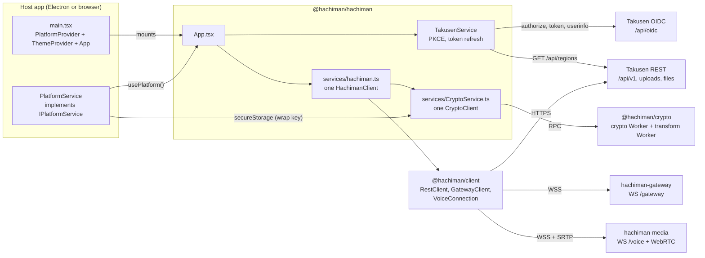
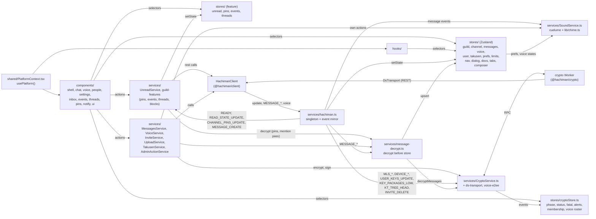
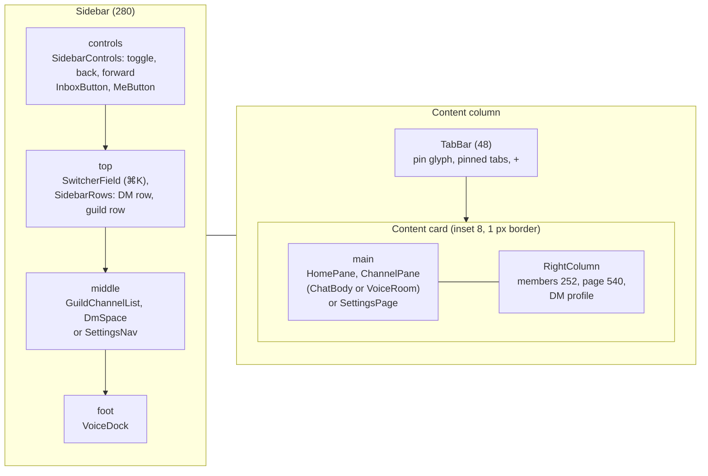
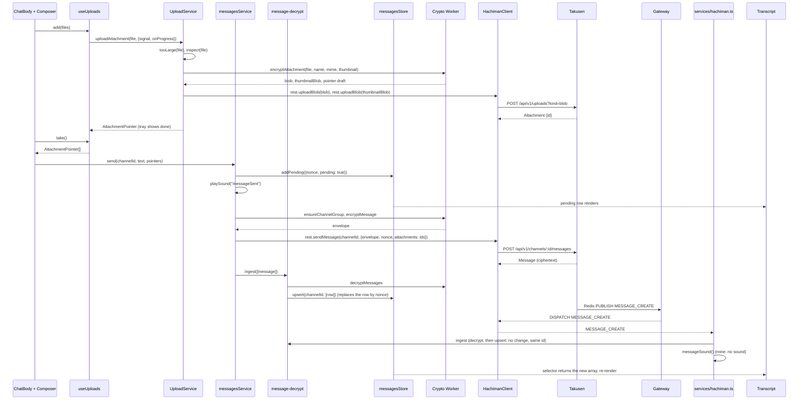
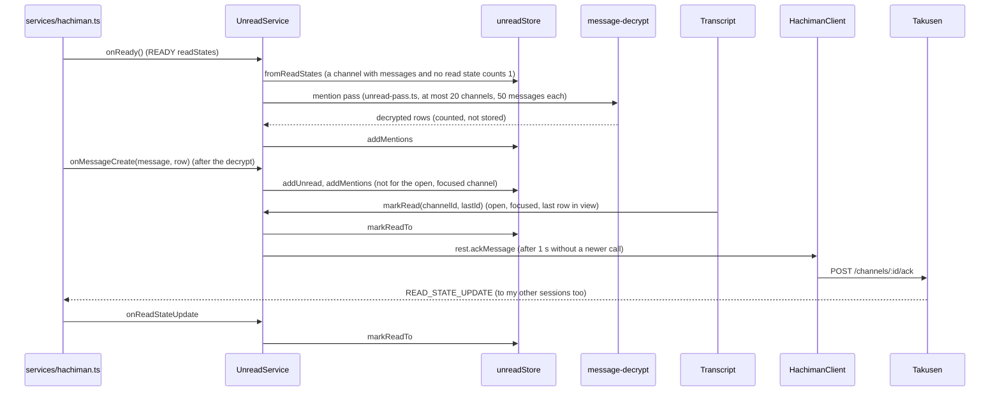
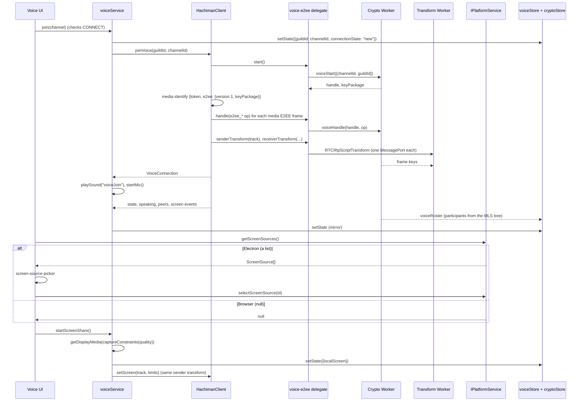
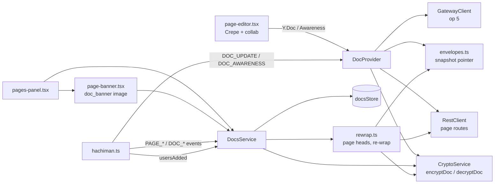

# @hachiman/hachiman

The shared React UI of Hachiman. All three host apps mount it: [`hachiman-electron`](../hachiman-electron/README.md), [`hachiman-browser`](../hachiman-browser/README.md) and [`hachiman-ios`](../hachiman-ios/README.md).
The package has no build step. Hosts import its TypeScript source and resolve the `@/` alias to `src/`.

References:

- Client API (`@hachiman/client`): [`docs/gateway-protocol.md`](../../docs/gateway-protocol.md) §10.
- Host seam (`IPlatformService`): [`docs/gateway-protocol.md`](../../docs/gateway-protocol.md) §11.
- E2EE (normative): [`docs/gateway-protocol.md`](../../docs/gateway-protocol.md) §12. The crypto package: [`pkgs/hachiman-crypto`](../../pkgs/hachiman-crypto/README.md).
- Visual spec (tokens, layout, transcript): [`docs/ui-redesign.md`](../../docs/ui-redesign.md).
- Repo conventions: [`CLAUDE.md`](../../CLAUDE.md).

## Where it fits



- The host renders `<PlatformProvider value={platformService}><ThemeProvider><App /></ThemeProvider></PlatformProvider>`.
- The host supplies only the platform seam. It does not create a client or a store.
- `services/hachiman.ts` creates the one `HachimanClient`. The access token comes from `takusenService.getAccessToken`. `App.tsx` calls `startHachiman(platform)`, so the crypto Worker gets the host's `secureStorage`. Without the platform, the crypto Worker does not start (there is no wrap key for its store).
- `CryptoService` starts the crypto Worker of the signed-in user. The gateway connects only when the Worker has a device id, because IDENTIFY needs it.
- `TakusenService` runs the OIDC PKCE flow and refreshes the token. The host only opens the authorization page and delivers the callback URL.
- `TakusenService` also reads the public region list and posts region RTTs to `/api/v1/regions/recommend`.
- `src/shared/takusen-env.ts` resolves the endpoints from `VITE_*` variables. It has no imports, so the Electron main process can use it for its CSP.

## Package surface

`package.json` exports:

| Export          | File                        | Use                                                                                                                                                                                       |
| --------------- | --------------------------- | ----------------------------------------------------------------------------------------------------------------------------------------------------------------------------------------- |
| `.`             | `src/index.ts`              | `App`, `ThemeProvider`, `PlatformProvider`, `usePlatform`, the `IPlatformService` types (with `InviteLink`), `takusenService`, `parseInviteLink`, `parseInviteCode`                       |
| `./shared/*`    | `src/shared/*`              | The platform seam files                                                                                                                                                                   |
| `./takusen-env` | `src/shared/takusen-env.ts` | `resolveTakusenEnv` (pure, for the Electron main process)                                                                                                                                 |
| `./invite-link` | `src/lib/invite-link.ts`    | `parseInviteLink`, `parseInviteCode`, `inviteKeyFragment`, `InviteLink`: a re-export of `@hachiman/client/invite-link` (pure, for the Electron main process and the hosts' `node --test`) |
| `./dev/*`       | `src/dev/*.ts`              | Preview mode (`./dev/preview/index`)                                                                                                                                                      |
| `./style.css`   | `src/assets/main.css`       | Tailwind v4 tokens and fonts                                                                                                                                                              |

`react` and `react-dom` are peer dependencies.

## Code architecture



Data flows in one direction:

1. A component calls a service, or `hachiman.rest` for a simple mutation.
2. Takusen commits the change and publishes the gateway event.
3. `HachimanClient` updates its cache and emits the event.
4. `services/hachiman.ts` copies the changed cache slice into a store. A message goes through the crypto Worker first.
5. Components re-render from their selectors.

Only `services/hachiman.ts` writes the mirror stores (`guildStore`, `channelStore`, `eventsStore`, and the voice states in `voiceStore`). `UnreadService` writes `unreadStore`. `PinsService` writes `pinsStore`. `threadService` writes the activity order in `threadsStore`. `MessagesService` writes optimistic rows into `messagesStore`. The decrypted server echo replaces each row by nonce.

### E2EE in the UI

- **CryptoService** owns the one `CryptoClient`. `start` gets the store wrap key from `IPlatformService.secureStorage` and calls `init`. `stop` disposes the Worker on sign-out. The Worker store stays on disk for the next sign-in. Every Worker event goes into `cryptoStore` and to the listeners of `on`.
- **ds-transport.ts** implements `DsTransport`. Each method calls one `RestClient` route, because the Worker never calls `fetch`. `channelReaders` comes from the client cache. Unknown data gives no readers, so the Worker fails closed.
- **Decrypt before store.** `message-decrypt.ts` sends every ciphertext `Message` to the Worker and upserts only the result. A `pending` result shows a placeholder, and `epochKeysAvailable` decrypts it again. A `failed` result shows an "unable to decrypt" row with the reason. No envelope goes into a store as text.
- **Send.** `MessagesService` calls `ensureChannelGroup` and `encryptMessage`, then posts the envelope. `UploadService` encrypts each attachment in the Worker and uploads only the blobs. The name, MIME type and dimensions go into the envelope.
- **Link previews** (§12.8.1). `MessagesService` asks `services/link-preview.ts` (`linkPreviewFor`) for a preview. When the setting is on and the host can fetch (Electron, iOS), it takes the first https link of the text. The host fetches the page (`IPlatformService.fetchLinkResource`), `lib/link-preview.ts` reads the OpenGraph tags, and `UploadService.uploadLinkImage` draws the image again as WebP and uploads it encrypted. The preview goes into the envelope; a send waits for it at most 8 s. Receivers never fetch: `components/chat/link-preview-card.tsx` shows the preview and its image through `use-decrypted-blob`.
- **Attachments** show as object URLs of decrypted blobs (`hooks/use-decrypted-blob.ts`, `lib/blob-url-cache.ts`). The cache loads each blob one time and releases a URL when no component holds it.
- **Voice.** `voice-e2ee.ts` is the `VoiceE2eeDelegate` of `@hachiman/client`. It makes one transform Worker per call and one sender transform per track. A media close 4013 makes `VoiceService` join again. The call UI shows the participants from the MLS tree (`components/voice/call-roster.ts`).
- **DM calls** (contract §6 "DM calls"). A DM or group DM is also a voice room: `VoiceService.join` sends op 4 with `guildId` null. `components/voice/dm-call.tsx` puts the stage above the transcript and a "Join call" banner for the others. `CallRingService` turns `CALL_RING` into `ringStore` and a looped `ring` chime, and `components/voice/incoming-call.tsx` shows Accept and Decline. `lib/call-ring.ts` decides when the ring stops.
- **Admin actions.** `AdminActionService` signs role, overwrite, member-role and history-visibility changes (§12.16) and sends them in `X-Hachiman-Signed-Action`.
- **Invites with history** (§12.11.4). An administrator switches on "Include history" in the invite window. `InviteService.createHistoryInvite` calls `prepareHistoryInvite`, creates the invite with the record and calls `sendInviteBundles`. The window shows the link with `#k=<key>` once, from component state. A host gives an opened link to `onInviteLink`. `App.tsx` keeps its key in a memory map of `InviteService`, and `JoinServerModal` reads it from there. After the join, `redeemWaitingInvites` calls `redeemInvite` when the Worker is ready and the guild members are in the cache (`hachiman.ts` calls it again on the ready status, `READY` and `GUILD_CREATE`). The Worker then joins each `channel` group of the scope at once, by external commit with an `InviteAuth` (no member must be online). After a transport error it tries again with a growing wait, during the fetch window. A final failure adds a security notice (`cryptoStore.inviteHistoryFailures`, guild ids only). When the Worker cannot start in this window (`LockHeld`), `JoinServerModal` asks the user to agree to a join without the history. The browser sign-in redirect keeps the key in `sessionStorage` only, and `App.tsx` deletes the keys of a sign-in that did not finish (`dropSignInInviteKeys`).
- **cryptoStore** holds the Worker phase, `CryptoStatus`, the fatal state (4012 `update_required`, 4013 `device_revoked`), key-change, fork and KT alerts, membership events and the voice roster. It never holds key material, a recovery key or an invite seed.

`SoundService.playSound` checks `prefsStore` (`soundsEnabled`, `disabledSounds`, `soundVolume`) before each sound. Message sounds come from `cuelume`. Voice sounds come from `lib/chime.ts` (Web Audio).

| Path                               | Contents                                                                                                                                                                                                                                                                                                                                                                                                                                                                                                                                                                                                                                                                                                                                                                                                                                                                                                      |
| ---------------------------------- | ------------------------------------------------------------------------------------------------------------------------------------------------------------------------------------------------------------------------------------------------------------------------------------------------------------------------------------------------------------------------------------------------------------------------------------------------------------------------------------------------------------------------------------------------------------------------------------------------------------------------------------------------------------------------------------------------------------------------------------------------------------------------------------------------------------------------------------------------------------------------------------------------------------- |
| `src/App.tsx`                      | App root. It holds the one `TooltipProvider`, calls `startHachiman(platform)`, and subscribes to `onOAuthCallback` and `onInviteLink`. It keeps the key of an invite link in `InviteService` memory, not in the dialog store. It shows `FatalScreen`, `Shell` inside `CryptoGate`, or `SignInScreen`, plus `Dialogs` and `SecurityNotices`.                                                                                                                                                                                                                                                                                                                                                                                                                                                                                                                                                                   |
| `src/index.ts`                     | Public exports of the package                                                                                                                                                                                                                                                                                                                                                                                                                                                                                                                                                                                                                                                                                                                                                                                                                                                                                 |
| `src/components/shell/`            | `Shell` and its layout (see "Shell layout" below). `Sidebar` (four slots), `SidebarControls`, the hide and reveal state (`sidebar-state.ts`, `use-sidebar-reveal.ts`), `TabBar` and `PinToTabsButton`, `QuickSwitcher` (⌘K), `SidebarRows` and `TileRow`, `MeButton`, the unread marks, the guild tint, the channel pane and its header, guild header and menus, the dialog host (`dialogs.tsx`)                                                                                                                                                                                                                                                                                                                                                                                                                                                                                                              |
| `src/components/chat/`             | Transcript with the NEW divider, message row and toolbar, reaction chips and picker (`reactions.tsx`), reply quote, page link cards (`page-cards.tsx`), channel intro, composer, typing line, the "unable to decrypt" text (`decrypt-text.ts`), MLS membership lines                                                                                                                                                                                                                                                                                                                                                                                                                                                                                                                                                                                                                                          |
| `src/components/chat/attachments/` | `useUploads`, upload tray, drop zone, attachment grid, audio card with waveform, lightbox                                                                                                                                                                                                                                                                                                                                                                                                                                                                                                                                                                                                                                                                                                                                                                                                                     |
| `src/components/inbox/`            | `InboxButton`: the Mentions and Unread popover, with "Mark read". `inbox-model.ts` builds the lists                                                                                                                                                                                                                                                                                                                                                                                                                                                                                                                                                                                                                                                                                                                                                                                                           |
| `src/components/events/`           | The guild event row, the details popover with the "Going" toggle, and the create and edit dialog                                                                                                                                                                                                                                                                                                                                                                                                                                                                                                                                                                                                                                                                                                                                                                                                              |
| `src/components/threads/`          | `ThreadsButton` (the thread list in the channel header), the create thread dialog, the thread name rules                                                                                                                                                                                                                                                                                                                                                                                                                                                                                                                                                                                                                                                                                                                                                                                                      |
| `src/components/pins/`             | `PinsButton` (the pin count and popover in the channel header), "Pin message" in the message menu, jump to a pinned message                                                                                                                                                                                                                                                                                                                                                                                                                                                                                                                                                                                                                                                                                                                                                                                   |
| `src/components/notify/`           | `NotifyButton` (the bell menu of a channel), `FollowButton` (a read-only channel), `NotifySettingsDialog` (the guild levels and mute)                                                                                                                                                                                                                                                                                                                                                                                                                                                                                                                                                                                                                                                                                                                                                                         |
| `src/components/voice/`            | Voice room, `stream-grid`, `screen-share-controls`, `screen-source-picker`, stream quality fields, self mute and deafen toggles, call security (`call-roster`, `call-security`, `verify-call-dialog`)                                                                                                                                                                                                                                                                                                                                                                                                                                                                                                                                                                                                                                                                                                         |
| `src/components/security/`         | `CryptoGate` (`onboarding.tsx`): the gate in front of `Shell`, and the onboarding (set up, link, restore, reset). Devices panel, device linking (QR and SAS emoji), verification, key-change dialog. Recovery key view and panel, security log and notices, the host trust label, fatal screens. `qr.ts` is a small QR encoder (no dependency). On the mobile layout, `CryptoGate` shows the start-up, start-error and onboarding screens as whole screens in `StepScreen` (`screen-window.tsx`), not as a Dialog over `EmptyWindow`. The mobile set-up screens (M16 with its sheets) are in `setup-screens.tsx`, and the done step in `setup-done.tsx` (`SetupDoneStep` in the window, `SetupDoneScreen` for M21). After an onboarding the gate stays on `SetupDoneScreen` until "Open Hachiman". The steps pick their form from the step-layout context in `onboarding-steps.ts` (`'dialog'` or `'screen'`) |
| `src/components/people/`           | `RightColumn` (members, pages, DM profile), `DmProfileColumn`, the guild pages list, Active now, custom status dialog and line, block dialog, new message dialog                                                                                                                                                                                                                                                                                                                                                                                                                                                                                                                                                                                                                                                                                                                                              |
| `src/components/settings/`         | Settings in the sidebar: `SettingsNav` (the section list in the sidebar middle) and `SettingsPage` (the page in the content card). `settings-model.tsx` holds the sections of the user, guild and channel settings. `SaveBar`, the guild and channel overview and permissions pages, the role hoist row. `user/` holds account, appearance, voice and sounds. `invites.ts`, `invite-options.tsx`, `invite-history-option.tsx` and `permanent-invite-confirm.tsx` hold the invite choices (more than 24 hours, permanent and "Include history" only for an administrator), the scope of an invite with history, and the permanent-invite warning. `use-invite-creation.ts` holds the create flow that the invite window and the Invites tab share: the options, and the warning before a permanent invite. The guild settings dialogs are in `src/components/`.                                                |
| `src/components/mobile/`           | The mobile kit (`docs/ios-mobile-ui-spec.md` §3), only for the mobile layout: `Sheet` (a bottom sheet on Radix Dialog, with the handle drag), `PushedScreen` with `ScreenStackProvider` and `usePushScreen`, `NavBar` with `NavAction`, `ListGroup` and `ListRow`, `MobileFoot`, `FilterChips` and `MobileField`. `MobileShell` (the mobile shell: tab strip, chat card, the left and right `Drawer`, the swipes in `use-swipe.ts`, the drawer store in `drawer-state.ts`) and `MenuSheet` (the mobile form of the dropdown, context and popover primitives)                                                                                                                                                                                                                                                                                                                                                  |
| `src/components/ui/`               | shadcn and local primitives (dialog, tooltip, avatar, title bar) and the Arc primitives (badge, callout, checkbox, chip, keycap, radio card, segmented control, system tag, `feature.ts`). See `docs/ui-redesign.md` §5                                                                                                                                                                                                                                                                                                                                                                                                                                                                                                                                                                                                                                                                                       |
| `src/components/*.tsx`             | Channel sidebar (`GuildChannelList`, `DmSpace`), home pane, member list, voice dock (`voice-connected-panel.tsx`), guild and channel dialogs, user profile popover, sign-in screen                                                                                                                                                                                                                                                                                                                                                                                                                                                                                                                                                                                                                                                                                                                            |
| `src/stores/`                      | Zustand stores. `prefsStore` (also the sidebar mode, the guild order and notification levels per account), `navStore` (the view, not the history), `takusenStore` (session) and part of `voiceStore` (mute, deafen) persist to `localStorage`. `tabsStore` writes `hachiman:tabs:<userId>`. `unreadStore`, `pinsStore`, `eventsStore`, `threadsStore`, `composerStore` and `cryptoStore` are memory only.                                                                                                                                                                                                                                                                                                                                                                                                                                                                                                     |
| `src/services/`                    | `hachiman.ts`, `CryptoService`, `ds-transport`, `message-decrypt`, `voice-e2ee`, `MessagesService`, `VoiceService`, `InviteService`, `UploadService`, `AdminActionService`, `TakusenService`, `SoundService`, `UnreadService` with `unread-pass.ts`, `PinsService`, `guild-features.ts` (`pinsService`, `eventsService`, `threadService`, `blockService`, `setCustomStatus`)                                                                                                                                                                                                                                                                                                                                                                                                                                                                                                                                  |
| `src/hooks/`                       | `use-hachiman` (derived channel and voice lists), `use-member`, `use-app-shortcuts`, `use-custom-status`, `use-elapsed`, `use-sign-in`, `use-recommended-region`, `use-mic-level`, `use-action`, `use-draft`, `use-decrypted-blob`, `use-membership-timeline`, the layout hooks (`use-layout`, `use-visual-viewport`, `use-native-appearance`, `use-long-press`) and others                                                                                                                                                                                                                                                                                                                                                                                                                                                                                                                                   |
| `src/lib/`                         | Pure helpers: `sidebar-reveal`, `right-column`, `quick-switcher`, `reactions`, `notify`, `guild-tint`, `active-now`, `custom-status`, `member-groups`, `channel-access`, `waveform`, `sounds`, `chime`, `stream-quality`, `connection-quality`, `mentions`, `model`, `role-ink`, `format-bytes`, `attachments` (upload id order), `blob-url-cache`, `invite-link` (re-export of `@hachiman/client/invite-link`), `admin-payload`, `client-version`, `long-press`, `drag-commit`, `swipe`, `mobile-drawer` (the drawer close rule), `auto-select` (marks the app's own channel pick), `accessible-name`, `focus-opener`, `css-color`, `media-caps` (can the host share a screen), `tile-cutouts` (the mask holes of the mobile tiles), `theme`, `utils`                                                                                                                                                        |
| `src/shared/`                      | `IPlatformService.ts`, `PlatformContext.tsx`, `takusen-env.ts`                                                                                                                                                                                                                                                                                                                                                                                                                                                                                                                                                                                                                                                                                                                                                                                                                                                |
| `src/dev/preview/`                 | Preview mode: fixture, REST and voice stubs, the crypto stub                                                                                                                                                                                                                                                                                                                                                                                                                                                                                                                                                                                                                                                                                                                                                                                                                                                  |
| `src/assets/`                      | `main.css` and the bundled fonts                                                                                                                                                                                                                                                                                                                                                                                                                                                                                                                                                                                                                                                                                                                                                                                                                                                                              |

## Layout switch

The shared UI has two layouts: `desktop` and `mobile` (`docs/ios-mobile-ui-spec.md` §2.2). `useLayout()` (`hooks/use-layout.ts`) gives `mobile` on the iOS host, in a window narrower than 768 px, and on a short touch screen. `App.tsx` writes the value to `<html data-layout>`. Code outside React reads it with `layoutNow()`. The `mobile:` Tailwind variant (`assets/main.css`) matches under `[data-layout=mobile]`, also in Radix portals. Use it for mobile-only classes, so the desktop does not change.

- `useVisualViewport` sets `--app-height` (the visible height), `--kb` (the keyboard height) and `data-keyboard="open"` on `<html>`. The root and the sheets use them, so nothing goes under the keyboard.
- `useNativeAppearance` sends the resolved theme and the window colour to `IPlatformService.setAppearance` (the iOS status bar and the area behind the safe areas). `App.tsx` mounts the base colour. A screen with a tinted window passes its own colour.
- `App.tsx` renders `MobileShell` (`components/mobile/mobile-shell.tsx`) on the mobile layout and `Shell` on the desktop. In `components/ui`, `DialogContent` takes `presentation` (`sheet`, the mobile default, `dialog` or `fullscreen`), and the dropdown, context-menu and popover exports render `MenuSheet` or a `Sheet` on mobile.
- `useLongPress` (over the pure `lib/long-press.ts`) is the hold gesture of the hold menus. It stops on a move or a scroll and swallows the click after a hold.
- The mobile chat pane (`mobile-chat-pane.tsx`) has `MobileChannelHeader` (the title opens `ChannelInfoSheet`), the transcript and `MobileChatFooter` (typing line, `VoiceBar`, composer, safe bottom). `ChatBody` shares its state with the desktop footer through `useChannelChat`. `focusComposer()` focuses the composer inside a tap, so iOS raises the keyboard.
- A hold on a message opens `MessageActionSheet` (lifted row, `QuickReactions`, the actions). The desktop toolbar, the More menu and the sheet all take their items from `useMessageActions` (`components/chat/message-actions.ts`). A hold on a member opens `MemberSheet`. A tap opens the profile as a sheet.
- Tabs, guild tiles and channel rows use `useDragSensors` and `useSortableHoldMenu` (`hooks/use-sortable-row.ts`): on touch, hold and release opens the row menu, and hold and move reorders.
- Settings on mobile: `settings-host.tsx` shows `SettingsList` (M29) with `SettingsScreen` pushed over it for the user and channel targets, and `SectionTabs` for a guild. The model gives each target its `layout` (`list` or `tabs`). The red user row opens the `signOut` dialog. `SaveBar layout="foot"` is the docked mobile foot. Each page opts in.

## Shell layout

`components/shell/shell.tsx` gives the signed-in layout (`docs/ui-redesign.md` §6, §7). The window is a wallpaper that the guild tints (`use-guild-tint.ts`). The sidebar and the content column sit on it.



- `Sidebar` has four slots: `controls`, `top`, `middle` and `foot`. The controls row is the window drag region. With an inset title bar, it starts after the traffic lights.
- `SidebarRows` shows two `TileRow`s: the four most recent DMs and the first four guilds, each with a fifth cluster tile (`lib/sidebar-tiles.ts`). The DM cluster opens the DM home. The guild cluster opens a grid of every guild, five a line.
- Settings use the sidebar. `SettingsNav` replaces the sidebar middle, and `SettingsPage` shows in the content card. `navStore.settings` holds the open settings view.
- The sidebar has three states: docked, hidden and revealed (`sidebar-state.ts`, `use-sidebar-reveal.ts`, `lib/sidebar-reveal.ts`). When it is hidden, the card takes the window width, `TabBar` shows the sidebar controls, search and inbox, and the voice dock floats in the bottom-left corner of the card. The composer moves right by `--dock-inset`, so the dock does not cover it.
- `TabBar` shows the pinned tabs of `tabsStore`. A tab lights up when its target is the open view. `PinToTabsButton` and `PinToTabsMenuItem` pin a view from the channel intro, the page header and the context menus.
- `RightColumn` opens by default on windows of 1200 px and wider. The header toggle overrides the default.
- `QuickSwitcher` is mounted once in the shell. `useSwitcherShortcut` opens it on ⌘K.

## Send a message with an attachment



The composer refuses to send while an upload runs or after an upload fails. If the send fails, `markFailed` flags the row. The user can then retry or discard it. A retry encrypts again and sends the same attachment ids, because Takusen did not claim them. A `StaleEpoch`, `GroupPending`, `EpochConflict` or `PendingRemoves` error makes `MessagesService` catch up and encrypt again, with at most 4 attempts in total.

## Unread and ack



- Mentions are counted on the client only, because the server cannot read them. The mention pass runs after READY, when the crypto Worker is ready.
- The unread count is an upper bound. The server counts every message row, also reactions.
- The NEW divider uses the read state that the channel had when it opened (`unreadStore.opened`). It stays until another channel opens.
- `useChannelUnread`, `useGuildUnread`, `useDmUnread` and `useAnyMention` apply the notification levels and the mutes of `prefsStore` (`lib/notify.ts`). The channel rows, the sidebar tile rows, the tabs and the inbox dot read them.
- `InboxButton` shows the mention ids of `unreadStore` and the channels with unread messages. "Mark read" calls `markRead`.

## Reactions

A reaction is an encrypted message with its own envelope content kind (contract §12.8.1). The server stores it as a normal message row.

- **Send a reaction.** `MessagesService.react` folds the reaction into `messagesStore` at once (`applyReactions`), encrypts a `reaction` kind with the target client_msg_id, and posts it. A failed send takes the reaction back.
- **Receive a reaction.** `message-decrypt.ts` gives a `reaction` result to `deps.reactions`, never to a row. `messagesStore.applyReactions` keeps the newest event per (user, emoji) and target (`reactionLog`), and folds them into `reactions`. The fold is by client_msg_id, so a reaction whose target is not loaded shows when the target loads. `components/chat/reactions.tsx` shows the chips (`lib/reactions.ts`).
- **Page edits** do not show in the chat. `message-decrypt.ts` drops a received `page_activity` kind (the protocol keeps it), and the UI does not post one.

## Voice join and screen share



The browser shows its own share picker inside `getDisplayMedia`. In Electron, the main process answers `getDisplayMedia` with the selected source. See [`hachiman-electron`](../hachiman-electron/README.md#screen-share-source-pick).

A media close 4012 shows "update required" in the call UI. A media close 4013 sets `voiceResyncing`, and `VoiceService` joins the same channel again with a new leaf and new transforms.

## Pages channel

A `pages` channel shows the chat in the center and the page in the right column (`components/people/right-column.tsx`, 540 wide). The column head switches between Members and Pages. In a text channel, the Pages tab lists the pages of all pages channels of the guild (`people/guild-pages-list.tsx`), and one page opens beside the chat at 540. Page labels ("RFC", "Draft") are in the `Y.Doc` (`docs/page-labels.tsx`), so they are encrypted with the page.

| Path                                                       | What                                                                                                                                                                                                                                                                                                                                                                                                                                                                                                                                                    |
| ---------------------------------------------------------- | ------------------------------------------------------------------------------------------------------------------------------------------------------------------------------------------------------------------------------------------------------------------------------------------------------------------------------------------------------------------------------------------------------------------------------------------------------------------------------------------------------------------------------------------------------- |
| `components/docs/pages-panel.tsx`                          | The panel: banner, breadcrumb with the title field (`page-title-field.tsx`, editors only, `renamePage`), page tree popover, presence avatars, copy as markdown, the editor.                                                                                                                                                                                                                                                                                                                                                                             |
| `components/docs/page-banner.tsx`                          | The banner of a page: the `doc_banner` image of its top-level page (contract §12.20), shown through `use-decrypted-blob`. Sub-pages show it read-only. Editors add, change and remove it on the top-level page (`DocsService.setBanner`). `panel` and `screen` variants.                                                                                                                                                                                                                                                                                |
| `components/docs/page-editor.tsx`                          | Milkdown Crepe bound to the page `Y.Doc` and awareness through `@milkdown/plugin-collab`. Read-only without SEND_MESSAGES.                                                                                                                                                                                                                                                                                                                                                                                                                              |
| `components/docs/page-links.ts`, `page-picker.tsx`         | Links with the target `hachiman:page/<id>`, shown with the current title. Slash menu items "Link to page" and "New sub-page".                                                                                                                                                                                                                                                                                                                                                                                                                           |
| `components/docs/page-media.tsx`, `services/docs/media.ts` | Drop or paste a file: encrypt, upload, claim, then insert an `hm_media` node that holds the pointer. Shown through `use-decrypted-blob`. A copy puts only the upload id on the clipboard, never the file key.                                                                                                                                                                                                                                                                                                                                           |
| `services/docs/DocsService.ts`                             | The page tree per channel, title encryption, the `PAGE_*` events, into `docsStore`.                                                                                                                                                                                                                                                                                                                                                                                                                                                                     |
| `services/docs/titles.ts`                                  | Pure title rules: the node of a page from its decrypt result, and the merge into the stored node (a decrypted title stays while a newer envelope is pending). `createPageTitles` owns the titles that wait for keys: it decrypts and stores titles, retries the pending ones, and does one group catch-up per channel when a title is of an epoch that the Worker did not apply yet. `DocsService` only wires it.                                                                                                                                       |
| `services/docs/page-tree.ts`                               | Pure tree helpers: depth-first rows, path, subtree, positions. A drop is usually one PATCH (the midpoint between the new neighbours).                                                                                                                                                                                                                                                                                                                                                                                                                   |
| `services/docs/DocProvider.ts`                             | One `Y.Doc` and awareness per open page: load the snapshot and updates, batch local updates (100 ms), encrypt and post, apply remote updates, fill `seq` gaps, post snapshots. An idle page gets its snapshot pointer re-wrapped instead. A page that waits for keys (for its snapshot or for an update) retries slowly and reads the state again, so a newer snapshot opens it. `DocAwareness.ts` relays awareness through gateway op 5.                                                                                                               |
| `services/docs/envelopes.ts`                               | The snapshot pointer of a page: is it stale (another group or an older epoch), open it (decrypt it as a `doc_snapshot` of the page, parse it, and make sure that it names the upload of the row), and re-wrap it in the current epoch. `DocProvider` and `rewrap.ts` both use it, so the reader and the re-wrapper accept the same pointers.                                                                                                                                                                                                            |
| `services/docs/rewrap.ts`                                  | The re-wrap pass for new members (contract §12.20 "Access by new members"). The Worker event `usersAdded` starts it: at once and after the epoch grace on the committer, after 12 to 20 s on the other members. Per pages channel of the group, it reads the page heads, re-wraps stale snapshot pointers and titles, and loads a closed page with updates after a stale snapshot (or with no snapshot) into a headless provider, to post a full snapshot. Only the committer's second pass also loads the pages with updates after a current snapshot. |



## Conventions

Read [`CLAUDE.md`](../../CLAUDE.md#working-in-the-shared-ui-appshachimansrc) before you change this package. These rules are the most important:

- Zustand selectors must not return a new array or object. Use `useShallow` or a module-level empty constant. See [Zustand selector conventions](../../CLAUDE.md#zustand-selector-conventions).
- There is one `TooltipProvider`, in `App.tsx`. Do not add another.
- Components get host features only through `usePlatform()`. Do not import Electron or browser code.
- Read `me` from `useUserStore`. Do not hardcode user data.
- Decrypt before store. Only `message-decrypt.ts` puts message rows from the server into `messagesStore`.
- Show an attachment only through `useDecryptedBlob`. Do not set its `src` to a file URL. Avatars, icons and guild banners stay plaintext. A page banner is E2EE: it shows only through `useDecryptedBlob`.
- Do not put key material, a recovery key or an envelope into a store. The recovery key stays in the component state of the dialog that shows it.
- Show other users' device names from the device certificates (`components/security/device-names.ts`), not from the REST `Device.name`.

## Preview mode

Open the browser host dev server with `?preview`. The browser host then calls `startPreview()` from `./dev/preview/index` before it renders. Stubbed REST and gateway data seed the stores, so the UI runs without Takusen or a gateway. The crypto client is `createCryptoStub`. It has no Worker and no keys, and it marks its envelopes "NOT ENCRYPTED". Production builds do not include it.

Options: `?preview=signedout`, `&theme=light`, `&display=compact`. The fixture and stub details are in [`src/dev/README.md`](src/dev/README.md).

## Commands

```bash
pnpm -F @hachiman/hachiman typecheck   # tsgo --noEmit -p tsconfig.web.json --composite false
pnpm -F @hachiman/hachiman lint        # eslint --cache .
pnpm -F @hachiman/hachiman format      # prettier --write .
pnpm -F @hachiman/hachiman shadcn:add <component>   # adds to src/components/ui (components.json)
pnpm -F @hachiman/hachiman test        # vitest run --config src/dev/vitest.config.ts
```

This package has no `dev` script. Run it through a host: `pnpm dev:browser` or `pnpm dev:electron`.

The unit tests (`src/**/*.test.ts`) cover the services, hooks and helpers. Examples are the decrypt order, the DS transport, the voice delegate, the QR encoder and the recovery key input. Run them with `pnpm -F @hachiman/hachiman test`. The `vitest` devDependency of this package needs a `pnpm install` outside the sandbox. Until then, or inside the sandbox, run the binary of a sibling package from `apps/hachiman`:

```bash
../../pkgs/hachiman-client/node_modules/.bin/vitest run --config src/dev/vitest.config.ts
```
