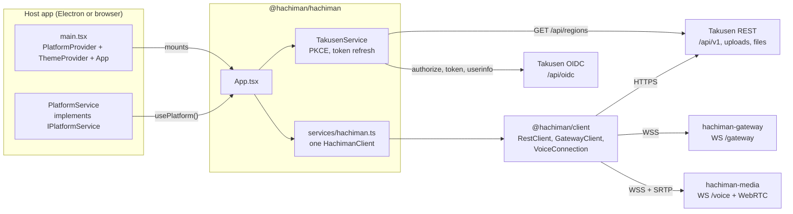
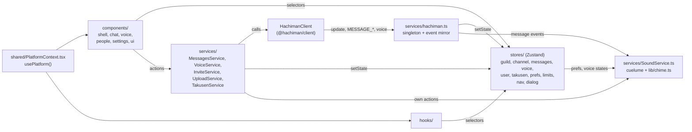
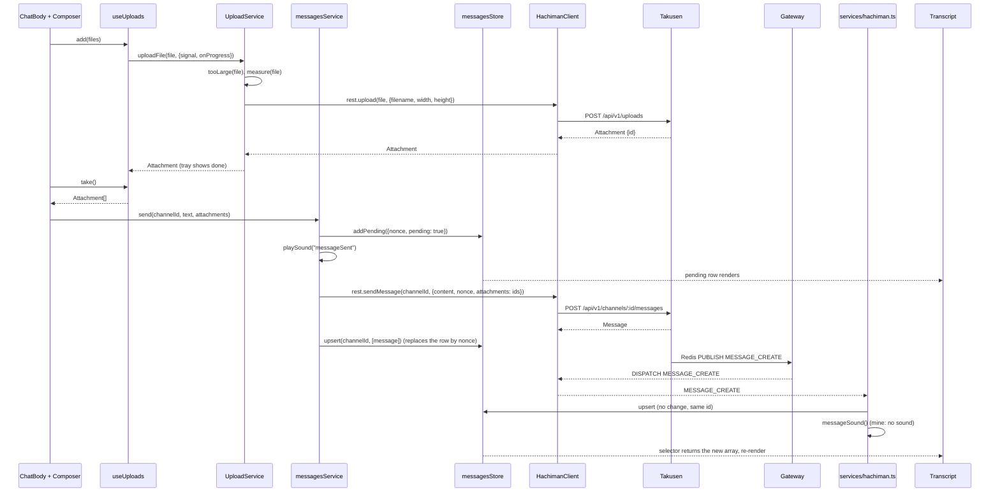
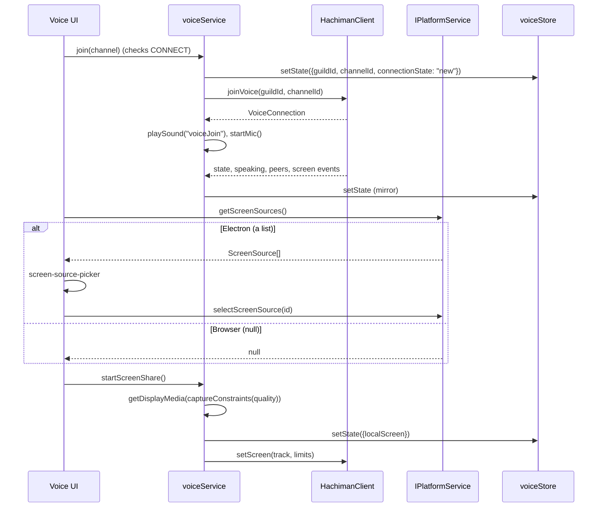

# @hachiman/hachiman

The shared React UI of Hachiman. Both host apps mount it: [`hachiman-electron`](../hachiman-electron/README.md) and `hachiman-browser`.
The package has no build step. Hosts import its TypeScript source and resolve the `@/` alias to `src/`.

References:

- Client API (`@hachiman/client`): [`docs/gateway-protocol.md`](../../docs/gateway-protocol.md) §10.
- Host seam (`IPlatformService`): [`docs/gateway-protocol.md`](../../docs/gateway-protocol.md) §11.
- Visual spec (tokens, layout, transcript): [`docs/ui-redesign.md`](../../docs/ui-redesign.md).
- Repo conventions: [`CLAUDE.md`](../../CLAUDE.md).

## Where it fits



- The host renders `<PlatformProvider value={platformService}><ThemeProvider><App /></ThemeProvider></PlatformProvider>`.
- The host supplies only the platform seam. It does not create a client or a store.
- `services/hachiman.ts` creates the one `HachimanClient`. The access token comes from `takusenService.getAccessToken`.
- `TakusenService` runs the OIDC PKCE flow and refreshes the token. The host only opens the authorization page and delivers the callback URL.
- `TakusenService` also reads the public region list and posts region RTTs to `/api/v1/regions/recommend`.
- `src/shared/takusen-env.ts` resolves the endpoints from `VITE_*` variables. It has no imports, so the Electron main process can use it for its CSP.

## Package surface

`package.json` exports:

| Export | File | Use |
|---|---|---|
| `.` | `src/index.ts` | `App`, `ThemeProvider`, `PlatformProvider`, `usePlatform`, the `IPlatformService` types, `takusenService`, `parseInviteCode` |
| `./shared/*` | `src/shared/*` | The platform seam files |
| `./takusen-env` | `src/shared/takusen-env.ts` | `resolveTakusenEnv` (pure, for the Electron main process) |
| `./dev/*` | `src/dev/*.ts` | Preview mode (`./dev/preview/index`) |
| `./style.css` | `src/assets/main.css` | Tailwind v4 tokens and fonts |

`react` and `react-dom` are peer dependencies.

## Code architecture



Data flows in one direction:

1. A component calls a service, or `hachiman.rest` for a simple mutation.
2. Takusen commits the change and publishes the gateway event.
3. `HachimanClient` updates its cache and emits the event.
4. `services/hachiman.ts` copies the changed cache slice into a store.
5. Components re-render from their selectors.

Only `services/hachiman.ts` writes the mirror stores (`guildStore`, `channelStore`, and the voice states in `voiceStore`). `MessagesService` writes optimistic rows into `messagesStore`. The server echo replaces each row by nonce.

`SoundService.playSound` checks `prefsStore` (`soundsEnabled`, `disabledSounds`, `soundVolume`) before each sound. Message sounds come from `cuelume`. Voice sounds come from `lib/chime.ts` (Web Audio).

| Path | Contents |
|---|---|
| `src/App.tsx` | App root. It holds the one `TooltipProvider`, calls `startHachiman()`, and subscribes to `onOAuthCallback` and `onInviteCode`. It shows `Shell` or `SignInScreen`, plus `Dialogs`. |
| `src/index.ts` | Public exports of the package |
| `src/components/shell/` | `Shell`, channel pane, guild header and menus, the dialog host (`dialogs.tsx`) |
| `src/components/chat/` | Transcript, message row and toolbar, composer, typing line |
| `src/components/chat/attachments/` | `useUploads`, upload tray, drop zone, attachment grid, lightbox |
| `src/components/voice/` | Voice room, `stream-grid`, `screen-share-controls`, `screen-source-picker`, stream quality fields, self mute and deafen toggles |
| `src/components/people/` | Member list sections by presence |
| `src/components/settings/` | Settings layout. `user/` holds account, appearance, voice and sounds. The guild settings dialogs are in `src/components/`. |
| `src/components/ui/` | shadcn and local primitives (dialog, tooltip, avatar, window strip, title bar) |
| `src/components/*.tsx` | Server icon rail, channel sidebar, member list, voice panel, guild and channel dialogs, sign-in screen |
| `src/stores/` | Zustand stores. `prefsStore`, `navStore`, `takusenStore` (session) and part of `voiceStore` (mute, deafen) persist to `localStorage`. |
| `src/services/` | `hachiman.ts`, `MessagesService`, `VoiceService`, `InviteService`, `UploadService`, `TakusenService`, `SoundService` |
| `src/hooks/` | `use-hachiman` (derived channel and voice lists), `use-member`, `use-sign-in`, `use-recommended-region`, `use-mic-level`, `use-action`, `use-draft` and others |
| `src/lib/` | Pure helpers: `sounds`, `chime`, `stream-quality`, `connection-quality`, `mentions`, `model`, `role-ink`, `format-bytes`, `utils` |
| `src/shared/` | `IPlatformService.ts`, `PlatformContext.tsx`, `takusen-env.ts` |
| `src/dev/preview/` | Preview mode: fixture, REST and voice stubs |
| `src/assets/` | `main.css` and the bundled fonts |

## Send a message with an attachment



The composer refuses to send while an upload runs or after an upload fails. If `rest.sendMessage` fails, `markFailed` flags the row. The user can then retry or discard it. A retry sends the same attachment ids again, because Takusen did not claim them.

## Voice join and screen share



The browser shows its own share picker inside `getDisplayMedia`. In Electron, the main process answers `getDisplayMedia` with the selected source. See [`hachiman-electron`](../hachiman-electron/README.md#screen-share-source-pick).

## Conventions

Read [`CLAUDE.md`](../../CLAUDE.md#working-in-the-shared-ui-appshachimansrc) before you change this package. These rules are the most important:

- Zustand selectors must not return a new array or object. Use `useShallow` or a module-level empty constant. See [Zustand selector conventions](../../CLAUDE.md#zustand-selector-conventions).
- There is one `TooltipProvider`, in `App.tsx`. Do not add another.
- Components get host features only through `usePlatform()`. Do not import Electron or browser code.
- Read `me` from `useUserStore`. Do not hardcode user data.

## Preview mode

Open the browser host dev server with `?preview`. The browser host then calls `startPreview()` from `./dev/preview/index` before it renders. Stubbed REST and gateway data seed the stores, so the UI runs without Takusen or a gateway. Production builds do not include it.

Options: `?preview=signedout`, `&theme=light`, `&display=compact`. The fixture and stub details are in [`src/dev/README.md`](src/dev/README.md).

## Commands

```bash
pnpm -F @hachiman/hachiman typecheck   # tsgo --noEmit -p tsconfig.web.json --composite false
pnpm -F @hachiman/hachiman lint        # eslint --cache .
pnpm -F @hachiman/hachiman format      # prettier --write .
pnpm -F @hachiman/hachiman shadcn:add <component>   # adds to src/components/ui (components.json)
```

This package has no `dev` script and no tests. Run it through a host: `pnpm dev:browser` or `pnpm dev:electron`.
