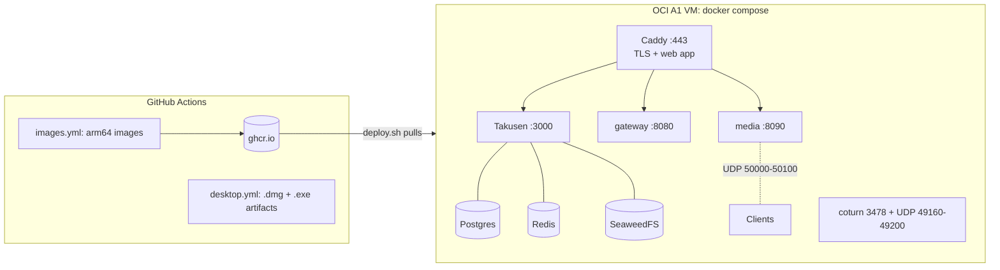

# infra

Deploys Hachiman to one Oracle Cloud Always Free Ampere A1 VM (arm64, 2 OCPU, 12 GB) in Sydney or Melbourne.



| File | What it does |
|---|---|
| `oci/` | OpenTofu: VCN, subnet, security list, the A1 VM, a reserved public IP |
| `oci/cloud-init.yaml.tftpl` | First boot: Docker, host firewall, nightly `pg_dump` cron, idle-reclaim guard |
| `compose.yml` | The stack. App services use host networking and listen on loopback, except Caddy, media UDP and coturn |
| `Caddyfile` | `<domain>`: Takusen, `/gateway`, `/voice`. `app.<domain>`: the web app with its CSP header |
| `bootstrap-env.sh` | Runs on the VM. Writes `.env` with new secrets on the first deploy only |
| `deploy.sh` | Copies the files, writes `.env`, pulls the images, runs the migrations, starts the stack. CI runs it on each push to `main` |

## First deploy

1. Make an Oracle Cloud account. Pick Sydney or Melbourne as the home region. You cannot change it later.
2. Install the [OCI CLI](https://docs.oracle.com/en-us/iaas/Content/API/SDKDocs/cliinstall.htm) and run `oci setup config`. It writes `~/.oci/config` and an API key.
3. Install [OpenTofu](https://opentofu.org/docs/intro/install/).
4. Create the VM:
   ```bash
   cd infra/oci
   cp terraform.tfvars.example terraform.tfvars   # set tenancy_ocid and region
   tofu init && tofu apply
   ```
   If the apply fails with "Out of host capacity", run it again later. Free A1 capacity in Australia is often full.
5. Add two DNS A records that point at the `public_ip` output: `<domain>` and `app.<domain>`.
6. Make a deploy key for GitHub Actions and allow it on the VM:
   ```bash
   ssh-keygen -t ed25519 -N '' -f deploy_key
   ssh-copy-id -i deploy_key.pub ubuntu@<ip>
   ssh-keyscan <ip> > known_hosts
   ```
7. In GitHub (Settings > Secrets and variables > Actions), set:
   - Variables: `HACHIMAN_DOMAIN` (for example `chat.example.com`) and `DEPLOY_HOST` (the `public_ip` output).
   - Secrets: `DEPLOY_SSH_KEY` (the contents of `deploy_key`) and `DEPLOY_KNOWN_HOSTS` (the contents of `known_hosts`).

   Then delete the local `deploy_key` file. If you set `ssh_source_cidr` to your own IP, GitHub's runners cannot connect: keep `0.0.0.0/0`.
8. Run the **Images** workflow (Actions > Images > Run workflow).
9. Sign up in the web app at `https://app.<domain>`. Then make yourself an admin:
   ```bash
   ssh ubuntu@<ip> 'cd /opt/hachiman && docker compose run --rm migrate pnpm admin:grant you@example.com'
   ```

## Deploys

Each push to `main` that changes a server app, a package, `infra/compose.yml`, `infra/Caddyfile` or `infra/*.sh` runs the **Images** workflow:

1. It builds the four images and pushes them to GHCR as `:latest` and `:<sha>`.
2. It runs `deploy.sh` with that sha. The deploy pulls the images, runs the migrations (`db:migrate`, then `db:seed`), and then starts the new containers. If a migration fails, the deploy stops and the old containers keep running.
3. It deletes all image versions except the newest 10 of each image.

The `production` environment and a concurrency group serialize the deploys. To add a manual approval, add a required reviewer to the `production` environment in the repository settings.

To deploy from your machine, for example to roll back to one commit:

```bash
DOMAIN=chat.example.com GHCR_TOKEN=<PAT with read:packages> IMAGE_TAG=<sha> infra/deploy.sh
```

GHCR storage and bandwidth for container images are free at this time. GitHub gives at least one month of notice before it starts to charge.

## Desktop builds

The **Desktop** workflow builds an Apple Silicon `.dmg` and a Windows `.exe` on each push to `main` that changes the app. Download them from the newest release in the `hachiman-release` repository (`hachiman-macos.zip`, `hachiman-windows.zip`). The installed apps update themselves from that release when Takusen has `TAKUSEN_UPDATE_GITHUB_REPO` and `TAKUSEN_UPDATE_GITHUB_TOKEN` in `/opt/hachiman/.env` (contract §4 Desktop updates). The builds have no trusted signature (the macOS app is ad-hoc signed):

- macOS: open the app once and close the warning. Then select **Open Anyway** in System Settings → Privacy & Security.
- Windows: in the SmartScreen dialog, select **More info** and then **Run anyway**.

macOS runners use 10 times the plan minutes in a private repository.

## Back up

- `/opt/hachiman/.env`: all secrets. Nothing else has a copy.
- `/opt/hachiman/data/keys/`: the DS, KT and voice signing keys, the Web Push (VAPID) key and the APNs `.p8` key. If you lose the DS and KT keys, E2EE delivery and key transparency break for all devices. If you lose the VAPID key, browser push stops until each browser opens the app again.

**Push notifications** (contract §4 Push). Each deploy adds `TAKUSEN_VAPID_KEY=/keys/takusen-vapid.p256` and `TAKUSEN_VAPID_SUBJECT=mailto:admin@<domain>` to `/opt/hachiman/.env` when they are missing (also on a server set up before push). Change the subject in `.env` to a real contact; later deploys keep it. iOS push needs an APNs key from developer.apple.com (Keys → Apple Push Notifications service). Add the GitHub secrets `APNS_KEY_P8` (`base64 -i AuthKey_<key id>.p8`) and `APNS_KEY_ID`. The team and the topic are the variables `APPLE_TEAM_ID` and `HACHIMAN_BUNDLE_ID` of the iOS workflow. The next deploy writes the key to `data/keys/apns.p8` (mode 600) and sets the four `TAKUSEN_APNS_*` lines. Without the secrets, a deploy changes no APNs setting.
- `/opt/hachiman/backups/`: the nightly database dumps, one file for each weekday.
- `/opt/hachiman/data/seaweedfs/`: the uploaded files (ciphertext).

These files are all on one VM. Copy them to another place, for example Cloudflare R2.

## Limits

- **Idle reclaim.** Oracle reclaims an Always Free VM when its 95th percentile CPU, network and memory use stays under 20% for 7 days. The cron job in `oci/cloud-init.yaml.tftpl` keeps one core busy for 2 minutes in every 10. Upgrade the account to Pay As You Go and remove the job: the free allowance stays the same.
- **Region.** Media registers as `ap-southeast`, the nearest seeded region. Add a Sydney region to `apps/takusen/src/db/seed.ts` when placement needs it.
- **TURN over TLS.** coturn serves only plain TURN on 3478 (UDP and TCP). Clients behind a firewall that allows only 443 cannot connect to voice.
