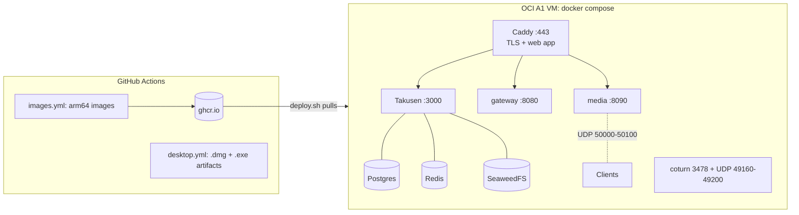

# infra

Deploys Hachiman to one Oracle Cloud Always Free Ampere A1 VM (arm64, 2 OCPU, 12 GB) in Sydney or Melbourne.



| File | What it does |
|---|---|
| `oci/` | OpenTofu: VCN, subnet, security list, the A1 VM, a reserved public IP |
| `oci/cloud-init.yaml.tftpl` | First boot: Docker, host firewall, nightly `pg_dump` cron, idle-reclaim guard |
| `compose.yml` | The stack. App services use host networking and listen on loopback, except Caddy, media UDP and coturn |
| `Caddyfile` | `<domain>`: Takusen, `/gateway`, `/voice`. `app.<domain>`: the web app with its CSP header |
| `bootstrap-env.sh` | Runs on the VM. Writes `.env` with new secrets on the first deploy only |
| `deploy.sh` | Copies the files, writes `.env`, pulls the images, starts the stack |

## First deploy

1. Make an Oracle Cloud account. Pick Sydney or Melbourne as the home region. You cannot change it later.
2. Install the [OCI CLI](https://docs.oracle.com/en-us/iaas/Content/API/SDKDocs/cliinstall.htm) and run `oci setup config`. It writes `~/.oci/config` and an API key.
3. Install [OpenTofu](https://opentofu.org/docs/intro/install/).
4. Create the VM:
   ```bash
   cd infra/oci
   cp terraform.tfvars.example terraform.tfvars   # set tenancy_ocid and region
   tofu init && tofu apply
   ```
   If the apply fails with "Out of host capacity", run it again later. Free A1 capacity in Australia is often full.
5. Add two DNS A records that point at the `public_ip` output: `<domain>` and `app.<domain>`.
6. In GitHub, set the repository variable `HACHIMAN_DOMAIN` (Settings > Secrets and variables > Actions > Variables). Then run the **Images** workflow.
7. Make a classic personal access token with `read:packages`. The images of a private repository are private.
8. Deploy:
   ```bash
   DOMAIN=chat.example.com GHCR_TOKEN=<token> infra/deploy.sh
   ```
9. Sign up in the web app at `https://app.<domain>`. Then make yourself an admin:
   ```bash
   ssh ubuntu@<ip> 'cd /opt/hachiman && docker compose run --rm migrate pnpm admin:grant you@example.com'
   ```

To deploy again after a push to `main`, wait for the **Images** workflow, then run `deploy.sh` again. Set `IMAGE_TAG=<sha>` to deploy or roll back to one commit.

## Desktop builds

The **Desktop** workflow builds an Apple Silicon `.dmg` and a Windows `.exe` on each push to `main` that changes the app. Download them from the newest run's artifacts (`hachiman-macos`, `hachiman-windows`). The workflow deletes the artifacts of older runs. The builds are not signed:

- macOS: right-click the app and select **Open** on the first start.
- Windows: in the SmartScreen dialog, select **More info** and then **Run anyway**.

macOS runners use 10 times the plan minutes in a private repository.

## Back up

- `/opt/hachiman/.env`: all secrets. Nothing else has a copy.
- `/opt/hachiman/data/keys/`: the DS, KT and voice signing keys. If you lose the DS and KT keys, E2EE delivery and key transparency break for all devices.
- `/opt/hachiman/backups/`: the nightly database dumps, one file for each weekday.
- `/opt/hachiman/data/seaweedfs/`: the uploaded files (ciphertext).

These files are all on one VM. Copy them to another place, for example Cloudflare R2.

## Limits

- **Idle reclaim.** Oracle reclaims an Always Free VM when its 95th percentile CPU, network and memory use stays under 20% for 7 days. The cron job in `oci/cloud-init.yaml.tftpl` keeps one core busy for 2 minutes in every 10. Upgrade the account to Pay As You Go and remove the job: the free allowance stays the same.
- **Region.** Media registers as `ap-southeast`, the nearest seeded region. Add a Sydney region to `apps/takusen/src/db/seed.ts` when placement needs it.
- **TURN over TLS.** coturn serves only plain TURN on 3478 (UDP and TCP). Clients behind a firewall that allows only 443 cannot connect to voice.
