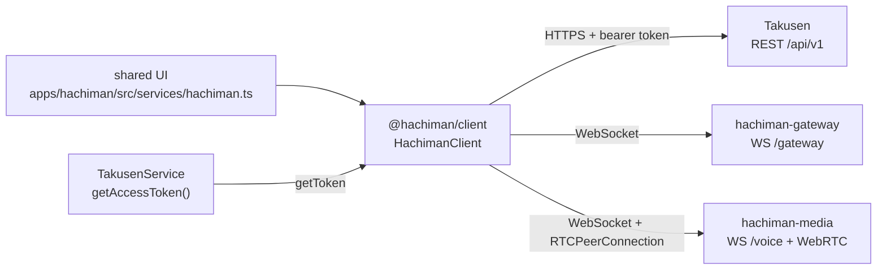
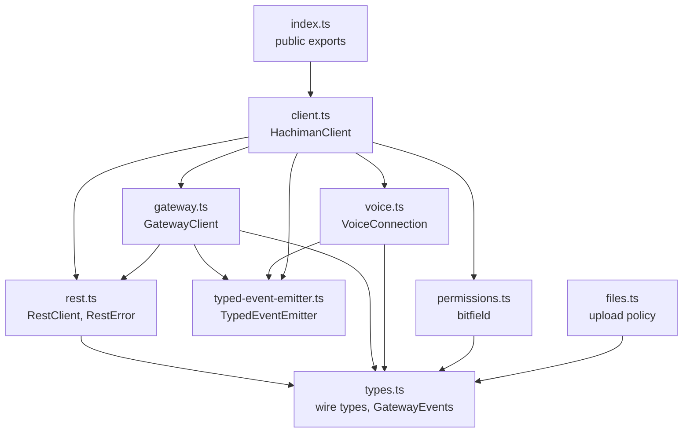
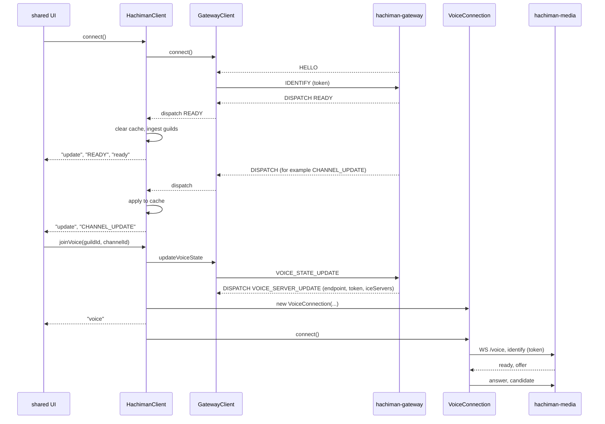

# @hachiman/client

Browser-safe client for Hachiman. It connects to Takusen REST, the gateway WebSocket and the media-node voice WebSocket (WebRTC).
It uses only `fetch`, `XMLHttpRequest`, `WebSocket` and `RTCPeerConnection`. Consumers import it as TypeScript source. There is no emit step.
The wire contract is [`docs/gateway-protocol.md`](../../docs/gateway-protocol.md). §10 is the API of this package.

## Where it fits



- The shared UI makes the one `HachimanClient` in `apps/hachiman/src/services/hachiman.ts`. It copies the client cache into the Zustand stores.
- `TakusenService.getAccessToken` supplies the token. The client calls `getToken` before each REST request and each IDENTIFY or RESUME.
- REST requests go to Takusen (contract §4). Gateway frames go to `hachiman-gateway` (§6). Voice frames go to `hachiman-media` (§8).
- The client gets the media endpoint and the voice token from the gateway event `VOICE_SERVER_UPDATE`. It has no media URL in its configuration.

## Code architecture



`gateway.ts` imports only the `TokenProvider` type from `rest.ts`.

| File | Contents |
|---|---|
| `src/index.ts` | Public surface. It exports every module below. |
| `src/client.ts` | `HachimanClient`. It owns `rest` and `gateway`, keeps the cache and owns the active `VoiceConnection`. It has `joinVoice`, `leaveVoice`, `setSelfVoice`, `setScreen`, `permissionsFor` and `guildPermissions`. |
| `src/rest.ts` | `RestClient` has one method for each REST route. It throws `RestError` on a non-2xx response. `upload` uses `XMLHttpRequest` to report progress. |
| `src/gateway.ts` | `GatewayClient`. It handles HELLO, IDENTIFY, heartbeat, RESUME, RECONNECT and INVALID_SESSION, and reconnects with backoff. It emits one typed event for each dispatch. |
| `src/voice.ts` | `VoiceConnection`. It opens the media voice WebSocket and one `RTCPeerConnection`. Media sends the offer and the client answers. It has a mic transceiver and a screen transceiver. Methods: `setMicrophone`, `setScreen`, `setMuted`, `setDeafened`, `setSpeaking`, `setOutputDevice`, `setOutputVolume`, `getStats`. |
| `src/permissions.ts` | Discord-style permission bitfield, `has`, `computeChannelPermissions`, `effectivePermissions`. |
| `src/types.ts` | Wire types and the `GatewayEvents` map. |
| `src/files.ts` | Upload policy: `DEFAULT_LIMITS`, `PROFILE_IMAGE_TYPES`, `EMBEDDABLE`, `embedKind`. |
| `src/typed-event-emitter.ts` | Small typed event emitter. It does not use `node:events`. |
| `src/test/fake-ws.ts` | WebSocket fake for the tests. |
| `src/*.spec.ts` | Vitest tests. |

The package exports these subpaths: `.`, `./permissions`, `./files` and `./types`.

### Connect, cache and voice join



`joinVoice` fails after 15 seconds if `VOICE_SERVER_UPDATE` does not arrive. A new READY drops the voice connection.

## Usage

```ts
import { HachimanClient, Permissions, has } from '@hachiman/client'

const client = new HachimanClient({
  apiUrl: 'http://localhost:3000/api/v1',
  gatewayUrl: 'ws://localhost:8080/gateway',
  getToken: () => takusen.getAccessToken(), // must return a fresh token on each call
})
client.on('ready', ({ user }) => console.log('hello', user.username))
client.on('MESSAGE_CREATE', msg => console.log(msg.author.username, msg.content))
client.connect()

if (has(client.permissionsFor(channelId), Permissions.SEND_MESSAGES))
  await client.rest.sendMessage(channelId, { content: 'hi', nonce: crypto.randomUUID() })

const voice = await client.joinVoice(guildId, voiceChannelId)
await voice.setMicrophone(await navigator.mediaDevices.getUserMedia({ audio: true }))
client.setSelfVoice({ selfMute: true })
```

Use `client.setSelfVoice` and `client.setScreen` for mute, deafen and screen share. They send the VOICE_STATE_UPDATE. `VoiceConnection.setMuted`, `setDeafened` and `setScreen` change only the media side.

## Rules

- Keep the package browser-safe. Do not import Node modules, rxjs or protobuf.
- Change `src/permissions.ts` and `apps/hachiman-server/pkg/permissions/permissions.go` together. `sync_test.go` parses the TS file and fails on a mismatch.
- A new gateway event needs all of these in one change:
  - the contract (§6, and §4/§5 if REST publishes it)
  - `GatewayEvents` in `src/types.ts`, and a case in `HachimanClient.apply` if the event changes cached state
  - the Takusen publish call (callers of `apps/takusen/src/lib/events.ts`)
  - the dispatch and visibility filter in `cmd/hachiman-gateway`
- Get a `webrtc-reviewer` review for changes to `src/voice.ts`.

## Test and typecheck

```bash
pnpm -F @hachiman/client test        # vitest run, node environment, WebSocket fakes
pnpm -F @hachiman/client typecheck   # tsgo --noEmit -p tsconfig.json
pnpm -F @hachiman/client lint
```

This package started as a fork of the tf2pickup-org client library. `LICENSE` keeps the upstream attribution.
