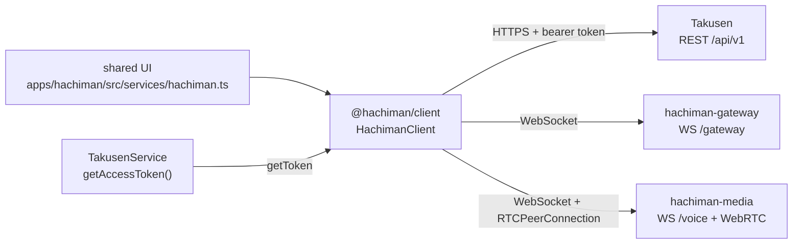
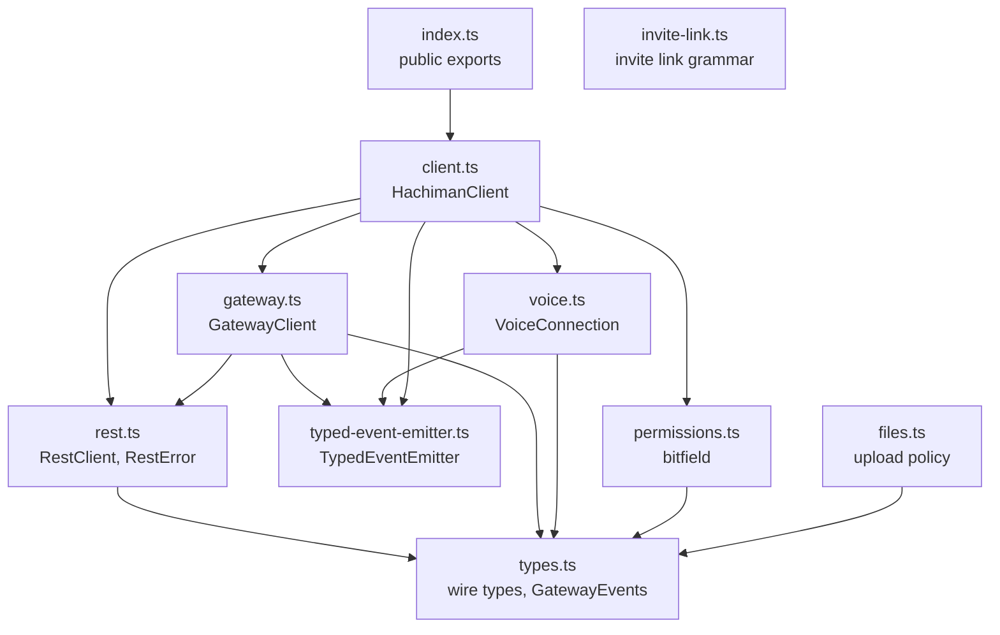
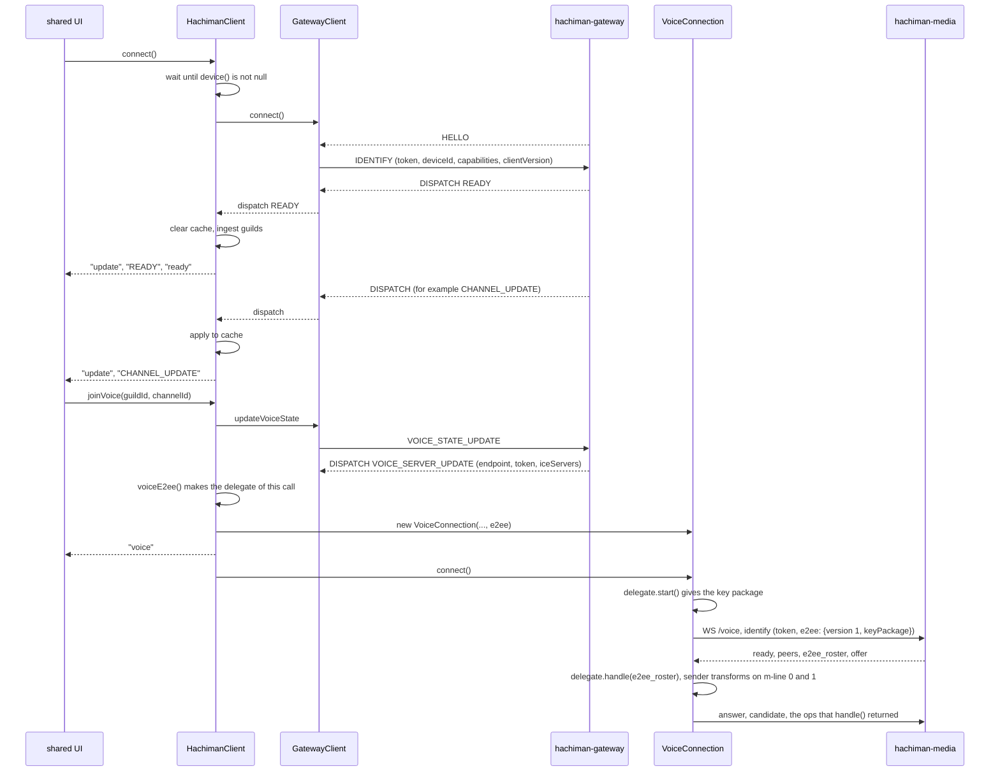

# @hachiman/client

Browser-safe client for Hachiman. It connects to Takusen REST, the gateway WebSocket and the media-node voice WebSocket (WebRTC).
It uses only `fetch`, `XMLHttpRequest`, `WebSocket` and `RTCPeerConnection`. Consumers import it as TypeScript source. There is no emit step.
The wire contract is [`docs/gateway-protocol.md`](../../docs/gateway-protocol.md). §10 is the API of this package, and §12 is the end-to-end encryption (E2EE) contract.

The package has no crypto code. It moves ciphertext and E2EE ops between the servers and the shared UI. The shared UI encrypts and decrypts with `@hachiman/crypto` (a Worker). This package does not import `@hachiman/crypto`. The dependency goes the other way: `@hachiman/crypto` imports `@hachiman/client/permissions`.

## Where it fits



- The shared UI makes the one `HachimanClient` in `apps/hachiman/src/services/hachiman.ts`. It copies the client cache into the Zustand stores.
- `TakusenService.getAccessToken` supplies the token. The client calls `getToken` before each REST request and each IDENTIFY or RESUME.
- The `device` option supplies the device id, the capabilities and the client version. REST sends the device id in `X-Hachiman-Device`. IDENTIFY and RESUME send it to the gateway (§12.13).
- The `voiceE2ee` option makes a `VoiceE2eeDelegate` for each call. The delegate is the crypto side of the call.
- REST requests go to Takusen (contract §4). Gateway frames go to `hachiman-gateway` (§6). Voice frames go to `hachiman-media` (§8).
- The client gets the media endpoint and the voice token from the gateway event `VOICE_SERVER_UPDATE`. It has no media URL in its configuration.

## Code architecture



`gateway.ts` imports only the `TokenProvider` type from `rest.ts`.

| File | Contents |
|---|---|
| `src/index.ts` | Public surface. It exports every module below, except `invite-link.ts` (subpath only). |
| `src/client.ts` | `HachimanClient`. It owns `rest` and `gateway`, keeps the cache and owns the active `VoiceConnection`. It has `joinVoice`, `leaveVoice`, `setSelfVoice`, `setScreen`, `permissionsFor` and `guildPermissions`. `connect` waits while `device()` returns null. |
| `src/rest.ts` | `RestClient` has one method for each REST route of §4 and §12.12. It throws `RestError` on a non-2xx response. `uploadBlob` and `uploadImage` use `XMLHttpRequest` to report progress. |
| `src/gateway.ts` | `GatewayClient`. It handles HELLO, IDENTIFY, heartbeat, RESUME, RECONNECT and INVALID_SESSION, and reconnects with backoff. It emits one typed event for each dispatch. After close 4012 or 4013 it stays closed and emits `fatal`. |
| `src/voice.ts` | `VoiceConnection` and `VoiceE2eeDelegate`. It opens the media voice WebSocket and one `RTCPeerConnection`. Media sends the offer and the client answers. It has a mic transceiver and a screen transceiver. It gives the `e2ee_*` ops to the delegate and installs the SFrame transforms. Methods: `setMicrophone`, `setScreen`, `setMuted`, `setDeafened`, `setSpeaking`, `setOutputDevice`, `setOutputVolume`, `setScreenSubscriptions`, `getStats`. |
| `src/permissions.ts` | Discord-style permission bitfield, `has`, `computeChannelPermissions`, `effectivePermissions`. It imports only `./types`, because `@hachiman/crypto` imports it. |
| `src/types.ts` | Wire types, the E2EE shapes of §12.12, the `GatewayEvents` map and the voice ops. It imports nothing. |
| `src/files.ts` | Upload policy: `DEFAULT_LIMITS`, `PROFILE_IMAGE_TYPES`, `blobKey`, `EMBEDDABLE`, `embedKind`. |
| `src/invite-link.ts` | The one invite link grammar (contract §11, §12.11.4): `parseInviteLink`, `parseInviteCode`, `parseInviteKeyFragment`, `inviteKeyFragment`. It has no imports. The shared UI re-exports it as `@hachiman/hachiman/invite-link` for the hosts. Takusen's invite page uses `parseInviteKeyFragment`. |
| `src/typed-event-emitter.ts` | Small typed event emitter. It does not use `node:events`. |
| `src/test/fake-ws.ts` | WebSocket fake for the tests. |
| `src/test/fake-rtc.ts` | `RTCPeerConnection` and `VoiceE2eeDelegate` fakes for the tests. |
| `src/*.spec.ts` | Vitest tests. |

The package exports these subpaths: `.`, `./permissions`, `./files`, `./invite-link` and `./types`.

### Connect, cache and voice join



`joinVoice` fails after 15 seconds if `VOICE_SERVER_UPDATE` does not arrive. A new READY drops the voice connection.

### Read state, guild data and custom status

These parts carry metadata only. The server never sees the content of a message, a reaction or a page.

| Part | REST (`RestClient`) | Gateway event | Cache (`HachimanClient.cache`) |
|---|---|---|---|
| Read state (§1 `ReadState`) | `ackMessage(channelId, messageId)` | `READ_STATE_UPDATE` (to `user:{id}`). READY carries `readStates` (`unreadCount` capped at 100, `lastMessageId`, `lastMessageAt`) | `readStates`. A channel delete or a guild leave drops its rows |
| Pins | `getPins`, `pinMessage`, `unpinMessage` | `CHANNEL_PINS_UPDATE` | not cached. The shared UI loads the pins again |
| Custom emojis | `getGuildEmojis`, `createGuildEmoji`, `renameGuildEmoji`, `deleteGuildEmoji` | `GUILD_EMOJIS_UPDATE` | `emojis` (guild id to the list). READY and GUILD_CREATE fill it |
| Guild events | `getGuildEvents`, `createGuildEvent`, `updateGuildEvent`, `deleteGuildEvent`, `setEventRsvp` | `GUILD_EVENT_CREATE`, `GUILD_EVENT_UPDATE`, `GUILD_EVENT_DELETE`, `GUILD_EVENT_RSVP` | `events` (guild id to events, each with `me`). `fetchGuildEvents` fills it |
| Blocks | `getBlocks`, `blockUser`, `unblockUser` | `USER_BLOCK_UPDATE` | `blocks` (user ids). `fetchBlocks` fills it |
| Threads (channel type `thread`) | `createThread(parentId, {name, startMessageId})`, `listThreads(parentId)` | `CHANNEL_CREATE`, `CHANNEL_UPDATE`, `CHANNEL_DELETE` | `channels`. READY carries at most 50 threads per guild. `listThreads` gives the 50 most active threads of a channel |
| Custom status (§1 `CustomStatus`) | none | `PRESENCE_UPDATE`. `setCustomStatus(text, expiresAt)` sends op 3. An empty text clears it | `customStatuses` |
| Role hoist | `hoist` in the role create and update bodies | `GUILD_ROLE_*` | `Role.hoist` |
| Call start | none | `VOICE_STATE_UPDATE` | `VoiceState.joinedAt` (absent from an older gateway) |

A thread uses the MLS group of its parent channel. `permissionsFor` on a thread gives the permissions of the parent. A reaction and a page activity post are normal messages to this package: the content kind is inside the envelope.

## End-to-end encryption

The client carries ciphertext only. It never decrypts.

- **Messages.** `Message` has `envelope`, `groupId`, `epoch`, `clientMsgId` and `senderDevice`, and no text. `sendMessage` and `editMessage` send an envelope. The cache does not keep messages. The client emits `MESSAGE_CREATE` and `MESSAGE_UPDATE` as ciphertext, and the shared UI decrypts them.
- **Attachments.** `uploadBlob` uploads an encrypted blob (`?kind=blob`) and gives an `Attachment {id, key, size}`. `uploadImage` uploads a plaintext avatar, icon or banner (`?filename=`). `fetchBlob(key)` downloads a blob. The file name and the MIME type are only in the envelope.
- **REST errors.** `RestError` has `status`, `code`, `details` (the other body fields, for example `{epoch}` or `{userIds}`) and `retryAfterSec` (from `Retry-After` on 429).
- **Special results.** `postCommit` gives `{ok: false, code: 'EpochConflict', epoch}` on 409 `EpochConflict`, not an error. `getChannelMlsGroup` gives null on 404 `UnknownGroup`.
- **Signed admin actions (Phase 4).** The role, overwrite, member, channel and guild PATCH methods take `{signedAction}`. The client sends it in `X-Hachiman-Signed-Action`.
- **Invites with history.** `createInvite` takes `record`, the signed record of the crypto Worker (§12.11.4). `Invite.hasHistory` and `InvitePreview.hasHistory` show such an invite. `Invite.id` names the invite for its bundles. `inviteRecords`, `postInviteBundle` and `inviteBundles` are §12.12 routes. Only the crypto Worker calls them, through the `DsTransport` of the shared UI.
- **Gateway events.** The §12.13 events (`MLS_HANDSHAKE`, `MLS_BATCH_ASSIGN`, `DEVICE_INBOX`, ...) are in `GatewayEvents`. The client emits them and does not cache them. It also does not cache `INVITE_DELETE` (an invite was revoked).
- **Gateway close 4012 or 4013.** The gateway does not accept this client or this device. `GatewayClient` stays `closed` and emits `fatal`. `HachimanClient` leaves voice and emits `fatal`. Call `connect` again only after the cause is fixed (for example, a new device).

### Voice

One `VoiceE2eeDelegate` serves one call. `VoiceConnection` uses it like this:

1. `start()` gives the key package. Identify sends it as `e2ee: {version: 1, keyPackage}`.
2. Each `e2ee_*` op from media goes to `handle(op)`, one at a time and in arrival order. The client sends the returned ops in order.
3. After an `e2ee_commit` with a `welcome`, the next `e2ee_*` op must be `e2ee_ratchet_tree`. If the delegate breaks this order, the client sends nothing and closes the call. If `handle` rejects, the client also closes the call.
4. `senderTransform('audio')`, `senderTransform('video')` and `senderTransform('screen-audio')` are called once per call. The transforms go on the m-line 0, 1 and 2 senders before any track (m-line 2 only when the offer marks it `recvonly`). `setMicrophone`, `setMuted`, `setScreen` and `setScreenAudio` use `replaceTrack`, so the transforms stay. The client never makes a sender transform again (§12.10.2), because the SFrame counter would start at 0 again.
5. Each `ontrack` gets `receiverTransform(userId, kind)`. Stream id `screen-<userId>` gives `(userId, 'video')` for a video track and `(userId, 'screen-audio')` for an audio track. Every other stream id gives `(streamId, 'audio')`. A track without a stream id, or with a video track under a user id, gets no transform and does not play. Screen audio plays on its own element, with its own volume (`setScreenVolume`).
6. `close()` on the connection calls `close()` on the delegate.

Close 4013 (E2EE resync) emits `resync` and then `close`. `HachimanClient` then leaves voice and emits `voiceResync` with the guild and channel. Call `joinVoice` again to rejoin with a new leaf and new transforms. Close 4012 and 4014 emit only `close`.

## Usage

```ts
import { HachimanClient, Permissions, has } from '@hachiman/client'

const client = new HachimanClient({
  apiUrl: 'http://localhost:3000/api/v1',
  gatewayUrl: 'ws://localhost:8080/gateway',
  getToken: () => takusen.getAccessToken(), // must return a fresh token on each call
  device: () => cryptoService.device(), // { deviceId, capabilities: ['e2ee/1'], clientVersion } or null
  voiceE2ee: () => cryptoService.voiceDelegate(), // one VoiceE2eeDelegate per call
})
client.on('ready', ({ user }) => console.log('hello', user.username))
client.on('MESSAGE_CREATE', async msg => show(await cryptoService.decrypt(msg))) // the envelope is ciphertext
client.on('fatal', ({ code }) => console.warn('gateway refused this client or device', code))
client.connect()

if (has(client.permissionsFor(channelId), Permissions.SEND_MESSAGES))
  await client.rest.sendMessage(channelId, { envelope: await cryptoService.encrypt(channelId, 'hi'), nonce: crypto.randomUUID() })

const voice = await client.joinVoice(guildId, voiceChannelId)
await voice.setMicrophone(await navigator.mediaDevices.getUserMedia({ audio: true }))
client.setSelfVoice({ selfMute: true })
```

Use `client.setSelfVoice` and `client.setScreen` for mute, deafen and screen share. They send the VOICE_STATE_UPDATE. `VoiceConnection.setMuted`, `setDeafened` and `setScreen` change only the media side.

## Rules

- Keep the package browser-safe. Do not import Node modules, rxjs or protobuf.
- Do not add crypto code, and do not import `@hachiman/crypto`. Keep the E2EE shapes in `src/types.ts` structurally equal to the `Wire*` and voice op types in `pkgs/hachiman-crypto/src/api.ts`.
- Keep `src/permissions.ts` free of imports other than `./types`.
- Change `src/permissions.ts` and `apps/hachiman-server/pkg/permissions/permissions.go` together. `sync_test.go` parses the TS file and fails on a mismatch.
- A new gateway event needs all of these in one change:
  - the contract (§6, and §4/§5 if REST publishes it)
  - `GatewayEvents` in `src/types.ts`, and a case in `HachimanClient.apply` if the event changes cached state
  - the Takusen publish call (callers of `apps/takusen/src/lib/events.ts`)
  - the dispatch and visibility filter in `cmd/hachiman-gateway`
- Get a `webrtc-reviewer` review for changes to `src/voice.ts`.

## Test and typecheck

```bash
pnpm -F @hachiman/client test        # vitest run, node environment, WebSocket fakes
pnpm -F @hachiman/client typecheck   # tsgo --noEmit -p tsconfig.json
pnpm -F @hachiman/client lint
```

This package started as a fork of the tf2pickup-org client library. `LICENSE` keeps the upstream attribution.
